# AI-DLC Adaptive Workflow 개요 (Overview)

**목적**: AI 모델과 개발자가 workflow 전체 구조를 이해하기 위한 기술 참조 문서.

**참고**: 사용자에게 보여주는 소개는 welcome-message.md, 진행 규칙 (승인 · 기록 · 체크박스) 은 core-workflow.md 기준

## 3-Phase 생명주기 (The Three-Phase Lifecycle):
• **INCEPTION PHASE**: 계획과 아키텍처 (Workspace Detection + 조건부 phase + Workflow Planning)
• **CONSTRUCTION PHASE**: 설계, 구현, 빌드 · 테스트 (unit 별 설계 + Code Generation + Build & Test)
• **OPERATIONS PHASE**: 배포, 관측, 장애 대응, 운영 피드백 (조건부 stage 7개, phase 단위 1회)

## Adaptive Workflow (The Adaptive Workflow):
• **Workspace Detection** (항상) → **Reverse Engineering** (brownfield 전용) → **Requirements Analysis** (항상, 깊이 조정) → **조건부 Phase** (필요 시) → **Workflow Planning** (항상) → **Code Generation** (항상, unit 별) → **Build and Test** (항상)

## 동작 방식 (How It Works):
• **AI 가 분석**: 요청, 작업 공간, 복잡도를 분석해 필요한 stage 를 결정
• **항상 실행되는 stage**: Workspace Detection, Requirements Analysis (깊이 조정), Workflow Planning, Code Generation (unit 별), Build and Test
• **나머지 stage 는 모두 조건부**: Reverse Engineering, User Stories, Application Design, Units Generation, unit 별 설계 stage (Functional Design, NFR Requirements, NFR Design, Infrastructure Design), Operations stage 7개
• **고정 순서 없음**: stage 는 해당 작업에 맞는 순서로 실행

## 팀의 역할 (Your Team's Role):
• **질문에 답변**: 전용 질문 파일에서 [Answer]: 태그와 문자 선택지 (A, B, C, D, E) 로 답한다
• **선택지 E 사용 가능**: 제시된 선택지가 맞지 않으면 "Other" 를 고르고 직접 답을 적는다
• **팀으로 작업**: 다음으로 넘어가기 전에 각 phase 를 함께 검토하고 승인
• **공동 결정**: 필요할 때 아키텍처 방향을 함께 결정
• **중요**: 팀 작업이다 - phase 마다 관련 이해관계자를 참여시킨다

## AI-DLC 3-Phase Workflow (AI-DLC Three-Phase Workflow):

```mermaid
flowchart TD
    Start(["사용자 요청"])
    
    subgraph INCEPTION["🔵 INCEPTION PHASE"]
        WD["Workspace Detection<br/><b>ALWAYS</b>"]
        RE["Reverse Engineering<br/><b>CONDITIONAL</b>"]
        RA["Requirements Analysis<br/><b>ALWAYS</b>"]
        Stories["User Stories<br/><b>CONDITIONAL</b>"]
        WP["Workflow Planning<br/><b>ALWAYS</b>"]
        AppDesign["Application Design<br/><b>CONDITIONAL</b>"]
        UnitsG["Units Generation<br/><b>CONDITIONAL</b>"]
    end
    
    subgraph CONSTRUCTION["🟢 CONSTRUCTION PHASE"]
        FD["Functional Design<br/><b>CONDITIONAL</b>"]
        NFRA["NFR Requirements<br/><b>CONDITIONAL</b>"]
        NFRD["NFR Design<br/><b>CONDITIONAL</b>"]
        ID["Infrastructure Design<br/><b>CONDITIONAL</b>"]
        CG["Code Generation<br/><b>ALWAYS</b>"]
        BT["Build and Test<br/><b>ALWAYS</b>"]
    end
    
    subgraph OPERATIONS["🟡 OPERATIONS PHASE"]
        DPL["Deployment Pipeline<br/><b>CONDITIONAL</b>"]
        ENV["Environment Provisioning<br/><b>CONDITIONAL</b>"]
        DEX["Deployment Execution<br/><b>CONDITIONAL</b>"]
        OBS["Observability Setup<br/><b>CONDITIONAL</b>"]
        INC["Incident Response<br/><b>CONDITIONAL</b>"]
        PERF["Performance Validation<br/><b>CONDITIONAL</b>"]
        FBO["Feedback & Optimization<br/><b>CONDITIONAL</b>"]
    end
    
    Start --> WD
    WD -.-> RE
    WD --> RA
    RE --> RA
    
    RA -.-> Stories
    RA --> WP
    Stories --> WP
    
    WP -.-> AppDesign
    WP -.-> UnitsG
    AppDesign -.-> UnitsG
    UnitsG --> FD
    FD -.-> NFRA
    NFRA -.-> NFRD
    NFRD -.-> ID
    
    WP --> CG
    FD --> CG
    NFRA --> CG
    NFRD --> CG
    ID --> CG
    CG -.->|다음 Unit| FD
    CG --> BT
    BT -.-> DPL
    DPL -.-> ENV
    ENV -.-> DEX
    DEX -.-> OBS
    OBS -.-> INC
    INC -.-> PERF
    PERF -.-> FBO
    FBO -.-> End
    BT --> End(["완료"])
    
    style WD fill:#4CAF50,stroke:#1B5E20,stroke-width:3px,color:#fff
    style RA fill:#4CAF50,stroke:#1B5E20,stroke-width:3px,color:#fff
    style WP fill:#4CAF50,stroke:#1B5E20,stroke-width:3px,color:#fff

    style CG fill:#4CAF50,stroke:#1B5E20,stroke-width:3px,color:#fff
    style BT fill:#4CAF50,stroke:#1B5E20,stroke-width:3px,color:#fff
    style DPL fill:#FFA726,stroke:#E65100,stroke-width:3px,stroke-dasharray: 5 5,color:#000
    style ENV fill:#FFA726,stroke:#E65100,stroke-width:3px,stroke-dasharray: 5 5,color:#000
    style DEX fill:#FFA726,stroke:#E65100,stroke-width:3px,stroke-dasharray: 5 5,color:#000
    style OBS fill:#FFA726,stroke:#E65100,stroke-width:3px,stroke-dasharray: 5 5,color:#000
    style INC fill:#FFA726,stroke:#E65100,stroke-width:3px,stroke-dasharray: 5 5,color:#000
    style PERF fill:#FFA726,stroke:#E65100,stroke-width:3px,stroke-dasharray: 5 5,color:#000
    style FBO fill:#FFA726,stroke:#E65100,stroke-width:3px,stroke-dasharray: 5 5,color:#000
    style RE fill:#FFA726,stroke:#E65100,stroke-width:3px,stroke-dasharray: 5 5,color:#000
    style Stories fill:#FFA726,stroke:#E65100,stroke-width:3px,stroke-dasharray: 5 5,color:#000
    style AppDesign fill:#FFA726,stroke:#E65100,stroke-width:3px,stroke-dasharray: 5 5,color:#000

    style UnitsG fill:#FFA726,stroke:#E65100,stroke-width:3px,stroke-dasharray: 5 5,color:#000
    style FD fill:#FFA726,stroke:#E65100,stroke-width:3px,stroke-dasharray: 5 5,color:#000
    style NFRA fill:#FFA726,stroke:#E65100,stroke-width:3px,stroke-dasharray: 5 5,color:#000
    style NFRD fill:#FFA726,stroke:#E65100,stroke-width:3px,stroke-dasharray: 5 5,color:#000
    style ID fill:#FFA726,stroke:#E65100,stroke-width:3px,stroke-dasharray: 5 5,color:#000
    style INCEPTION fill:#BBDEFB,stroke:#1565C0,stroke-width:3px, color:#000
    style CONSTRUCTION fill:#C8E6C9,stroke:#2E7D32,stroke-width:3px, color:#000
    style OPERATIONS fill:#FFF59D,stroke:#F57F17,stroke-width:3px, color:#000
    style Start fill:#CE93D8,stroke:#6A1B9A,stroke-width:3px,color:#000
    style End fill:#CE93D8,stroke:#6A1B9A,stroke-width:3px,color:#000
    
    linkStyle default stroke:#333,stroke-width:2px
```

**Stage 설명 (Stage Descriptions):**

**🔵 INCEPTION PHASE** - 계획과 아키텍처
- Workspace Detection: 작업 공간 상태와 프로젝트 유형 분석 (ALWAYS)
- Reverse Engineering: 기존 코드베이스 분석 (CONDITIONAL - Brownfield 전용)
- Requirements Analysis: 요구사항 수집 · 검증 (ALWAYS - 깊이 조정)
- User Stories: user story 와 persona 작성 (CONDITIONAL)
- Workflow Planning: 실행 계획 작성 (ALWAYS)
- Application Design: 상위 수준 컴포넌트 식별과 서비스 계층 설계 (CONDITIONAL)
- Units Generation: unit (작업 단위) 으로 분해 (CONDITIONAL)

**🟢 CONSTRUCTION PHASE** - 설계, 구현, 빌드 · 테스트
- Functional Design: unit 별 상세 비즈니스 로직 설계 (CONDITIONAL, unit 별)
- NFR Requirements: NFR 결정과 기술 스택 선택 (CONDITIONAL, unit 별)
- NFR Design: NFR 패턴과 논리 컴포넌트 반영 (CONDITIONAL, unit 별)
- Infrastructure Design: 실제 인프라 서비스에 매핑 (CONDITIONAL, unit 별)
- Code Generation: Part 1 - Planning, Part 2 - Generation 으로 코드 생성 (ALWAYS, unit 별)
- Build and Test: 모든 unit 빌드와 포괄적 테스트 실행 (ALWAYS)

**🟡 OPERATIONS PHASE** - 배포와 운영 (모두 CONDITIONAL, phase 단위 1회)
- Deployment Pipeline (파이프라인 구성): 배포 흐름 · 전략 · 롤백 runbook
- Environment Provisioning (환경 준비): 환경 목록 · 설정 · 검증
- Deployment Execution (배포 실행): 배포 · smoke test · health check
- Observability Setup (관측 설정): SLO · 지표 · 알람 · 로그 조회
- Incident Response (장애 대응): runbook · 장애 대응 계획 · 연락 체계
- Performance Validation (성능 검증): 부하 테스트와 NFR 대조
- Feedback & Optimization (운영 피드백): 운영 결과 분석, 개선 과제 → 다음 요청 (Inception)

**핵심 원칙**: core-workflow.md 의 "Adaptive Workflow 원칙" · "핵심 원칙" 참조. OPERATIONS 는 확인된 배포 대상이 없으면 건너뜀
