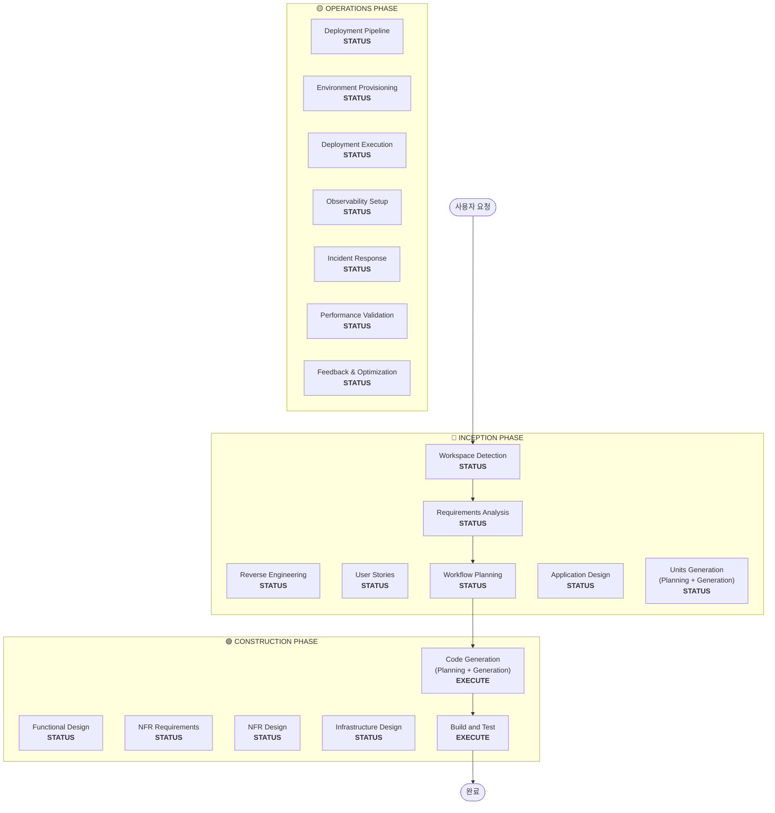

# Workflow Planning

**목적 (Purpose)**: 실행할 phase 를 결정하고 포괄적인 실행 계획을 작성한다

**항상 실행 (Always Execute)**: 이 phase 는 요구사항과 범위를 파악한 뒤 항상 실행된다

## Step 1: 이전 컨텍스트 전체 불러오기

### 1.1 Reverse Engineering 산출물 불러오기 (brownfield 인 경우)
- architecture.md
- component-inventory.md
- technology-stack.md
- dependencies.md

### 1.2 Requirements Analysis 불러오기
- requirements.md (의도 분석 포함)
- requirement-verification-questions.md (답변 포함)

### 1.3 User Stories 불러오기 (실행된 경우)
- stories.md
- personas.md

## Step 2: 상세 범위 및 영향 분석

**이제 전체 컨텍스트 (요구사항 + 스토리) 를 확보했으므로 상세 분석을 수행한다:**

### 2.1 변환 범위 파악 (Brownfield 전용)

**brownfield 프로젝트인 경우**, 변환 범위를 분석한다:

#### 아키텍처 변환
- **단일 컴포넌트 변경** vs **아키텍처 변환**
- **인프라 변경** vs **애플리케이션 변경**
- **배포 모델 변경** (서버리스 → 컨테이너, 가상 머신 → 관리형 서비스 등)

#### 관련 컴포넌트 식별
변환의 경우 다음을 식별한다:
- 업데이트가 필요한 **인프라 코드**
- 변경이 필요한 **IaC 정의** (Terraform · CDK 등)
- **API 게이트웨이 · 프록시** 구성
- **로드 밸런서** 요구사항
- 필요한 **네트워킹** 변경
- **모니터링/로깅** 조정

#### 패키지 간 영향
- 업데이트가 필요한 **인프라 (IaC)** 패키지
- 버전 업데이트가 필요한 **공유 모델**
- 엔드포인트 변경이 필요한 **클라이언트 라이브러리**
- 새 테스트 시나리오가 필요한 **테스트 패키지**

### 2.2 변경 영향 평가

#### 영향 영역
1. **사용자에게 보이는 변경**: 사용자 경험에 영향을 주는가?
2. **구조 변경**: 시스템 아키텍처가 바뀌는가?
3. **데이터 모델 변경**: 데이터베이스 스키마나 데이터 구조에 영향을 주는가?
4. **API 변경**: 인터페이스나 계약에 영향을 주는가?
5. **NFR 영향**: 성능, 보안, 확장성에 영향을 주는가?

#### 애플리케이션 계층 영향 (해당 시)
- **코드 변경**: 새 진입점, 어댑터, 구성
- **의존성**: 새 라이브러리, 프레임워크 변경
- **구성**: 환경 변수, 설정 파일
- **테스트**: 단위 테스트, 통합 테스트

#### 인프라 계층 영향 (해당 시)
- **배포 모델**: 서버리스 → 컨테이너, 가상 머신 → 관리형 서비스 등
- **네트워킹**: 네트워크 구성, 방화벽 · 보안 규칙, 로드 밸런서
- **스토리지**: 영구 볼륨, 공유 스토리지
- **확장**: Auto-scaling 정책, 용량 계획

#### 운영 계층 영향 (해당 시)
- **모니터링**: 지표 수집, 사용자 정의 지표, 대시보드
- **로깅**: 로그 수집, 구조화 로깅
- **알림**: 알람 구성, 알림 채널
- **배포**: CI/CD 파이프라인 변경, 롤백 전략

### 2.3 컴포넌트 관계 매핑 (Brownfield 전용)

**brownfield 프로젝트인 경우**, 컴포넌트 의존성 그래프를 작성한다:

```markdown
## 컴포넌트 관계
- **주 컴포넌트**: [변경 대상 패키지]
- **인프라 컴포넌트**: [IaC 패키지, 없으면 "없음"]
- **공유 컴포넌트**: [모델, 유틸리티, 클라이언트]
- **의존 컴포넌트**: [이 컴포넌트를 호출하는 서비스]
- **지원 컴포넌트**: [모니터링, 로깅, 배포]
```

각 관련 컴포넌트마다:
- **변경 유형**: Major, Minor, Configuration-only
- **변경 이유**: 직접 의존성, 배포 모델, 네트워킹
- **변경 우선순위**: Critical, Important, Optional

### 2.4 위험 평가

위험 수준을 평가한다:
1. **Low**: 격리된 변경, 쉬운 롤백, 잘 이해된 범위
2. **Medium**: 여러 컴포넌트, 보통 수준의 롤백, 일부 미지수
3. **High**: 시스템 전체 영향, 복잡한 롤백, 상당한 미지수
4. **Critical**: 운영 핵심, 어려운 롤백, 높은 불확실성

## Step 3: Phase 결정

### 3.1 User Stories - 이미 실행했는가, 건너뛰는가?
**이미 실행함**: 다음 결정으로 이동
**실행하지 않음 - 다음의 경우 실행**:
- 여러 사용자 persona
- 사용자 경험에 영향
- 인수 조건 필요
- 팀 협업 필요

**다음의 경우 건너뜀**:
- 내부 리팩터링
- 재현 방법이 명확한 버그 수정
- 기술 부채 감소
- 인프라 변경

### 3.2 Application Design - 다음의 경우 실행:
- 새 컴포넌트나 서비스 필요
- 컴포넌트 메서드와 비즈니스 규칙 정의 필요
- 서비스 계층 설계 필요
- 컴포넌트 의존성 명확화 필요

**다음의 경우 건너뜀**:
- 기존 컴포넌트 경계 안의 변경
- 새 컴포넌트나 메서드 없음
- 순수 구현 변경

### 3.3 Units Generation - 다음의 경우 실행:
- 새 데이터 모델이나 스키마
- API 변경이나 새 엔드포인트
- 복잡한 알고리즘이나 비즈니스 로직
- 상태 관리 변경
- 여러 패키지 변경 필요
- Infrastructure-as-code 업데이트 필요

**다음의 경우 건너뜀**:
- 단순 로직 변경
- UI 만의 변경
- 구성 업데이트
- 단순한 구현

### 3.4 NFR 구현 - 다음의 경우 실행:
- 성능 요구사항
- 보안 고려사항
- 확장성 우려
- 모니터링/관측성 필요

**다음의 경우 건너뜀**:
- 기존 NFR 설정으로 충분
- 새 NFR 요구사항 없음
- NFR 영향이 없는 단순 변경

### 3.5 Operations stage - stage 별로 EXECUTE/SKIP 결정
**공통 전제**: 배포 대상 · 환경 · 운영 도구가 작업 공간 설정, 이전 산출물, 사용자 답변으로 확인될 때만 EXECUTE 로 판단한다. 확인되지 않으면 SKIP 하고 근거에 "배포 대상 미확인" 을 적는다 (지어내지 않는다)

- **Deployment Pipeline**: 실제 배포 대상이 있고 배포 흐름 · 전략 · 롤백 정의가 필요하면 실행 / 기존 파이프라인으로 충분하면 건너뜀
- **Environment Provisioning**: 새 환경이 필요하거나 기존 환경 설정 · 검증이 필요하면 실행 / 환경이 이미 준비 · 검증되었으면 건너뜀
- **Deployment Execution**: 배포 대상 · 환경 · 배포 방식이 확인되면 실행 / 확인된 배포 대상이 없으면 건너뜀
- **Observability Setup**: 운영 서비스에 SLO · 지표 · 알람 · 로그 조회 정의가 필요하면 실행 / 기존 관측 구성으로 충분하면 건너뜀
- **Incident Response**: 장애 진단 · 격리 · 롤백 절차가 필요하면 실행 / 기존 runbook 으로 충분하면 건너뜀
- **Performance Validation**: 성능 · 확장성 NFR 을 실환경 또는 동등 환경에서 검증해야 하면 실행 / 성능 NFR 이 없거나 Build and Test 성능 테스트로 충분하면 건너뜀
- **Feedback & Optimization**: 운영 지표 · 로그 · 장애 기록이 있거나 운영 회고가 필요하면 실행 / 운영 데이터가 아직 없으면 건너뜀

## Step 4: 적응형 상세도 참고

**적응형 깊이 설명은 [depth-levels.md](../common/depth-levels.md) 참조**

실행할 각 stage 마다:
- 정의된 모든 산출물을 작성한다
- 산출물 안의 상세 수준은 문제 복잡도에 맞춘다
- 모델이 문제 특성에 따라 적절한 상세 수준을 결정한다

## Step 5: 다중 모듈 조율 분석 (Brownfield 전용)

**여러 모듈/패키지가 있는 brownfield 인 경우**, 의존성을 분석하고 최적의 업데이트 전략을 결정한다:

### 5.1 모듈 의존성 분석
- 빌드 시스템 의존성과 의존성 매니페스트를 검토한다
- 빌드 시점 의존성과 런타임 의존성을 구분한다
- 모듈 간 API 계약과 공유 인터페이스를 매핑한다

### 5.2 업데이트 전략 결정
의존성 분석을 바탕으로 다음을 결정한다:
- **업데이트 순서**: 의존성 때문에 먼저 업데이트해야 하는 모듈
- **병렬화 기회**: 동시에 업데이트할 수 있는 모듈
- **조율 요구사항**: 버전 호환성, API 계약, 배포 순서
- **테스트 전략**: 모듈별 테스트 vs 통합 테스트 방식
- **롤백 전략**: 순서 진행 중 실패 시 복구 계획

### 5.3 조율 계획 문서화
```markdown
## 모듈 업데이트 전략
- **업데이트 방식**: [Sequential/Parallel/Hybrid]
- **Critical Path**: [다른 업데이트를 막는 모듈]
- **조율 지점**: [공유 API, 인프라, 데이터 계약]
- **테스트 체크포인트**: [통합 검증 시점]
```

영향받는 각 모듈마다 식별한다:
- **업데이트 우선순위**: 먼저 업데이트 필수 vs 나중에 업데이트 가능
- **의존성 제약**: 이 모듈이 의존하는 것, 이 모듈에 의존하는 것
- **변경 범위**: Major (호환성 깨짐), Minor (호환), Patch (수정)

## Step 6: 워크플로우 시각화 생성

다음을 보여주는 Mermaid 흐름도를 작성한다:
- 모든 phase 의 순서
- 각 조건부 phase 의 EXECUTE 또는 SKIP 결정
- 각 phase 상태에 맞는 스타일

**스타일 규칙** (흐름도 뒤에 추가):
```
style WD fill:#4CAF50,stroke:#1B5E20,stroke-width:3px,color:#fff
style CG fill:#4CAF50,stroke:#1B5E20,stroke-width:3px,color:#fff
style BT fill:#4CAF50,stroke:#1B5E20,stroke-width:3px,color:#fff
style US fill:#BDBDBD,stroke:#424242,stroke-width:2px,stroke-dasharray: 5 5,color:#000
style Start fill:#CE93D8,stroke:#6A1B9A,stroke-width:3px,color:#000
style End fill:#CE93D8,stroke:#6A1B9A,stroke-width:3px,color:#000

linkStyle default stroke:#333,stroke-width:2px
```

**스타일 지침**:
- 완료/항상 실행: `fill:#4CAF50,stroke:#1B5E20,stroke-width:3px,color:#fff` (Material Green, 흰 글씨)
- 조건부 EXECUTE: `fill:#FFA726,stroke:#E65100,stroke-width:3px,stroke-dasharray: 5 5,color:#000` (Material Orange, 검은 글씨)
- 조건부 SKIP: `fill:#BDBDBD,stroke:#424242,stroke-width:2px,stroke-dasharray: 5 5,color:#000` (Material Gray, 검은 글씨)
- 시작/끝: `fill:#CE93D8,stroke:#6A1B9A,stroke-width:3px,color:#000` (Material Purple, 검은 글씨)
- Phase 컨테이너: 더 밝은 Material 색 사용 (INCEPTION: #BBDEFB, CONSTRUCTION: #C8E6C9, OPERATIONS: #FFF59D)

## Step 7: 실행 계획 문서 작성

`aidlc-docs/inception/plans/execution-plan.md` 를 작성한다:

```markdown
# 실행 계획 (Execution Plan)

## 상세 분석 요약

### 변환 범위 (Brownfield 전용)
- **변환 유형**: [Single component/Architectural/Infrastructure]
- **주요 변경**: [설명]
- **관련 컴포넌트**: [목록]

### 변경 영향 평가
- **사용자에게 보이는 변경**: [Yes/No - 설명]
- **구조 변경**: [Yes/No - 설명]
- **데이터 모델 변경**: [Yes/No - 설명]
- **API 변경**: [Yes/No - 설명]
- **NFR 영향**: [Yes/No - 설명]

### 컴포넌트 관계 (Brownfield 전용)
[컴포넌트 의존성 그래프]

### 위험 평가
- **위험 수준**: [Low/Medium/High/Critical]
- **롤백 복잡도**: [Easy/Moderate/Difficult]
- **테스트 복잡도**: [Simple/Moderate/Complex]

## 워크플로우 시각화



**참고**: STATUS 자리표시자를 실제 phase 상태 (COMPLETED/SKIP/EXECUTE) 로 바꾸고 알맞은 스타일을 적용한다

## 실행할 Phase

### 🔵 INCEPTION PHASE
- [x] Workspace Detection (COMPLETED)
- [x] Reverse Engineering (COMPLETED/SKIPPED)
- [x] Requirements Analysis (COMPLETED)
- [x] User Stories (COMPLETED/SKIPPED)
- [x] Execution Plan (IN PROGRESS)
- [ ] Application Design - [EXECUTE/SKIP]
  - **근거 (Rationale)**: [실행 또는 건너뛰는 이유]
- [ ] Units Generation - [EXECUTE/SKIP]
  - **근거 (Rationale)**: [실행 또는 건너뛰는 이유]

### 🟢 CONSTRUCTION PHASE
- [ ] Functional Design - [EXECUTE/SKIP]
  - **근거 (Rationale)**: [실행 또는 건너뛰는 이유]
- [ ] NFR Requirements - [EXECUTE/SKIP]
  - **근거 (Rationale)**: [실행 또는 건너뛰는 이유]
- [ ] NFR Design - [EXECUTE/SKIP]
  - **근거 (Rationale)**: [실행 또는 건너뛰는 이유]
- [ ] Infrastructure Design - [EXECUTE/SKIP]
  - **근거 (Rationale)**: [실행 또는 건너뛰는 이유]
- [ ] Code Generation - EXECUTE (ALWAYS)
  - **근거 (Rationale)**: 구현 계획과 코드 생성 필요
- [ ] Build and Test - EXECUTE (ALWAYS)
  - **근거 (Rationale)**: 빌드, 테스트, 검증 필요

### 🟡 OPERATIONS PHASE
- [ ] Deployment Pipeline - [EXECUTE/SKIP]
  - **근거 (Rationale)**: [실행 또는 건너뛰는 이유]
- [ ] Environment Provisioning - [EXECUTE/SKIP]
  - **근거 (Rationale)**: [실행 또는 건너뛰는 이유]
- [ ] Deployment Execution - [EXECUTE/SKIP]
  - **근거 (Rationale)**: [실행 또는 건너뛰는 이유]
- [ ] Observability Setup - [EXECUTE/SKIP]
  - **근거 (Rationale)**: [실행 또는 건너뛰는 이유]
- [ ] Incident Response - [EXECUTE/SKIP]
  - **근거 (Rationale)**: [실행 또는 건너뛰는 이유]
- [ ] Performance Validation - [EXECUTE/SKIP]
  - **근거 (Rationale)**: [실행 또는 건너뛰는 이유]
- [ ] Feedback & Optimization - [EXECUTE/SKIP]
  - **근거 (Rationale)**: [실행 또는 건너뛰는 이유]

## 패키지 변경 순서 (Brownfield 전용)
[해당 시 의존성과 함께 패키지 업데이트 순서 나열]

## 예상 일정
- **전체 Phase 수**: [숫자]
- **예상 소요 기간**: [시간 추정]

## 성공 기준
- **주 목표**: [핵심 목표]
- **핵심 결과물**: [목록]
- **품질 게이트**: [목록]

[brownfield 인 경우]
- **통합 테스트**: 모든 컴포넌트가 함께 동작
- **운영 준비**: 모니터링, 로깅, 알림 동작
```

## Step 8: 상태 추적 초기화

`aidlc-docs/aidlc-state.md` 를 업데이트한다:

```markdown
# AI-DLC State Tracking

## Project Information
- **Project Type**: [Greenfield/Brownfield]
- **Start Date**: [ISO timestamp]
- **Current Stage**: INCEPTION - Workflow Planning

## Execution Plan Summary
- **Total Stages**: [숫자]
- **Stages to Execute**: [목록]
- **Stages to Skip**: [이유와 함께 목록]

## Stage Progress

### 🔵 INCEPTION PHASE
- [x] Workspace Detection
- [x] Reverse Engineering (if applicable)
- [x] Requirements Analysis
- [x] User Stories (if applicable)
- [x] Workflow Planning
- [ ] Application Design - [EXECUTE/SKIP]
- [ ] Units Generation - [EXECUTE/SKIP]

### 🟢 CONSTRUCTION PHASE
- [ ] Functional Design - [EXECUTE/SKIP]
- [ ] NFR Requirements - [EXECUTE/SKIP]
- [ ] NFR Design - [EXECUTE/SKIP]
- [ ] Infrastructure Design - [EXECUTE/SKIP]
- [ ] Code Generation - EXECUTE
- [ ] Build and Test - EXECUTE

### 🟡 OPERATIONS PHASE
- [ ] Deployment Pipeline - [EXECUTE/SKIP]
- [ ] Environment Provisioning - [EXECUTE/SKIP]
- [ ] Deployment Execution - [EXECUTE/SKIP]
- [ ] Observability Setup - [EXECUTE/SKIP]
- [ ] Incident Response - [EXECUTE/SKIP]
- [ ] Performance Validation - [EXECUTE/SKIP]
- [ ] Feedback & Optimization - [EXECUTE/SKIP]

## Current Status
- **Lifecycle Phase**: INCEPTION
- **Current Stage**: Workflow Planning Complete
- **Next Stage**: [다음에 실행할 stage]
- **Status**: Ready to proceed
```

## Step 9: 사용자에게 계획 제시

```markdown
# 📋 Workflow Planning 완료 (Workflow Planning Complete)

다음을 바탕으로 포괄적인 실행 계획을 작성했습니다:
- 요청 내용: [요약]
- 기존 시스템: [brownfield 인 경우 요약]
- 요구사항: [실행한 경우 요약]
- User stories: [실행한 경우 요약]

**상세 분석**:
- 위험 수준: [수준]
- 영향: [주요 영향 요약]
- 영향받는 컴포넌트: [목록]

**권장 실행 계획**:

[X] 개 stage 실행을 권장합니다:

🔵 **INCEPTION PHASE:**
1. [Stage 이름] - *근거:* [실행 이유]
2. [Stage 이름] - *근거:* [실행 이유]
...

🟢 **CONSTRUCTION PHASE:**
3. [Stage 이름] - *근거:* [실행 이유]
4. [Stage 이름] - *근거:* [실행 이유]
...

[Y] 개 stage 를 건너뛰기를 권장합니다:

🔵 **INCEPTION PHASE:**
1. [Stage 이름] - *근거:* [건너뛰는 이유]
2. [Stage 이름] - *근거:* [건너뛰는 이유]
...

🟢 **CONSTRUCTION PHASE:**
3. [Stage 이름] - *근거:* [건너뛰는 이유]
4. [Stage 이름] - *근거:* [건너뛰는 이유]
...

[여러 패키지가 있는 brownfield 인 경우]
**권장 패키지 업데이트 순서**:
1. [패키지] - [이유]
2. [패키지] - [이유]
...

**예상 일정**: [기간]

> **📋 <u>**검토 필요 (REVIEW REQUIRED):**</u>**  
> 실행 계획을 확인해 주세요: `aidlc-docs/inception/plans/execution-plan.md`

> **🚀 <u>**다음 단계 (WHAT'S NEXT?)**</u>**
>
> **다음 중 선택할 수 있습니다:**
>
> 🔧 **변경 요청 (Request Changes)** - 필요하면 실행 계획 수정 요청
> [건너뛰는 stage 가 있는 경우:]
> 📝 **건너뛴 Stage 추가 (Add Skipped Stages)** - 현재 SKIP 으로 표시된 stage 를 포함하도록 선택
> ✅ **승인 후 계속 (Approve & Continue)** - 계획을 승인하고 **[다음 Stage 이름]** 으로 진행
```

## Step 10: 사용자 응답 처리

- **승인된 경우**: 실행 계획의 다음 stage 로 진행한다
- **변경을 요청한 경우**: 실행 계획을 업데이트하고 다시 확인받는다
- **사용자가 stage 포함/제외를 강제로 원하는 경우**: 그에 맞게 계획을 업데이트한다

## Step 11: 상호작용 기록

`aidlc-docs/audit.md` 에 기록한다:

```markdown
## Workflow Planning - Approval
**Timestamp**: [ISO timestamp]
**AI Prompt**: "이 계획으로 진행할까요?"
**User Response**: "[사용자의 응답 원문 전체]"
**Status**: [Approved/Changes Requested]
**Context**: [X] 개 stage 를 실행하는 워크플로우 계획 작성

---
```
