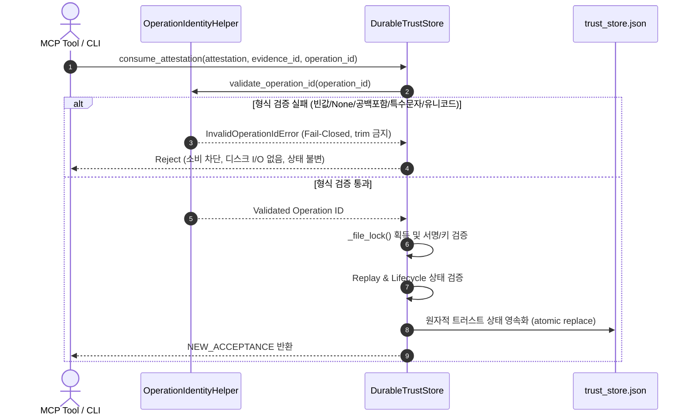
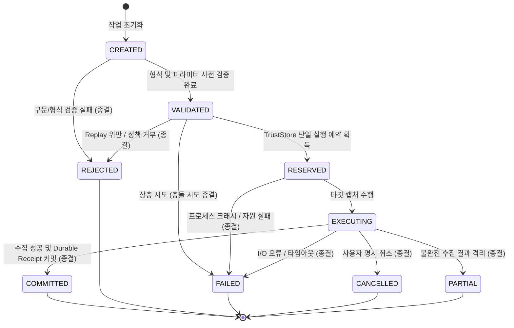

# 비즈니스 로직 및 워크플로우 명세서 (Business Logic Model)

- **대상 작업 단위**: `unit-1-operation-replay-identity`
- **담당 모듈**: `extractor/capture_backend.py` (`OperationIdentityHelper`, `DurableTrustStore`, `CausalAttestation`)
- **연관 요구사항**: `FR-TRUST-001`, `FR-TRUST-002`, `FR-TRUST-003`, `FR-TRUST-007`, `NFR-SECURITY-001`, `NFR-RESILIENCY-001`
- **연관 사용자 스토리**: `US-TRUST-001`, `US-TRUST-002`, `US-TRUST-003`, `US-TRUST-007`

---

## 1. 개요 및 설계 원칙

본 문서는 `unit-1-operation-replay-identity`의 상세 비즈니스 로직과 알고리즘을 기술한다.
DynamicState의 임베디드 리눅스 진단 환경에서 신뢰할 수 없는 요청이나 동시 다발적 요청이 발생하더라도, 지속성 영수증(Durable Attestation) 및 트러스트 저장소가 오염되지 않도록 fail-closed 원칙에 기반하여 엄격한 순차 검증 파이프라인을 구축한다.

---

## 2. Operation ID 사전 검증 및 Attestation 소비 파이프라인 (FR-TRUST-001)

### 2.1 3단계 식별자 검증 분리 원칙
식별자 처리는 다음의 3가지 관심사로 명확히 분리하여 수행한다:
1. **형식 검증 (Format Validation)**:
   - 정규식 `^[a-zA-Z0-9_.:-]{1,128}$` 완전 일치 검증.
   - `None`, 빈 문자열, 공백 전용 문자열, 유니코드(전각 문자, 스마트 대시 등), 허용되지 않는 특수문자 즉시 거부.
   - **절대 묵시적 trim이나 정규화를 수행하지 않음** (공백이 포함된 경우 거부).
   - 모든 외부 입력 경계(MCP 도구, CLI, HTTP API, TrustStore 메서드)에 동일한 검증 로직 강제.
2. **고유성 검증 (Uniqueness Validation)**:
   - 단일 실행 원칙에 따라 이전에 커밋된 Operation ID와의 중복 여부 확인.
3. **Replay 검증 (Replay Protection)**:
   - 동일 Operation ID 요청이 발생했을 때, 컨텍스트와 매개변수의 일치 여부를 대조하여 멱등 재조회 허용 또는 Replay 위반 차단 결정.

### 2.2 사전 검증 시퀀스

---

## 3. Process Identity 및 Canonical Operation Identity 모델 (FR-TRUST-002)

### 3.1 계층형 Identity 구조
- **프로세스 식별자 (`ProcessIdentity`)**: 타깃 OS 프로세스의 유일성을 정의하는 4대 불변 튜플.
  - `host_identity`: `/etc/machine-id` 또는 정규화된 머신 식별자.
  - `boot_id`: 커널 부팅 식별자 (`/proc/sys/kernel/random/boot_id`).
  - `pid`: 타깃 프로세스 ID (정수).
  - `process_start_time`: `/proc/<pid>/stat`의 `starttime` 필드 (부팅 후 클록 틱 단위의 불변 정수 타임스탬프).
- **표준 작업 식별자 (`CanonicalOperationIdentity`)**: `ProcessIdentity`를 포함하며 전체 Replay 방어 및 작업 범위를 포괄하는 완전한 식별 모델.
  - `operation_id: str` (형식 검증 통과 필수)
  - `operation_kind: str` (예: `LIVE_CAPTURE`, `TRACE_SNAPSHOT`)
  - `process_identity: ProcessIdentity` (위 4대 튜플)
  - `build_id: str` (타깃 바이너리 ELF Build ID)
  - `session_identity: str` (진단 세션 ID)
  - `request_scope: str` (요청 진단 범위)
  - `normalized_parameters: Dict[str, Any]` (키 정렬된 매개변수)
  - `schema_version: str` (스키마 버전, e.g., `"1.0"`)

### 3.2 PID 재사용(PID Reuse) 방어 알고리즘
1. 동일 호스트에서 PID가 재사용되더라도 `boot_id`가 다르면 시스템 재부팅 후 PID 재할당으로 판정하여 Replay Violation 차단.
2. `boot_id`가 일치하더라도 `process_start_time`이 다르면 동일 부팅 세션 내 PID 재사용(PID rollover)으로 판정하여 Replay Violation 차단.
3. 필수 식별자 필드가 하나라도 누락되면 즉시 `MissingIdentityFieldError` (Fail-Closed) 발생.

---

## 4. Metadata 단조성 및 기존 상태 불변 보존 (FR-TRUST-003)

### 4.1 기존 커밋 상태 보존 및 상충 요청 격리 원칙
- **원칙**: 기존에 확립되어 유효하거나 이미 `COMMITTED`된 작업의 상태는, **외부에서 새롭게 유입된 상충 요청으로 인해 절대 `FAILED`나 `CANCELLED`로 변경되어서는 안 된다.**
- **동작 방식**:
  1. 기존에 저장된 `build_id`, `target_host`, `process_identity`와 새롭게 유입된 메타데이터가 상충할 때:
     - 기존 저장소의 원본 상태는 **100% 온전하게 보존**된다.
     - 상충을 발생시킨 **새로운 시도(attempt)**에 대해서만 `FAILED` 또는 `REJECTED`가 적용된다.
     - 충돌 시도를 감사 로그 및 `IdentityConflictEvent`로 기록한다.
     - 호출자에게 `IdentityConflictError`를 발생시켜 상충 요청을 fail-closed로 거부한다.
  2. 빈 메타데이터(`{}` 또는 `None`)는 기존의 유효한 메타데이터 필드를 절대 지우거나 덮어쓰지 못한다.

---

## 5. Operation 생명주기 상태 머신 및 안전한 복구 (FR-TRUST-007)

### 5.1 엄격한 단방향 생명주기 전이

### 5.2 크래시 복구 및 재시도(Retry) 규칙
1. **복구 원칙**:
   - 시스템 재기동 후 복구 루틴은 저장소의 지속성 상태를 점검하며, `RESERVED` 또는 `EXECUTING` 상태로 남아 있는 미완료 작업을 **절대 성공한 것으로 간주하지 않는다.**
   - 미완료 작업은 묵시적으로 재사용될 수 없으며, 안전하게 `ABORTED_ON_RESTART`로 종결 처리된다.
2. **재시도 정책**:
   - 실패하거나 중단된 작업을 재시도할 때는 **반드시 새로운 `operation_id`를 발급**받아야 한다.
   - 신규 작업 레코드에 원본 작업 참조(`retry_of_operation_id`)를 유지하여 감사 추적성을 보존한다.
