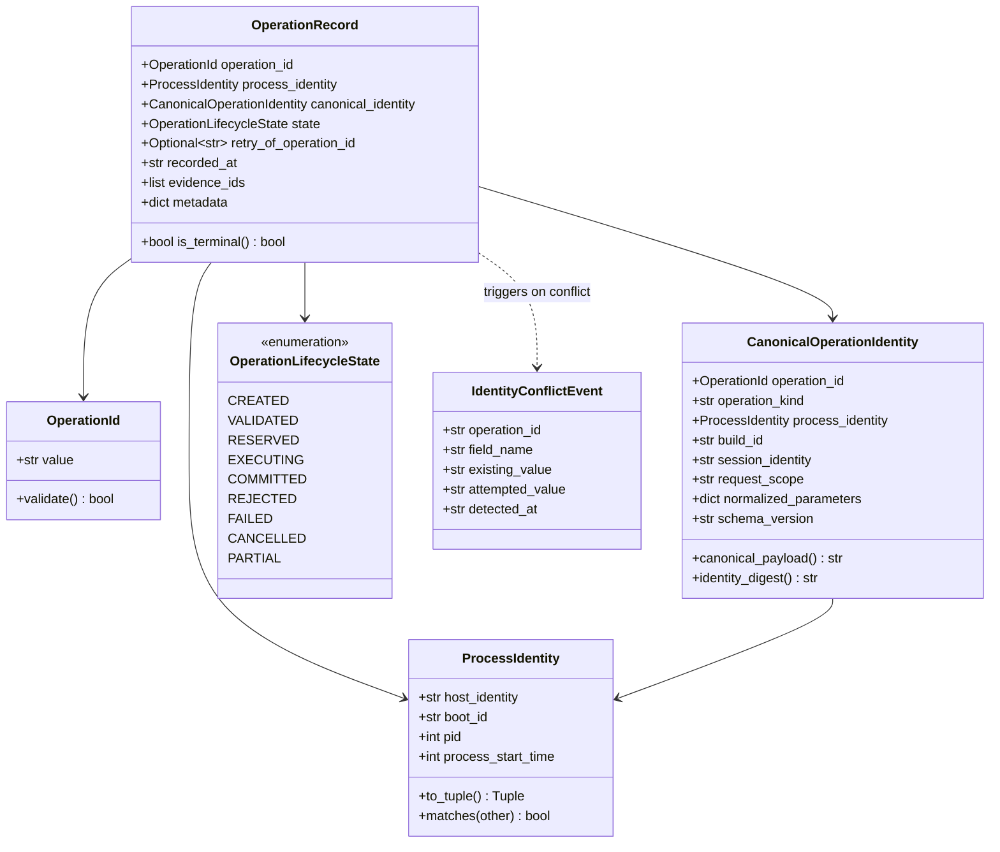

# 도메인 엔티티 명세서 (Domain Entities)

- **대상 작업 단위**: `unit-1-operation-replay-identity`
- **담당 모듈**: `extractor/capture_backend.py`

---

## 1. 개요
본 문서는 `unit-1-operation-replay-identity`에서 다루는 도메인 모델, 값 객체(Value Object), 열거형(Enum) 및 엔티티(Entity)의 구조와 속성을 정의한다. 기존 `capture_backend.py`의 구조를 보존하고 병렬 서브시스템 없이 일관되게 동작하도록 설계한다.

---

## 2. 도메인 모델 클래스 다이어그램

---

## 3. 엔티티 및 값 객체 상세 명세

### 3.1 `OperationId` (Value Object)
- **책임**: 작업 식별자의 엄격한 형식 유효성을 보장하는 불변 값 객체.
- **속성**:
  - `value: str`: 식별자 문자열 (1~128자).
- **불변식**:
  - `None`, 빈 문자열, 공백 전용 문자열 불허.
  - 정규식 `^[a-zA-Z0-9_.:-]{1,128}$` 완전 일치 필수.
  - **절대 묵시적 trim이나 정규화를 수행하지 않음** (공백 발견 시 즉시 `InvalidOperationIdError`).
  - 유니코드 특수문자, 제어 문자 완전 차단.

### 3.2 `ProcessIdentity` (Value Object)
- **책임**: OS 수준에서 대상 타깃 프로세스의 유일성을 정의하는 4대 불변 식별 튜플.
- **속성**:
  - `host_identity: str`: 머신 식별자 (`/etc/machine-id` 기반).
  - `boot_id: str`: 커널 부팅 ID (`/proc/sys/kernel/random/boot_id`).
  - `pid: int`: 타깃 프로세스 ID.
  - `process_start_time: int`: `/proc/<pid>/stat`의 22번째 필드(`starttime`)에서 읽은 부팅 후 클록 틱 단위의 불변 정수값.
- **동작**:
  - 4개 필드 중 하나라도 불일치하면 동일 프로세스로 인정하지 않고 `ProcessIdentityMismatchError` 발생.

### 3.3 `CanonicalOperationIdentity` (Value Object / Frozen Data Model)
- **책임**: Replay 방어 및 작업 범위 전체를 포괄하는 표준 식별자.
- **속성**:
  - `operation_id: OperationId`
  - `operation_kind: str` (e.g., `"LIVE_CAPTURE"`, `"TRACE_SNAPSHOT"`)
  - `process_identity: ProcessIdentity`
  - `build_id: str`
  - `session_identity: str`
  - `request_scope: str`
  - `normalized_parameters: Dict[str, Any]` (키 정렬된 딕셔너리)
  - `schema_version: str` (기본 `"1.0"`)
- **메서드**:
  - `canonical_payload() -> str`: 정렬된 JSON 직렬화 문자열.
  - `identity_digest() -> str`: SHA-256 다이제스트.

### 3.4 `OperationLifecycleState` (Enum)
- `CREATED`: 작업 객체 생성됨.
- `VALIDATED`: 형식 및 파라미터 검증 완료.
- `RESERVED`: TrustStore 내 단일 실행 권한 예약됨.
- `EXECUTING`: 실제 타깃 수집 진행 중.
- `COMMITTED`: 영수증 영속화 완료 (불변 종결 상태).
- `REJECTED`: 구문 검증 실패 또는 Replay 거부 (종결 상태).
- `FAILED`: 실행 실패, 크래시 또는 상충 시도 (상충 시도 종결 상태).
- `CANCELLED`: 명시적 사용자 취소 (종결 상태).
- `PARTIAL`: 불완전 수집 결과 격리 (종결 상태).

### 3.5 `OperationRecord` (Domain Entity)
- **책임**: `DurableTrustStore` 내부에서 작업의 지속성 상태를 추적.
- **속성**:
  - `operation_id: str`
  - `process_identity: Dict[str, Any]`
  - `state: OperationLifecycleState`
  - `retry_of_operation_id: Optional[str]`: 재시도 시 원본 작업 ID 참조.
  - `evidence_ids: List[str]`
  - `metadata: Dict[str, Any]`
  - `recorded_at: str` (ISO 8601 UTC)
  - `updated_at: str` (ISO 8601 UTC)

### 3.6 `IdentityConflictEvent` (Domain Event)
- **책임**: 기존 신뢰 식별자와 상충하는 외부 요청 유입 시 감사용 이벤트 기록.
- **속성**:
  - `operation_id: str`
  - `field_name: str` (예: `"build_id"`)
  - `existing_value: str` (기존 보존 값)
  - `attempted_value: str` (거부된 새 요청 값)
  - `detected_at: str` (ISO 8601 UTC)
