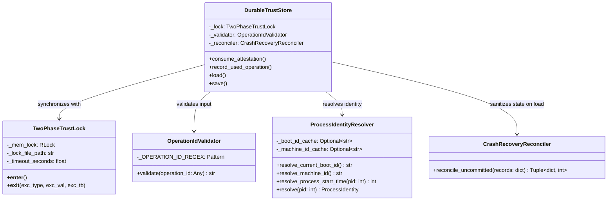

# 논리 컴포넌트 명세서 (Logical Components)

- **대상 작업 단위**: `unit-1-operation-replay-identity`
- **담당 모듈**: `extractor/capture_backend.py`

---

## 1. 컴포넌트 아키텍처 다이어그램

---

## 2. 논리 컴포넌트 상세 명세

### 2.1 `OperationIdValidator`
- **책임**: 모든 외부 입력 및 저장소 경계에서 `operation_id`의 정규식 구문, 길이, 공백 및 유니코드 포함 여부를 나노초/마이크로초 단위로 엄격히 검증.
- **인터페이스**:
  - `validate(operation_id: Any) -> str`
- **주요 동작**:
  - `isinstance(operation_id, str)` 확인.
  - `1 <= len(operation_id) <= 128` 정수 비교.
  - 시작/끝 공백 문자 존재 시 즉시 `InvalidOperationIdError` (trim 금지).
  - 컴파일된 모듈 싱글톤 `re.compile(r"^[a-zA-Z0-9_.:-]{1,128}$")` 매칭.
  - 통과 시 원본 문자열 반환.

### 2.2 `ProcessIdentityResolver`
- **책임**: Linux OS 커널의 가상 파일시스템(`/proc`)으로부터 대상 프로세스의 4대 식별 튜플을 안전하게 추출.
- **인터페이스**:
  - `resolve(pid: int) -> ProcessIdentity`
  - `resolve_process_start_time(pid: int) -> int`
- **주요 동작**:
  - `/proc/sys/kernel/random/boot_id` 읽기 (부팅 세션 동안 인메모리 캐싱).
  - `/etc/machine-id` (또는 `/var/lib/dbus/machine-id`) 읽기 (호스트 머신 ID 캐싱).
  - `/proc/<pid>/stat`을 열어 공백으로 분리된 필드 중 22번째 필드(`starttime`, 클록 틱 단위 정수) 추출.
  - 타깃 프로세스가 종료되었거나 권한 부족 시 `ProcessIdentityUnavailableError` 발생 (fail-closed, 임의 타임스탬프 대체 절대 금지).

### 2.3 `TwoPhaseTrustLock`
- **책임**: 인메모리 스레드 동기화와 OS 프로세스 간 파일 락을 2단계로 결합하여 데드락과 무한 대기를 원천 차단하는 컨텍스트 매니저.
- **인터페이스**:
  - `acquire(timeout: float = 5.0) -> None`
  - `release() -> None`
  - `__enter__()`, `__exit__()`
- **주요 동작**:
  1. 1단계: `threading.RLock.acquire()` 호출 (스레드 간 락 획득).
  2. 2단계: 락 파일 fd를 열고 `fcntl.flock(fd, fcntl.LOCK_EX | fcntl.LOCK_NB)` 시도.
     - `EAGAIN` 또는 `EWOULDBLOCK` 발생 시 1ms부터 50ms까지 지수 백오프(`time.sleep`) 적용.
     - 누적 대기 시간이 5.0초를 초과하면 `LockTimeoutError("Durable trust store lock acquisition timed out after 5.0s")` 발생 및 1단계 RLock 해제.
  3. `finally` 블록: `fcntl.flock(fd, fcntl.LOCK_UN)` 호출 후 `RLock.release()` 역순 해제.

### 2.4 `CrashRecoveryReconciler`
- **책임**: 저장소 초기화 시점에 디스크 파일의 미완료 작업을 전수 감사하여 일관된 종결 상태로 조정.
- **인터페이스**:
  - `reconcile_uncommitted(records: Dict[str, Dict[str, Any]]) -> Tuple[Dict[str, Dict[str, Any]], int]`
- **주요 동작**:
  - `used_operation_ids` 딕셔너리의 모든 항목을 순회.
  - `state` 필드가 `"RESERVED"` 또는 `"EXECUTING"`인 레코드를 탐지.
  - 상태를 `"ABORTED_ON_RESTART"`로 변경하고 중단 시각(`aborted_at`) 기록.
  - 조정된 건수를 반환하며, 1건 이상 조정 시 즉시 `save()`를 트리거하여 디스크에 원자적으로 저장.
