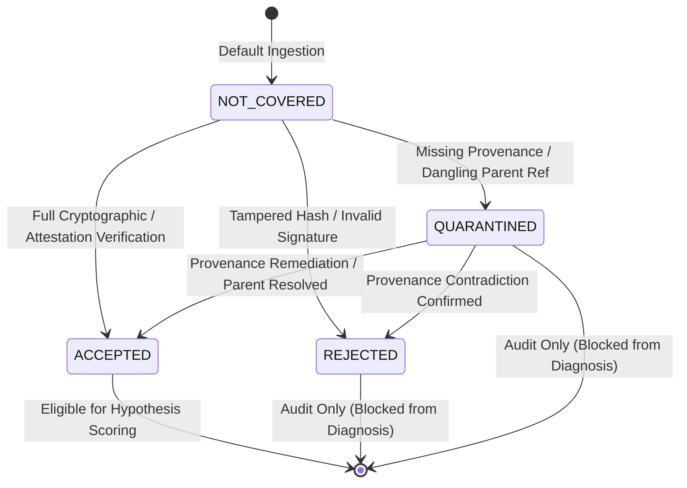
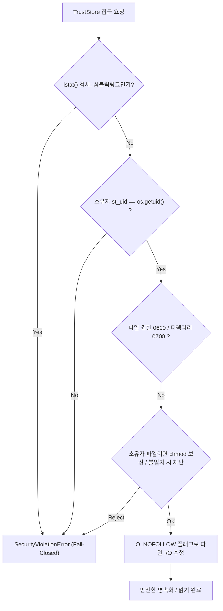

# Business Logic Model: Evidence Ledger Admission & Store Security (Unit 2)

> **Unit ID**: `unit-2-ledger-admission-store-security`  
> **Source Files**: [evidence_ledger.py](file:///home/ubuntu/workspace/ut/extractor/evidence_ledger.py), [capture_backend.py](file:///home/ubuntu/workspace/ut/extractor/capture_backend.py)  
> **Related Stories**: `US-TRUST-004`, `US-TRUST-005`, `US-TRUST-006`  
> **Related Requirements**: `FR-TRUST-004`, `FR-TRUST-005`, `FR-TRUST-006`, `NFR-SECURITY-001`, `NFR-RESILIENCY-001`  

---

## 1. 5단계 증거 입도 상태 머신 (Evidence Admission State Machine)

증거 레코드(`EvidenceRecord`)는 수집 및 검증 파이프라인에서 다음 5개 상태 중 하나를 부여받습니다:

1. **`ACCEPTED`**:
   - 무결성 검증, 서명 검증, 출처 계통 검증을 모두 통과한 권위 있는(Authoritative) 증거.
   - 하류 가설 평가(Hypothesis Scoring) 및 최종 진단 판정(Diagnostic Verdict)에 유일하게 사용 가능.
2. **`REJECTED`**:
   - 변조 감지, 서명 불일치, 불법적 상태 전이, 인가되지 않은 조작으로 검증 실패한 증거.
   - 즉시 배제되며 하류 가설 평가로 유입 차단. 감사 트레일에는 실패 사유와 함께 보존.
3. **`QUARANTINED`**:
   - 필수 출처 메타데이터 결손, 알 수 없는 출처, 또는 존재하지 않는 부모 증거를 참조(Dangling Parent Reference)하는 고아 증거.
   - 격리 상태로 보존되며, 승격(promotion) 전까지는 하류 가설 평가에 반영되지 않음.
4. **`NOT_COVERED`**:
   - 검증 메커니즘이나 attestation 증거가 제공되지 않은 미검증 관측값.
5. **`PARTIAL`**:
   - 일부 속성이나 필드만 관측/검증되었고 잔여 필드의 무결성이 확정되지 않은 부분 증거.

---

## 2. 하류 진단 유입 차단 인터페이스 (`get_eligible_evidence`)

하류 진단 엔진(`ExpertDiagnosticEngine`, `CompetingHypothesis`)의 가설 평가 및 판정 산출 시, 오염된 증거나 격리된 증거의 침투를 원천 차단하기 위해 2단계 접근 계층을 수립합니다:

1. **`get_eligible_evidence() -> List[EvidenceRecord]`**:
   - `admission_state == EvidenceAdmissionState.ACCEPTED`인 증거 레코드만 필터링하여 반환.
   - 가설 지지/반박 평가, 원인 귀속(Causal Attribution), 신뢰도 점수 산출 등 모든 하류 진단 로직은 반드시 이 메서드를 통해서만 증거를 소비.
2. **`get_audit_trail() -> List[EvidenceRecord]`**:
   - `ACCEPTED`, `REJECTED`, `QUARANTINED`, `NOT_COVERED`, `PARTIAL`을 포함한 전체 증거 레코드 및 배제 사유(`admission_reason`)를 반환.
   - 포렌식 분석, 보안 감사, 컴플라이언스 보고서 생성 목적으로만 사용.

---

## 3. TrustStore 파일시스템 보안 검증 파이프라인

`DurableTrustStore`는 상태 영속화(`save()`) 및 로드(`load()`) 시 파일시스템 공격(심볼릭링크 조작, 권한 상승, TOCTOU)을 방어하기 위해 다음 순차 검증 파이프라인을 통과해야 합니다:

---

## 4. 4단계 원자적 교체 및 크래시 복구 수명주기

`DurableTrustStore.save()`는 디스크 풀, 비정상 종료, 전원 단절 시 영수증 데이터 손상을 방지하기 위해 다음 4단계를 엄격히 준수합니다:

1. **임시 파일 작성**: 대상 파일과 동일한 디렉터리에 `.trust_tmp_{uuid}` 이름으로 `O_CREAT | O_EXCL | O_WRONLY` (모드 `0600`) 오픈.
2. **동기식 플러시 (`fsync`)**: 데이터 직렬화 후 파일 디스크립터에 대해 `os.fsync(fd)`를 실행하여 물리적 디스크 영속화 보장.
3. **원자적 교체 (`os.replace`)**: POSIX 표준 원자적 교체를 통해 대상 파일로 교체.
4. **부모 디렉터리 동기식 플러시**: 대상 디렉터리의 디렉터리 엔트리 갱신을 디스크에 반영하기 위해 디렉터리 fd에 대해 `os.fsync(dir_fd)` 실행.
5. **크래시 잔여물 정리**: `load()` 수행 시 비정상 종료로 남은 `.trust_tmp_*` 패턴의 stale 임시 파일을 자동으로 스캔 및 안전하게 정리.
