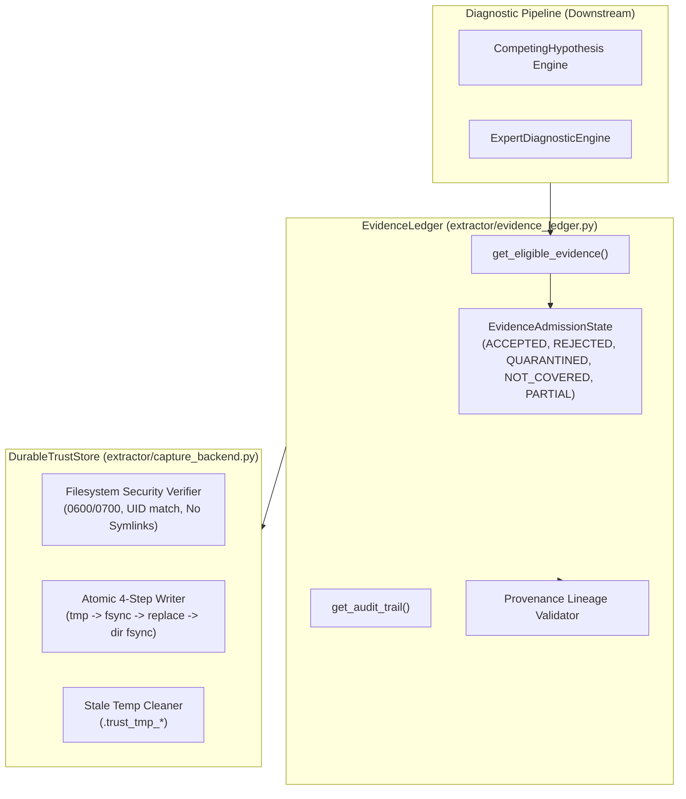

# Logical Components: Evidence Ledger Admission & Store Security (Unit 2)

> **Unit ID**: `unit-2-ledger-admission-store-security`  

---

## 1. 컴포넌트 상호작용 다이어그램

## 2. 컴포넌트 인터페이스 명세

1. **`EvidenceLedger`**:
   - `get_eligible_evidence() -> List[EvidenceRecord]`: `ACCEPTED` 레코드만 반환.
   - `get_audit_trail() -> List[EvidenceRecord]`: 모든 상태의 레코드 반환.
   - `validate_and_admit(record: EvidenceRecord) -> EvidenceAdmissionState`: 출처 및 무결성 검증 후 입도 상태 결정.
2. **`DurableTrustStore`**:
   - `_verify_path_security(path: Path) -> None`: UID, 권한, 심볼릭링크 검증. 위반 시 `SecurityViolationError`.
   - `_cleanup_stale_temp_files() -> None`: `.trust_tmp_*` 파일 삭제.
   - `save() -> None`: 원자적 4단계 디스크 영속화.
