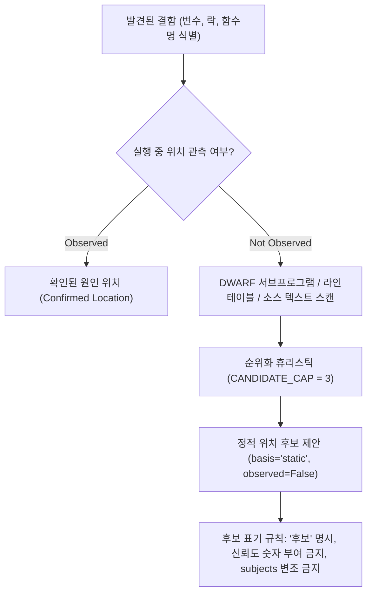

# Business Logic Model: Diagnosis Accuracy & Hypothesis Budgeting (Unit 5)

> **Unit ID**: `unit-5-diagnosis-accuracy-budget`  
> **Source Files**: 
> - [static_location_candidates.py](file:///home/ubuntu/workspace/ut/extractor/static_location_candidates.py)
> - [competing_hypotheses.py](file:///home/ubuntu/workspace/ut/extractor/competing_hypotheses.py)
> - [check_budget.py](file:///home/ubuntu/workspace/ut/extractor/check_budget.py)
> - [healthy_verdict.py](file:///home/ubuntu/workspace/ut/extractor/healthy_verdict.py)  
> **Related Stories**: `US-DIAG-001`  
> **Related Requirements**: `FR-DIAG-001`, `FR-DIAG-002`, `FR-DIAG-003`, `FR-DIAG-004`  

---

## 1. 정적 위치 후보 순위화 및 정직성 모델 (`FR-DIAG-001`)

---

## 2. 경쟁 가설 모순 증거 분리 모델 (`FR-DIAG-002`)

- 가설 지지 증거(supporting evidence)와 반박/모순 증거(contradictory evidence)를 명시적으로 분리하여 평가.
- `EvidenceLedger.get_eligible_evidence()`를 통해 유입된 `ACCEPTED` 증거만 점수 계산에 반영.
- 모순 증거 발견 시 즉시 지지 점수를 감쇄하고, 반박 근거가 지지 근거를 초과할 경우 가설을 `REFUTED`로 확정.

---

## 3. 적응형 관측 예산 회계 모델 (`FR-DIAG-003`)

- 진단 세션 시작 시 `default_check_budget_s` (기본 4.0~5.0s)를 설정.
- 각 체크(recipe) 실행 전 남은 예산 확인 (`check_budget.reserve()`).
- 예산 소진 시 조사를 안전하게 중단하되, 이미 수집된 결함 및 증거는 손실 없이 보존 (`test_budget_stop_keeps_findings.py`).

---

## 4. 건강 판정 및 기권(Abstention) 일관성 모델 (`FR-DIAG-004`)

- 결함이 탐지되지 않았더라도 정상 동작 증거가 불충분하거나 수집된 관측이 결측된 경우 `HEALTHY`로 단정하지 않고 `INCONCLUSIVE` 또는 `not_covered`로 기권.
- `HEALTHY` 판정은 최소 3개 이상의 핵심 정상 동작 증거(락 경합 없음, 스레드 정상 대기 등)가 증명된 경우에만 선언.
