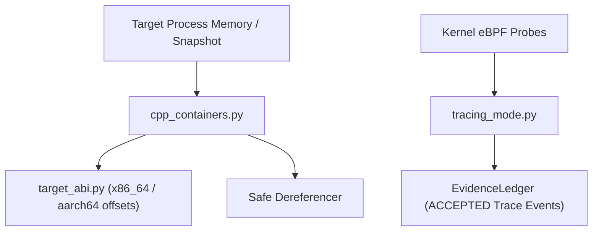

# NFR Design Patterns & Logical Components: C++ STL Decoders & Cross-ABI Tracing (Unit 6)

> **Unit ID**: `unit-6-cpp-abi-tracing`  

---

## 1. Design Patterns
- **Safe Dereference Pattern**: 포인터 산술 연산 전 메모리 세그먼트 경계 및 정렬 유효성을 검사하는 사전 방어 로직.
- **RAII Lifecycle Pattern**: `with TracingSession():` 컨텍스트 매니저를 통해 예외 발생 시에도 eBPF 프로브 자동 언로드 보장.

## 2. Logical Components

