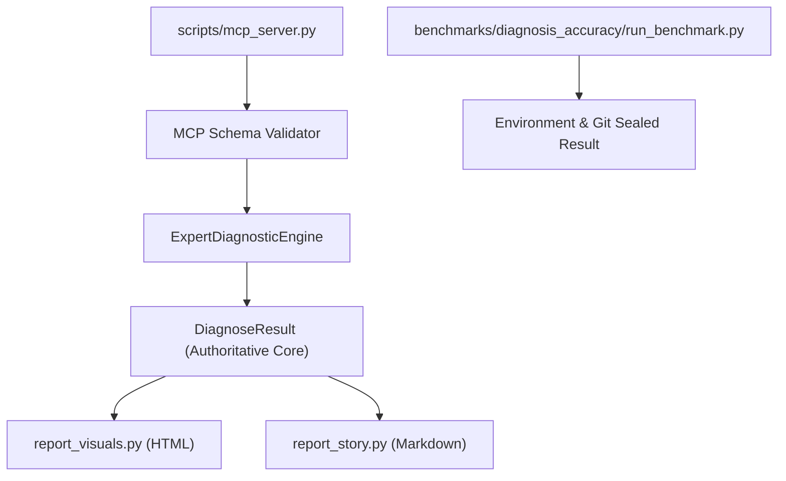

# NFR Design Patterns & Logical Components: Report Equivalence, MCP Contracts & Clean Benchmark (Unit 7)

> **Unit ID**: `unit-7-report-mcp-benchmark`  

---

## 1. Design Patterns
- **Dual-View Rendering Pattern**: 동일한 진단 결과 데이터 모델(DiagnoseResult DTO)을 입력받아 HTML과 Markdown 뷰로 병렬 렌더링하여 데이터 모순 원천 차단.
- **Contract Boundary Pattern**: MCP 진입점에서 스키마 기반 요청 검증 후 내부 엔진으로 위임.

## 2. Logical Components

