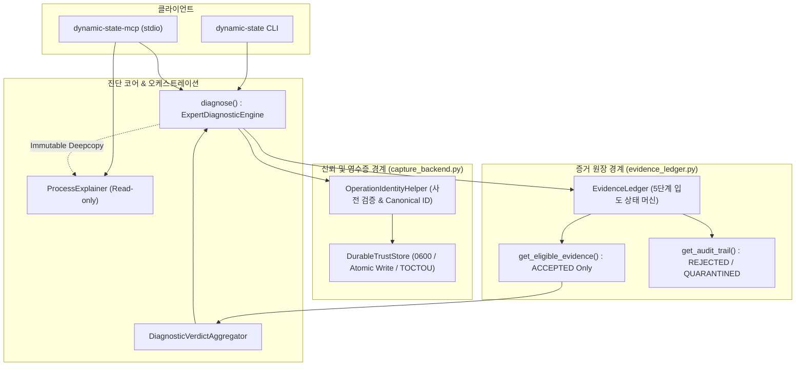

# 애플리케이션 설계 통합 명세서 (Application Design Specification)

> **기준 요구사항**: `aidlc-docs/inception/requirements/requirements.md` (FR-TRUST-001 ~ 007, NFR-SECURITY-001, NFR-PBT-001, NFR-RESILIENCY-001, FR-EXPLAIN-001)  
> **설계 결정**: Q1: A (`capture_backend.py` 보강), Q2: A (`EvidenceLedger` 인터페이스 차단), Q3: A (임시파일 + 원자적 rename + fsync)

---

## 1. 아키텍처 개요 및 설계 원칙

본 설계는 DynamicState의 기존 결정론적 C/C++ 런타임 진단 아키텍처를 온전히 보존하면서, P0 7대 신뢰성·보안 결함을 완벽히 폐쇄하기 위한 상위 수준 설계를 정의한다.

1. **No Duplicate Implementation**:
   - `capture_backend.py`와 `evidence_ledger.py`의 기존 클래스(`Attestation`, `OperationReceipt`, `DurableTrustStore`, `EvidenceLedger`)를 재사용·보강한다.
   - 새로운 서브시스템이나 병렬 데이터 모델을 도입하지 않는다.
2. **Fail-Closed Gate**:
   - durable Attestation 소비 전 `operation_id` 및 메타데이터 형식/일관성을 사전 검증한다.
   - `boot_id`, `pid`, `process_start_time`을 결합한 Canonical Replay Identity로 PID 재사용을 원천 방어한다.
3. **Single Point of Enforcement**:
   - `EvidenceLedger.get_eligible_evidence()`를 통해서만 하류 진단 엔진에 증거를 노출하여, `REJECTED`/`QUARANTINED` 증거의 가설/판정 유입을 인터페이스 수준에서 차단한다.
4. **POSIX Atomic Crash-Consistency**:
   - 동일 디렉터리 내 `0600` 임시 파일 작성 → 파일 `fsync` → `os.replace` 원자적 교체 → 부모 디렉터리 `fsync` 파이프라인으로 지속성 영수증을 보호한다.
5. **Read-Only Explanation Isolation**:
   - `ProcessExplainer`는 방어적 복사된 불변 `DiagnoseResult`를 소비하는 읽기 전용 계층으로 동작하며, 진단 결과와 판정을 변경할 수 없다.

---

## 2. 컴포넌트 아키텍처 및 역할

---

## 3. 핵심 모듈별 설계 상세

### 3.1 `capture_backend.py` 보강 (FR-TRUST-001, 002, 003, 005, 007)
- **`validate_operation_id(op_id)`**: 문자열 타입, 8~128자 영숫자/하이픈 검증. durable Attestation 소비 직전에 필수 호출.
- **`build_canonical_replay_identity(op_id, target, params)`**: `host`, `boot_id`, `pid`, `process_start_time`, `target_id`, `build_id`를 정규화하여 frozen Dataclass로 반환.
- **`update_metadata_monotonic(old_meta, new_meta)`**: 빈 metadata에 의한 덮어쓰기 방지 및 충돌 감지.
- **`atomic_write_secure(path, data)`**: 동일 디렉터리 내 `0600` 임시 파일 생성 → fsync → `os.replace` → 디렉터리 fsync.
- **`verify_filesystem_security(path)`**: 심볼릭링크 거부, 소유자 UID 검증, 파일 모드 0600 초과 권한 거부.

### 3.2 `evidence_ledger.py` 보강 (FR-TRUST-004, 006)
- **5단계 입도 상태 enum**: `ACCEPTED`, `REJECTED`, `QUARANTINED`, `NOT_COVERED`, `PARTIAL`.
- **`get_eligible_evidence()`**: `ACCEPTED` 증거만 필터링하여 상위 엔진에 반환.
- **`get_audit_trail()`**: 감사/포렌식 전용 분리 인터페이스.
- **`validate_provenance(item)`**: 필수 계통 필드(`operation_id`, `boot_id`, `pid`, `parent_refs`) 결손 여부 검증.

### 3.3 `process_explainer.py` 격리 (FR-EXPLAIN-001)
- **`explain_process_behavior(result, lang)`**: `DiagnoseResult` 원본 방어적 복사, 결과 내 증거 ID만 참조하도록 검증.

---

## 4. 검증 및 테스트 아키텍처

1. **선행 TDD 재현 테스트 (`tests/test_trust_boundary_*.py`)**:
   - `test_trust_boundary_operation_id.py`: 유효하지 않은 op_id로 durable 상태 소비 시도 시 실패 재현.
   - `test_trust_boundary_replay_identity.py`: 동일 op_id 다른 타깃 및 PID 재사용 시 replay 방어 실패 재현.
   - `test_trust_boundary_metadata_conflict.py`: 빈 metadata 덮어쓰기 및 충돌 누락 실패 재현.
   - `test_trust_boundary_ledger_admission.py`: 거부된 증거가 verdict에 유입되는 결함 재현.
   - `test_trust_boundary_store_security.py`: 심볼릭링크, 파일 권한 0600 초과, 불완전 쓰기 복구 실패 재현.
2. **속성 기반 테스트 (Hypothesis PBT, `NFR-PBT-001`)**:
   - Canonical Identity 직렬화 왕복(round-trip) 및 정규화 순서 불변식 검증.
   - 임의 metadata 병합 시 단조성(Monotonicity) 불변식 검증.
3. **런타임 호출 경로 통합 검증**:
   - 개별 헬퍼뿐 아니라 `diagnose()` 및 `scripts/mcp_server.py`의 실제 진단 엔트리포인트를 관통하여 신뢰 경계 검증.

---

## 5. 설계 산출물 참조
- 컴포넌트 상세 정의: [components.md](file:///home/ubuntu/workspace/ut/aidlc-docs/inception/application-design/components.md)
- 메서드 시그니처: [component-methods.md](file:///home/ubuntu/workspace/ut/aidlc-docs/inception/application-design/component-methods.md)
- 서비스 오케스트레이션: [services.md](file:///home/ubuntu/workspace/ut/aidlc-docs/inception/application-design/services.md)
- 의존성 매트릭스: [component-dependency.md](file:///home/ubuntu/workspace/ut/aidlc-docs/inception/application-design/component-dependency.md)
