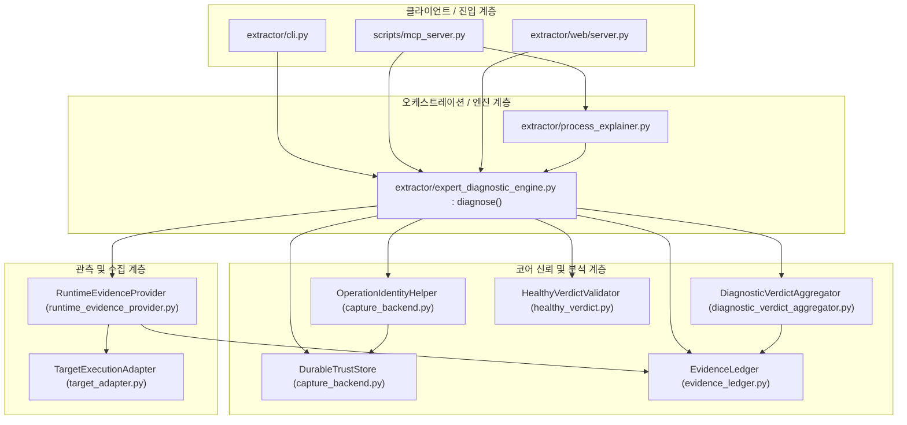

# 컴포넌트 의존성 명세서 (Component Dependency Specification)

## 1. 컴포넌트 의존성 다이어그램

---

## 2. 의존성 매트릭스 (Dependency Matrix)

| 호출 컴포넌트 (Caller) | 피호출 컴포넌트 (Callee) | 결합도 (Coupling) | 통신 방식 | 목적 |
|---|---|---|---|---|
| `MCP / CLI / Web` | `expert_diagnostic_engine` | Low | 직접 함수 호출 | 진단 실행 `diagnose()` |
| `MCP / Web` | `process_explainer` | Low | 직접 함수 호출 | 읽기 전용 자연어 해설 요청 |
| `expert_diagnostic_engine` | `OperationIdentityHelper` | High (내부) | 직접 함수 호출 | 사전 검증 및 Replay Identity 생성 |
| `expert_diagnostic_engine` | `DurableTrustStore` | High (내부) | 직접 메서드 호출 | 락 예약, 원자적 영수증 커밋 |
| `expert_diagnostic_engine` | `RuntimeEvidenceProvider` | Medium | 인터페이스 호출 | 런타임 증거 수집 |
| `expert_diagnostic_engine` | `EvidenceLedger` | High | 인터페이스 호출 | 입도 검증 및 `get_eligible_evidence()` |
| `expert_diagnostic_engine` | `DiagnosticVerdictAggregator`| Medium | 직접 함수 호출 | `ACCEPTED` 증거 기반 판정 집계 |
| `process_explainer` | `expert_diagnostic_engine` | Low (데이터만) | 읽기 전용 인자 | 불변 `DiagnoseResult` 해설 |

---

## 3. 순환 의존성 및 결합도 제어 규칙

1. **단방향 흐름 강제 (One-Way Dependency)**:
   - `capture_backend.py`는 상위 `expert_diagnostic_engine.py`나 `process_explainer.py`를 절대 임포트하지 않는다.
   - `evidence_ledger.py`는 `capture_backend.py`의 신뢰 데이터 모델만 참조하며 상위 진단 엔진에 의존하지 않는다.
2. **지연 임포트(Lazy Import) 정리**:
   - 기존의 순환 임포트를 방지하기 위해 사용되던 함수 내 지연 임포트를 점검하고, 데이터 모델(Dataclass/TypedDict)을 타입 힌트와 런타임 참조에서 안전하게 분리한다.
3. **거대 모듈 비대화 방지**:
   - `capture_backend.py` 내부의 헬퍼 함수들은 독립적인 순수 함수(pure functions)로 작성되어 테스트와 재사용이 용이하도록 한다.
