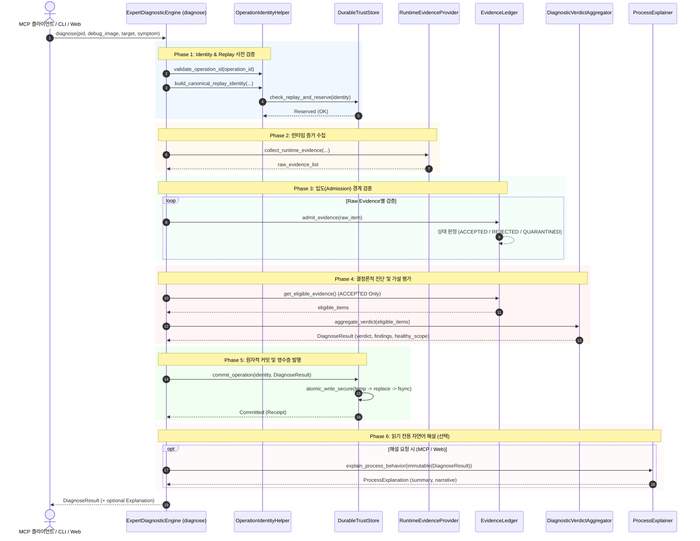

# 서비스 계층 및 오케스트레이션 명세서 (Services Specification)

## 1. 개요
본 문서는 `diagnose()` 단일 진입점을 중심으로 한 런타임 수집, 증거 입도(Admission), 결정론적 가설 평가, 지속성 영수증 발행 및 설명 계층 서비스의 오케스트레이션 흐름을 정의한다.

---

## 2. 서비스 오케스트레이션 흐름도

---

## 3. 핵심 오케스트레이션 규칙

1. **사전 검증 강제 (Fail-Closed Gate)**:
   - 단계 1~3에서 `validate_operation_id` 또는 `check_replay_and_reserve`가 실패하면 단계 4 이후의 수집 및 분석을 즉시 중단하고 예외를 반환한다.
   - 어떠한 durable Attestation 상태도 소비되지 않는다.

2. **입도(Admission) 필터링 우회 차단**:
   - 단계 10에서 `Engine`과 `Aggregator`는 원시 `raw_evidence_list`를 가설 평가에 직접 넘기지 않고, 반드시 `Ledger.get_eligible_evidence()`를 호출하여 `ACCEPTED` 증거만 공급받는다.
   - 무결성 훼손 및 미인증 증거는 단계 11의 가설 평가 알고리즘에 도달할 수 없다.

3. **원자적 지속성 및 충돌 복구**:
   - 단계 13에서 진단 결과와 작업 상태는 동일 디렉터리 내 `0600` 임시 파일 작성 후 `os.replace`로 원자적으로 교체된다.
   - 쓰기 도중 크래시가 발생하더라도 영수증 저장소는 '이전 상태'를 보존하며 손상된 부분 파일이 노출되지 않는다.

4. **설명 계층의 읽기 전용 격리**:
   - 단계 15에서 `ProcessExplainer`로 전달되는 `DiagnoseResult`는 방어적 복사되어 불변성이 보장된다.
   - 해설 생성이 실패하거나 타임아웃되어도 결정론적 진단 결과는 온전히 클라이언트에게 전달된다.
