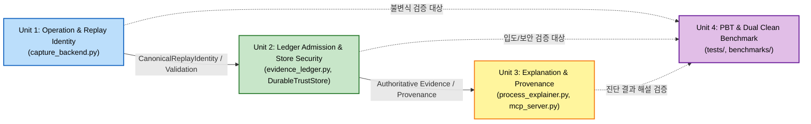

# 작업 단위 의존성 명세서 (Unit of Work Dependency Specification)

## 1. Unit 의존성 흐름도

---

## 2. 의존성 매트릭스 (Dependency Matrix)

| 작업 단위 (Unit) | 선행 필수 단위 (Dependencies) | 공유 인터페이스 / 데이터 계약 | TDD 우선순위 |
|---|---|---|---|
| **Unit 1**: Operation & Replay Identity | 없음 | `validate_operation_id()`, `CanonicalReplayIdentity` | **1순위 (최우선)** |
| **Unit 2**: Ledger Admission & Store Security | `Unit 1` | `EvidenceAdmissionState`, `get_eligible_evidence()`, `atomic_write_secure()` | **2순위** |
| **Unit 3**: Explanation & Provenance | `Unit 2` | `DiagnoseResult`, `AuthoritativeEvidence`, `explain_process_behavior()` | **3순위** |
| **Unit 4**: PBT & Dual Clean Benchmark | `Unit 1`, `Unit 2`, `Unit 3` | 전체 시스템 통합 및 벤치마크 데이터셋 | **4순위 (최종 게이트)** |

---

## 3. TDD 순차 실행 순서 (Sequential TDD Pipeline)

1. **Unit 1 선행 개발**:
   - `tests/test_trust_boundary_operation_id.py` 작성 → 실패 확인 → `capture_backend.py` 사전 검증 로직 구현 → 통과.
   - `tests/test_trust_boundary_replay_identity.py` 작성 → 실패 확인 → `CanonicalReplayIdentity` 정규화 구현 → 통과.
   - `tests/test_trust_boundary_metadata_conflict.py` 작성 → 실패 확인 → 단조성 및 충돌 격리 구현 → 통과.
2. **Unit 2 순차 개발**:
   - `tests/test_trust_boundary_ledger_admission.py` 작성 → 실패 확인 → `EvidenceLedger` 5단계 입도 필터 구현 → 통과.
   - `tests/test_trust_boundary_store_security.py` 작성 → 실패 확인 → `0600`/TOCTOU/원자적 교체 구현 → 통과.
   - `tests/test_trust_boundary_provenance.py` 작성 → 실패 확인 → 계통 링크 보존 구현 → 통과.
3. **Unit 3 순차 개발**:
   - `tests/test_process_explainer.py` 확장 → 방어적 복사 및 불변성 검증 테스트 작성 → 통과.
   - MCP `runtime_explain_process_behavior` 계약 테스트 작성 → 통과.
4. **Unit 4 최종 검증**:
   - Hypothesis PBT 스위트(`tests/test_trust_boundary_pbt.py`) 실행 → 불변식 검증.
   - aarch64 + x86_64 clean benchmark 실행 → 메타데이터 기록 및 `GO` 판정.
