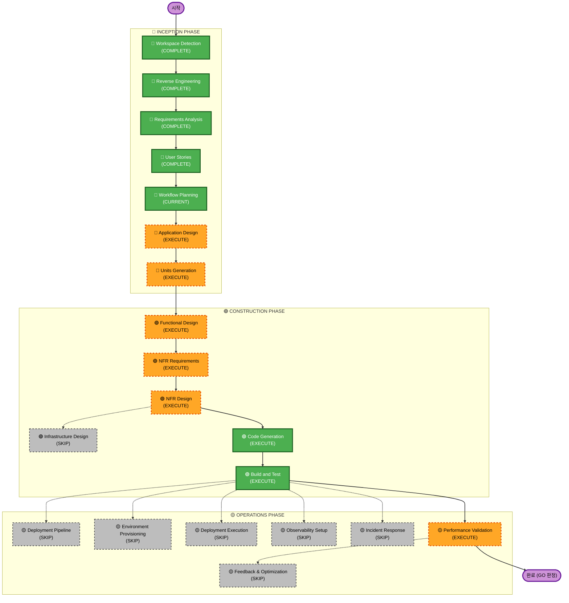

# 실행 계획 (Execution Plan)

## 1. 상세 분석 요약

### 1.1 변환 범위 (Brownfield)
- **변환 유형**: Architecture & Security Hardening (코어 신뢰 경계 폐쇄 및 입도 상태 머신 정립)
- **주요 변경**:
  - `capture_backend.py`: Operation ID 사전 검증, Canonical Replay Identity, Metadata 단조성 보장, TrustStore 파일시스템 보안 강화(0600/0700, TOCTOU 방어, 원자적 쓰기), Operation 생명주기 유효 전이.
  - `evidence_ledger.py`: 엄격한 입도(Admission) 상태 머신(`ACCEPTED`, `REJECTED`, `QUARANTINED`, `NOT_COVERED`, `PARTIAL`), 거부 증거 가설/판정 유입 차단, Provenance 계통 보존.
  - `process_explainer.py` 및 `scripts/mcp_server.py`: `DiagnoseResult` 및 증거 원본 불변성 보장, 읽기 전용 자연어 해설 계층 격리.
  - `tests/` 및 `benchmarks/`: P0 결함 5건 선행 TDD 재현 테스트, Hypothesis 기반 PBT, aarch64 + x86_64 이중 clean benchmark.
- **관련 컴포넌트**: `capture_backend.py`, `evidence_ledger.py`, `expert_diagnostic_engine.py`, `process_explainer.py`, `scripts/mcp_server.py`, `tests/`, `benchmarks/`

### 1.2 변경 영향 평가
- **사용자/에이전트에게 보이는 변경**: Yes (보다 신뢰성 높은 MCP 응답, PID 재사용 오염 방어, 일관된 증거 입도 상태 표시, 결정론적 자연어 해설)
- **구조 변경**: Minor (기존 아키텍처를 유지하되 내부 신뢰 경계 및 입도 필터 강화)
- **데이터 모델 변경**: Minor (Canonical Identity 직렬화 포맷, Admission 상태 머신 enum, Provenance 필드)
- **API 계약 변경**: None (기존 `diagnose()` 및 MCP 도구 계약 호환 유지)
- **NFR 영향**: 보안(차단성 제약), 복원력(원자적 복구), 테스트 용이성(PBT, TDD 재현성) 대폭 강화

### 1.3 컴포넌트 관계
- **주 컴포넌트**: `extractor/capture_backend.py`, `extractor/evidence_ledger.py`
- **상위 진단 엔진**: `extractor/expert_diagnostic_engine.py`
- **설명 인터페이스**: `extractor/process_explainer.py`, `scripts/mcp_server.py`
- **검증 컴포넌트**: `tests/`, `benchmarks/diagnosis_accuracy/`
- **인프라/배포 컴포넌트**: 변경 없음 (IaC/컨테이너 추가 없음)

### 1.4 위험 평가
- **위험 수준**: **Medium-High**
- **근거**: 런타임 영수증 및 증거 원장의 핵심 로직 수정이 포함되므로, 회귀(regression) 발생 시 정상 증거가 거부되거나 기존 벤치마크 결과에 영향을 줄 수 있음. 따라서 TDD 재현 테스트 선행 및 독립 회귀 테스트 격리가 필수적임.

---

## 2. Phase 결정 (EXECUTE / SKIP)

### 🔵 INCEPTION PHASE
1. **Workspace Detection**: **COMPLETE** (2026-11-15 완료)
2. **Reverse Engineering**: **COMPLETE** (2026-11-15 갱신 완료)
3. **Requirements Analysis**: **COMPLETE** (2026-11-15 완료)
4. **User Stories**: **COMPLETE** (2026-11-15 완료)
5. **Workflow Planning**: **IN_PROGRESS** (현재 단계)
6. **Application Design**: **EXECUTE**  
   - *근거*: Operation ID 사전 검증 순서, Canonical Replay Identity 직렬화 포맷, Evidence Ledger 5단계 입도 상태 머신, TrustStore 보안 불변식 및 컴포넌트 간 상호작용 상세 설계 필요.
7. **Units Generation**: **EXECUTE**  
   - *근거*: P0 Trust Closure 작업 단위(Unit-1: Operation & Replay Identity, Unit-2: Ledger Admission & Provenance, Unit-3: TrustStore Security, Unit-4: Explanation Layer & Benchmarks)로 모듈화하여 독립 TDD 진행 필요.

### 🟢 CONSTRUCTION PHASE
8. **Functional Design**: **EXECUTE**  
   - *근거*: 각 작업 단위(Unit)별 함수 시그니처, 상태 전이 규칙, TDD 실패 테스트 케이스 상세 명세 필요.
9. **NFR Requirements**: **EXECUTE**  
   - *근거*: NFR-SECURITY-001(0600 권한/TOCTOU), NFR-PBT-001(Hypothesis 불변식), NFR-RESILIENCY-001(원자적 복구), NFR-PROCESS-001/002(추적성, GO/NO-GO 보고) 상세화.
10. **NFR Design**: **EXECUTE**  
    - *근거*: 파일 퍼미션 강제 방식, PBT 시드 제어 및 최소 반례 축소 설계, 비정상 단절 복원 설계.
11. **Infrastructure Design**: **SKIP**  
    - *근거*: 인프라(IaC, 테라폼, 클라우드 리소스) 변경이 없으며, 기존 호스트/타깃 구조를 유지함.
12. **Code Generation**: **EXECUTE** (ALWAYS)  
    - *근거*: P0 5대 결함 패치, 신뢰 경계 및 입도 상태 머신 실제 코드 구현.
13. **Build and Test**: **EXECUTE** (ALWAYS)  
    - *근거*: TDD 재현 테스트, 전체 단위/통합 테스트, PBT 및 보안 불변식 회귀 검증.

### 🟡 OPERATIONS PHASE
14. **Deployment Pipeline**: **SKIP**  
    - *근거*: 신규 배포 파이프라인 구축 대상이 아니며, 기존 GitHub Actions CI 워크플로를 유지함.
15. **Environment Provisioning**: **SKIP**  
    - *근거*: 신규 인프라 프로비저닝 대상이 아님.
16. **Deployment Execution**: **SKIP**  
    - *근거*: 라이브 서비스 배포 단계 없음.
17. **Observability Setup**: **SKIP**  
    - *근거*: 신규 모니터링/SLO 서비스 구축 없음.
18. **Incident Response**: **SKIP**  
    - *근거*: 운영 장애 대응 런북 작성 대상 아님.
19. **Performance Validation**: **EXECUTE**  
    - *근거*: FR-BENCH-001 aarch64 + x86_64 이중 clean benchmark 실행 및 수집 영향 평가 NFR 검증 수행.
20. **Feedback & Optimization**: **SKIP**  
    - *근거*: 운영 피드백 수집 및 최적화 대상 아님.

---

## 3. 다중 모듈 조율 분석 (Multi-Module Coordination)

### 3.1 모듈 업데이트 전략
- **업데이트 방식**: **Sequential (TDD 우선 순차 진행)**
- **Critical Path**: `capture_backend.py` (Identity/Replay) → `evidence_ledger.py` (Admission) → `expert_diagnostic_engine.py` (통합)
- **조율 지점**:
  1. `OperationIdentity` 및 Canonical 직렬화 포맷 합의
  2. `EvidenceAdmissionState` enum 및 필터링 규칙 합의
  3. `DiagnoseResult` 불변성 보장 인터페이스 합의

### 3.2 작업 단위(Unit) 순서
1. **Unit 1: Operation Identity & Replay Protection** (`capture_backend.py`)
   - 사전 검증 시점 보장, boot_id/pid/start_time 결합 replay identity, metadata 단조성.
2. **Unit 2: Evidence Ledger Admission & Store Security** (`evidence_ledger.py`, `capture_backend.py`)
   - 5단계 입도 상태 머신, 거부 증거 가설 격리, 0600 권한/TOCTOU 방어, 원자적 쓰기.
3. **Unit 3: Explanation Layer Immutability & Provenance Traceability** (`process_explainer.py`, `mcp_server.py`)
   - `DiagnoseResult` 불변성 보장, 출처 계통 링크 완결성.
4. **Unit 4: Verification, PBT & Dual Clean Benchmark** (`tests/`, `benchmarks/`)
   - Hypothesis PBT 스위트, aarch64 + x86_64 clean benchmark 실행 및 결과 기록.

---

## 4. 워크플로우 시각화 (Workflow Flowchart)

---

## 5. 실행 계획 통계 요약

- **총 단계 (Total Stages)**: 20
- **완료된 단계 (Completed)**: 4 (Workspace Detection, Reverse Engineering, Requirements Analysis, User Stories)
- **현재 진행 단계 (Current)**: 1 (Workflow Planning)
- **실행할 단계 (To Execute)**: 8 (Application Design, Units Generation, Functional Design, NFR Requirements, NFR Design, Code Generation, Build and Test, Performance Validation)
- **건너뛸 단계 (To Skip)**: 7 (Infrastructure Design, Deployment Pipeline, Environment Provisioning, Deployment Execution, Observability Setup, Incident Response, Feedback & Optimization)
- **다음 Stage (Next Stage)**: `🔵 INCEPTION - Application Design`
