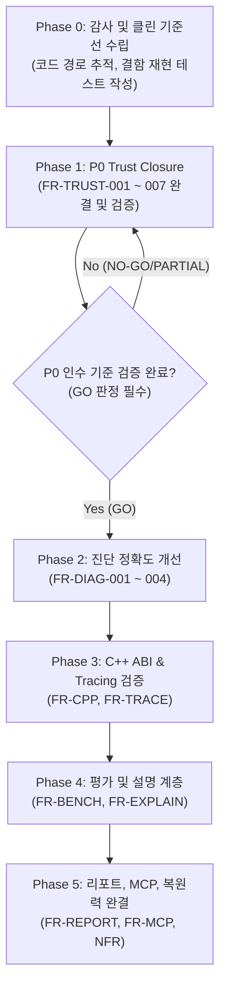

# 요구사항 명세서 (Requirements Specification)

> **기준 문서**: `docs/PRD.md` (v1.0), `docs/REQUIREMENTS_FEEDBACK.md`  
> **기준 커밋**: `9b327dd08027fd1c5044c85ed36b951a7c304939` (`main`)  
> **문서 상태**: 변경 요청 반영 완료 (P0 신뢰 폐쇄 및 Phase 0 감사 체계 통합)

---

## 1. 의도 분석 요약 (Intent Analysis Summary)

- **사용자 요청**: `docs/REQUIREMENTS_FEEDBACK.md`를 바탕으로 DynamicState를 임베디드 Linux C/C++ 시스템을 위한 전문가용 결정론적 런타임 진단 플랫폼으로 강화. P0 증거 신뢰성 및 보안 경계 폐쇄(7개 항목)를 최우선 완결하고, 구현 전 감사(Audit Before Implementation), 중복 구현 금지, 결함 재현 테스트 선행(TDD), PBT/Security/Resiliency 차단성 강제, 단계별 GO/NO-GO/PARTIAL 판정 체계를 정립.
- **요청 유형 (Request Type)**: Bug Fix & Enhancement (안정화 및 신뢰 경계 완결)
- **범위 추정 (Initial Scope)**: Multiple Components (`capture_backend.py`, `evidence_ledger.py`, `expert_diagnostic_engine.py`, `process_explainer.py`, `tests/`, `benchmarks/`)
- **복잡도 추정 (Complexity)**: Complex
- **요구사항 깊이 (Depth)**: Comprehensive

---

## 2. 필수 엔지니어링 원칙 (Mandatory Engineering Principles)

1. **구현 전 감사 (Audit Before Implementation)**:
   - 코드 변경 전 최신 main HEAD(`9b327dd`)의 실제 런타임 호출 경로를 추적한다.
   - 보고된 각 결함이 실제로 존재하는지 확인하고, 기존 구현과 테스트 커버리지를 식별한다.
   - 이미 올바르게 구현되고 검증된 기능은 재개발하지 않고 COMPLETE로 표시한다.
2. **중복 구현 금지 (No Duplicate Implementation)**:
   - 기존 기능의 병렬 구현, 불필요한 추상화나 프레임워크 도입, MCP 도구 중복 개발을 엄격히 금지한다.
   - 기존 아키텍처와 코드를 교정하고 통합하는 것을 최우선으로 한다.
3. **테스트 선행 개발 (Test-First Development)**:
   - 확인된 결함마다 먼저 실패하는 독립 재현 테스트를 작성한다.
   - 현재 구현에서 실패함을 확인한 후 최소한의 적절한 수정을 적용하고, 회귀 테스트 통과를 검증한다.
   - 실행되지 않은 테스트는 절대 PASS로 보고하지 않는다.
4. **엄격한 범위 제어 (Scope Control)**:
   - Phase 0(감사) 및 Phase 1(P0 Trust Closure)을 최우선으로 완결한다.
   - P0 인수 기준이 충족되기 전까지 P1/P2 작업을 시작하지 않는다.
5. **결정론적 코어 및 LLM 설명 계층 분리**:
   - LLM은 사람이 읽는 설명과 상호작용 계층일 뿐이며, 결정론적 진단 알고리즘을 대체하거나 `DiagnoseResult` 및 증거 결론을 임의로 변경할 수 없다.

---

## 3. 기능 요구사항 (Functional Requirements)

### 3.1 P0 — 증거 신뢰성 및 보안 (Evidence Trust and Security)

#### [FR-TRUST-001] Operation Identity 사전 검증 (PRD: REQ-TRUST-001)
- **설명**: 모든 런타임 operation은 durable trust 관련 상태를 소비하거나 변경하기 전에 identity가 유효함을 검증해야 한다.
- **요구사항**:
  - durable Attestation 소비 이전에 operation identifier의 형식, 길이, 의미적 일관성을 검증한다.
  - 잘못된 형식, 불완전하거나 충돌하는 operation identity는 즉시 거부(fail-closed)한다.
  - 검증 실패 시 부분적으로 소비된 trust 상태가 남지 않도록 보장한다.
- **인수 기준**:
  - 잘못된 operation ID는 durable Attestation 상태를 소비할 수 없다.
  - 검증 실패 시 부분 커밋된 상태가 남지 않는다.
  - 동시 operation이 identity 검증을 우회할 수 없다.

#### [FR-TRUST-002] Replay 방어 Canonical Identity 완전성 (PRD: REQ-TRUST-002)
- **설명**: Replay 방어는 타깃 환경과 operation을 고유하게 식별하는 완전한 canonical identity를 사용해야 한다.
- **필수 포함 필드**:
  - `operation_id`, `operation_kind`, `host_identity`, `boot_id`, `pid`, `process_start_time`, `target_identity`, `build_id`, `normalized_parameters`, `schema_version`.
- **요구사항**:
  - 정규화된 직렬화 포맷을 정의하고 replay 검증 시 완전한 canonical identity를 비교한다.
  - PID 재사용(PID reuse) 문제를 방어하기 위해 PID 단독에 의존하지 않고 boot_id/start_time을 결합한다.
  - 동일한 operation ID라도 타깃이나 scope가 다르면 재사용을 거부한다.
- **인수 기준**:
  - 동일 operation replay는 거부되거나 정의된 멱등성 정책에 따라 안전하게 처리된다.
  - 필수 identity 필드 누락 시 fail-closed로 거부된다.

#### [FR-TRUST-003] Metadata 단조성 및 Identity 충돌 방어 (PRD: REQ-TRUST-003)
- **설명**: metadata 갱신 시 기존에 확립된 신뢰 identity를 덮어쓰거나 훼손하지 않아야 한다.
- **규칙**:
  1. 비어 있거나 누락된 metadata는 기존의 유효한 identity 필드를 덮어쓸 수 없다.
  2. 동일한 metadata는 수용된다.
  3. 상충되는 identity metadata는 명시적인 'Identity Conflict'로 기록되어야 한다.
  4. 해결되지 않은 identity 충돌과 연관된 증거는 권위 있는 증거(authoritative evidence)로 승격될 수 없다.
- **인수 기준**:
  - 빈 metadata가 기존 Build ID나 target identity를 지울 수 없다.
  - 충돌하는 metadata는 탐지 및 감사 가능해야 한다.

#### [FR-TRUST-004] Evidence Ledger 엄격 입도(Admission) 경계 (PRD: REQ-TRUST-004)
- **설명**: 증거 입도는 엄격한 신뢰 경계로 동작해야 하며, 명시적 입도 상태 머신을 가진다.
- **입도 상태 정의**: `ACCEPTED`, `REJECTED`, `QUARANTINED`, `NOT_COVERED`, `PARTIAL`
- **요구사항**:
  - `REJECTED`된 증거는 가설 점수 계산(hypothesis scoring)이나 진단 판정(verdict)에 절대 반영되어서는 안 된다.
  - `QUARANTINED` 증거는 감사용으로 보관될 수 있으나 진단 conclusion에는 사용될 수 없다.
  - `NOT_COVERED`와 `REJECTED`는 명확히 구분되어야 한다.
  - 입도 실패 내역은 진단 및 감사 출력에 명시되어야 한다.
- **인수 기준**:
  - 입도 실패 증거가 하류 진단 결론에 영향을 미치지 않는다.
  - 가설 점수 평가는 오직 `ACCEPTED` 증거만을 사용한다.

#### [FR-TRUST-005] TrustStore 파일시스템 보안 강화 (PRD: REQ-TRUST-005)
- **설명**: 지속성 저장소 파일, lock 파일, 디렉터리의 파일시스템 보안 불변식을 강제한다.
- **요구사항**:
  - 파일 타입, 소유자 UID, 디렉터리 권한을 검증한다.
  - 예기치 않은 심볼릭 링크 및 하드 링크 위험을 차단한다.
  - 안전한 lock 파일 생성/열기를 수행하고 TOCTOU 레이스를 방어한다.
  - 민감 파일은 `0600`, 디렉터리는 `0700` 권한 정책을 기본 적용하고 플랫폼 정책을 명시한다.
- **인수 기준**:
  - 비정상 파일 타입 및 소유자 불일치는 거부된다.
  - 원자적 쓰기(atomic write) 및 충돌 복구가 보장되어 불완전한 상태가 신뢰되지 않는다.

#### [FR-TRUST-006] 증거 출처(Provenance) 무결성 (PRD: 신뢰/출처 확장)
- **설명**: 모든 권위 있는 증거 항목은 원본 추적이 가능한 충분한 출처 메타데이터를 유지해야 한다.
- **필수 출처 필드**:
  - `operation_id`, `target_identity`, `host_identity`, `boot_id`, `pid`, `process_start_time`, `build_id`, `timestamp/clock`, `capture_mode`, `admission_result`, `parent_evidence_refs`.
- **요구사항**:
  - 증거 변환 과정에서도 출처가 보존되어야 하며, 파생 증거는 원본 증거 참조를 유지해야 한다.
  - 필수 출처 누락 시 권위 있는 증거로 승격될 수 없다.
- **인수 기준**:
  - 모든 핵심 결론에서 원본 증거까지 역추적이 가능하다.
  - 끊어지거나 유효하지 않은 증거 참조는 탐지된다.

#### [FR-TRUST-007] Operation 생명주기 무결성 (PRD: 신뢰/생명주기 확장)
- **설명**: operation의 전체 생명주기 상태 전이를 엄격히 검증하고 강제한다.
- **생명주기 상태**: `CREATED` → `VALIDATED` → `RESERVED` → `EXECUTING` → `COMMITTED` (실패 시 `REJECTED`, `FAILED`, `CANCELLED`, `PARTIAL`)
- **요구사항**:
  - 유효한 상태 전이만을 허용하고 비정상 전이는 거부한다.
  - 프로세스 비정상 종료 후 복구 시 일관된 operation 상태를 산출해야 한다.
  - 재시도(retry)가 replay 방어를 우회할 수 없도록 보장한다.
- **인수 기준**:
  - 유효하지 않은 생명주기 전이는 거부된다.
  - 부분 실행과 성공적 커밋이 명확히 구별된다.

---

### 3.2 P1 — 진단 정확도 및 런타임 역공학 (P0 완료 후 진행)

- **[FR-DIAG-001] 정적 위치 후보 무결성**: DWARF/소스 기반 후보 순위화 결정론적 보장, 확인된 원인과 후보 구분.
- **[FR-DIAG-002] 가설 모델 불변식**: 모순된 증거의 명시적 분리, 거부된 증거 배제, 재현 가능한 가설 순위화.
- **[FR-DIAG-003] 적응형 조사 예산 무결성**: 관측 예산 reservation/consumption 감사성, 불필요 중복 관측 회피.
- **[FR-DIAG-004] 신뢰도 및 판정 기권(Abstention)**: 근거 부족 시 확정 판정을 회피하고 명시적 `INCONCLUSIVE`/`not_covered` 반환.
- **[FR-CPP-001] C++ 런타임 디코더 정확성**: libstdc++ 컨테이너(vector, map 등) 지원 ABI 검증, 비정상 메모리 fail-safe 방어.
- **[FR-CPP-002] x86_64 및 AArch64 크로스 아키텍처 일관성**: 두 아키텍처 간 논리적 진단 의미의 동등성 검증.
- **[FR-TRACE-001 & 002] 선택적 eBPF 추적 제어 및 증거 통합**: attach/detach 수명주기, 이벤트 손실 명시, 선택적 opt-in 유지.
- **[FR-EXPLAIN-001] 결정론적 진단 결과의 설명 계층 분리**: `DiagnoseResult` 및 증거 원본 불변성 보장, LLM 해설은 읽기 전용 계층으로 동작.
- **[FR-REPORT-001 ~ 003] 보고서 완결성, 출처 추적성, 재현성**: HTML과 Markdown의 동일 결론 유지, 출처 링크 보존.
- **[FR-MCP-001 ~ 003] MCP 도구 계약 일관성 및 추적성**: 동일한 결정론적 진단 코어 호출, 입력 검증 일관성, 구조화된 결과 반환.
- **[FR-BENCH-001 ~ 003] 재현 가능한 벤치마크 평가**: aarch64 + x86_64 이중 clean baseline, 결함 탐지율/오탐률/위치 정확도 분리 측정.

---

## 4. 비기능 요구사항 (Non-Functional Requirements)

### [NFR-SECURITY-001] 보안 불변식 및 차단성 제약 (PRD: REQ-TRUST-005)
- 저장 데이터 및 런타임 영수증 파일 권한은 `0600`(디렉터리 `0700`)을 강제한다.
- 파일시스템 경로 순회(path traversal), 심볼릭 링크 공격, TOCTOU 레이스를 fail-closed로 차단한다.
- 차단성 보안 위반 발견 시 즉시 작업을 거부하고 감사 로그에 기록한다.

### [NFR-PBT-001] 핵심 불변식에 대한 속성 기반 테스트 (PRD: PBT Policy)
- 적용 대상: Operation Identity, Replay 방어, 증거 입도 경계, Provenance 무결성, 생명주기 전이, TrustStore 직렬화.
- 모든 PBT는 재현 가능한 deterministic seed를 지원하고 실패 입력을 최소 반례(shrink)로 기록한다.
- CI 파이프라인에서 PBT 실패는 차단성(blocking) 실패로 취급된다.

### [NFR-RESILIENCY-001] 코어 작업 복원력 (PRD: NFR-RESILIENCY-001)
- 프로세스 강제 종료, 부분 쓰기, 커밋 실패, 동시 작업 시에도 신뢰 경계와 저장소 무결성을 보존한다.
- 실패 후 복구 시 부분 커밋된 상태가 신뢰되지 않도록 원자적 복구를 보장한다.

### [NFR-RESILIENCY-002] 원격 세션 격리 (PRD: NFR-RESILIENCY-002)
- SSH 단절, 프록시 장애, 수집기 비정상 종료 시 미완료 세션이 다른 세션이나 프로세스를 오염시키지 않도록 격리한다.
- PID 재사용에 따른 오래된 세션 증거(stale evidence) 오연결을 방지한다.

### [NFR-PROCESS-001] 요구사항 추적성 및 상태 관리 (PRD: Traceability)
- 각 요구사항은 코드 변경, 실제 런타임 경로, 회귀 테스트, 검증 명령, 산출물과 1:1로 매핑된다.
- 상태 표기: `NOT_STARTED`, `IN_PROGRESS`, `IMPLEMENTED`, `VERIFIED`, `BLOCKED`, `NOT_APPLICABLE`.
- 단순 코드 검토만으로 `VERIFIED`로 표기하는 것을 금지한다.

### [NFR-PROCESS-002] 완료 보고 및 GO/NO-GO 판정 (PRD: Reporting)
- 각 단계 완료 시 기준 commit SHA, 변경 파일, 추가된 테스트, 실제 실행 결과, 잔여 위험, 추적 매트릭스를 보고한다.
- 최종 판정은 다음 중 정확히 하나를 사용한다:
  - **GO**: 모든 필수 인수 기준 검증 완료.
  - **NO-GO**: 중요 요구사항 위반 또는 실패 존재.
  - **PARTIAL**: 일부는 검증되었으나 필수 검증이 미완료됨 (절대 GO로 표현 불가).

---

## 5. 단계별 구현 계획 (Implementation Priority)

1. **Phase 0 — 감사 및 기준선 (Audit and Baseline)**:
   - 최신 HEAD(`9b327dd`) 코드 경로 분석 및 7개 P0 요구사항의 실제 구현/미구현 상태 감사.
   - P0 5대 결함 재현 단위 테스트 작성 및 실패 확인.
2. **Phase 1 — P0 Trust Closure**:
   - FR-TRUST-001 ~ FR-TRUST-007 수정 및 TDD 검증 통과.
   - PBT 및 Security 차단 검증 수행.
   - P0 완결 보고서 작성 및 GO 판정 확인 전까지 후속 단계 진입 금지.
3. **Phase 2 ~ Phase 5**: P0 검증 완료 후 단계적 수행.

---

## 6. PRD 1:1 추적 매트릭스 (Traceability Matrix)

| 요구사항 ID | 기존 PRD 매핑 | 대상 코드 경로 | 상태 | 검증 방법 |
|---|---|---|---|---|
| FR-TRUST-001 | REQ-TRUST-001 | `extractor/capture_backend.py` | NOT_STARTED | TDD 재현 테스트, 단위 검증 |
| FR-TRUST-002 | REQ-TRUST-002 | `extractor/capture_backend.py` | NOT_STARTED | Canonical serialization/PBT |
| FR-TRUST-003 | REQ-TRUST-003 | `extractor/capture_backend.py` | NOT_STARTED | 빈 metadata 덮어쓰기 단위 테스트 |
| FR-TRUST-004 | REQ-TRUST-004 | `extractor/evidence_ledger.py` | NOT_STARTED | 입도 상태 격리 테스트 |
| FR-TRUST-005 | REQ-TRUST-005 | `extractor/capture_backend.py` | NOT_STARTED | 파일 퍼미션/소유자/심볼릭링크 테스트 |
| FR-TRUST-006 | Trust/Provenance | `extractor/evidence_ledger.py` | NOT_STARTED | 출처 계통 추적 테스트 |
| FR-TRUST-007 | Trust/Lifecycle | `extractor/capture_backend.py` | NOT_STARTED | 생명주기 상태 전이 테스트 |
| FR-DIAG-001 | REQ-DIAG-001 | `extractor/static_location_candidates.py` | NOT_STARTED | 후보 순위화 회귀 테스트 |
| FR-DIAG-002 | REQ-DIAG-002 | `extractor/competing_hypotheses.py` | NOT_STARTED | 가설 불변식 검증 |
| FR-DIAG-003 | REQ-DIAG-003 | `extractor/check_budget.py` | NOT_STARTED | 예산 reservation/accounting 테스트 |
| FR-DIAG-004 | REQ-DIAG-004 | `extractor/healthy_verdict.py` | NOT_STARTED | 기권/abstention 일관성 테스트 |
| FR-CPP-001 | REQ-CPP-001 | `extractor/cpp_containers.py` | NOT_STARTED | C++ STL 레이아웃 단위 테스트 |
| FR-CPP-002 | REQ-CPP-002 | `extractor/target_abi.py` | NOT_STARTED | x86_64 / AArch64 크로스 테스트 |
| FR-TRACE-001 | REQ-TRACE-001 | `extractor/tracing_mode.py` | NOT_STARTED | eBPF attach/detach 라이프사이클 |
| FR-TRACE-002 | REQ-TRACE-002 | `extractor/tracing_mode.py` | NOT_STARTED | 트레이스 증거 입도 규칙 테스트 |
| FR-BENCH-001 | REQ-BENCH-001 | `benchmarks/diagnosis_accuracy/` | NOT_STARTED | aarch64 + x86_64 clean baseline |
| FR-BENCH-002 | REQ-BENCH-002 | `benchmarks/diagnosis_accuracy/` | NOT_STARTED | 다차원 지표 분리 보고서 |
| FR-BENCH-003 | REQ-BENCH-003 | `benchmarks/collection_impact_benchmark.py` | NOT_STARTED | 수집 지연/부하 성능 평가 |
| FR-EXPLAIN-001 | REQ-MCP-002, REPORT-001 | `extractor/process_explainer.py` | NOT_STARTED | DiagnoseResult 불변성 테스트 |
| FR-REPORT-001 | REQ-REPORT-001 | `extractor/report_visuals.py` | NOT_STARTED | HTML/Markdown 일치성 테스트 |
| FR-REPORT-002 | REQ-REPORT-002 | `extractor/report_story.py` | NOT_STARTED | 증거 링크 완결성 검증 |
| FR-REPORT-003 | REQ-REPORT-003 | `extractor/reproducibility.py` | NOT_STARTED | 리포트 재현성 메타데이터 검증 |
| FR-MCP-001 | REQ-MCP-001 | `scripts/mcp_server.py` | NOT_STARTED | MCP 스키마 및 입력 검증 |
| FR-MCP-002 | REQ-MCP-002 | `scripts/mcp_server.py` | NOT_STARTED | 코어 진단 파이프라인 일치성 |
| FR-MCP-003 | REQ-MCP-003 | `scripts/mcp_server.py` | NOT_STARTED | 구조화된 출력 추적성 검증 |
| NFR-SECURITY-001 | REQ-TRUST-005 | 전 컴포넌트 | NOT_STARTED | 보안 차단성 제약 검증 |
| NFR-PBT-001 | PBT Policy | `tests/` | NOT_STARTED | Hypothesis 기반 PBT 스위트 |
| NFR-RESILIENCY-001| NFR-RESILIENCY-001 | `extractor/capture_backend.py` | NOT_STARTED | 복구 및 원자성 검증 |
| NFR-RESILIENCY-002| NFR-RESILIENCY-002 | `extractor/target_adapter.py` | NOT_STARTED | 원격 단절/오염 격리 테스트 |
| NFR-PROCESS-001 | Process Rules | `aidlc-docs/` | IN_PROGRESS | AI-DLC 산출물 1:1 매핑 관리 |
| NFR-PROCESS-002 | Process Rules | `aidlc-docs/audit.md` | IN_PROGRESS | 단계별 GO/NO-GO/PARTIAL 보고 |
