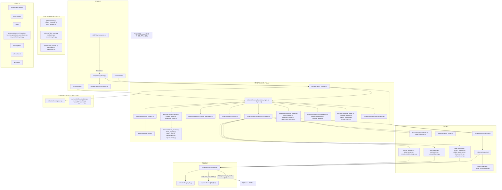

# 시스템 아키텍처 (System Architecture)

> 기준: `main` HEAD `9b327dd` (PR #1 머지 완료). 모듈 분류의 "정적 import 분석"은 `git ls-files` 의 Python 파일 전체에서 `ast` 로 import 문(함수 안의 지연 import 포함)을 추출해 만든 그래프이다. import 가 있다고 해서 실행 시 실제로 호출된다는 뜻은 아니므로 "경로에서 쓰임"은 보수적으로 표현했다.

## 시스템 개요

dynamicState 는 Python 패키지(`dynamicstate`, `pyproject.toml`)와 대상용 C 수집기 하나로 이루어진 도구이다. 서버나 데이터베이스는 없고, 호스트에서 도는 Python 프로세스 하나가 대상 프로세스를 읽어 분석한다.

- **하나의 진입점**: `extractor/expert_diagnostic_engine.py` 끝의 `diagnose(pid, debug_image, symptom, *, adapter, target, corpus_dir, time_limit_s, max_steps, include_report, engine)` 가 `DiagnoseResult` 를 돌려준다. 로컬과 원격(`target=`) 모두 이 함수 하나로 처리하고, CLI(`diagnose`), MCP(`runtime_diagnose_process`), 웹(POST `/api/diagnose`)이 모두 이 함수를 부른다.
- **엔진**: 문제 분류기(`ProblemClassifier`), 대상 평가(`TargetAssessor`), 계획기(`InvestigationPlanner`), 적응형 세션(`AdaptiveInvestigationSession`, 상태 `CREATED` → `CLASSIFYING` → `ASSESSING` → `PLANNING` → `COLLECTING` → `ANALYZING` → `VERIFYING` → `NARROWING` → 종료 상태 `COMPLETED`/`INCONCLUSIVE`/`BLOCKED`/`FAILED`/`BUDGET_EXHAUSTED`)으로 구성된다. 계획기는 증상과 무관하게 항상 **기준 점검(`BASELINE_RECIPE_IDS`)** 을 계획한다.
- **레시피와 플러그인 확장**: 진단 지식은 `extractor/diagnostic_recipes.py` 의 기본 레시피와 `extractor/recipe_plugins/` 아래 9개 특화 플러그인(`double_free`, `mapping_growth`, `heap_retention`, `thread_leak`, `lock_contention`, `lock_faults`, `fd_leak`, `heap_overflow_text`, `use_after_free`)으로 구성된다. 각 플러그인은 증거 수집기, 판정 규칙, 시각화 요소를 단일 모듈로 캡슐화한다.
- **증거 수집 및 추적**: `extractor/runtime_evidence_provider.py` 가 관측 종류별 수집기를 실행하며, `extractor/tracing_mode.py` 가 eBPF/uprobe 동적 추적 모드를 통해 정적 후보와 실시간 추적 지점을 분리한다. `extractor/cpp_containers.py` 는 libstdc++ STL 컨테이너(vector, map 등)를 직접 디코딩한다.
- **객체 연관 및 인과 모델**: `extractor/object_relations.py` 가 발견 사항(finding), 메모리 객체, 소스 변수, 스레드를 연결하는 연관 체인을 구축한다. `extractor/competing_hypotheses.py`, `extractor/cause_predictions.py`, `extractor/followup_value.py` 가 경쟁 가설을 분리하고 후속 관측 효용을 평가한다.
- **시간 예산 및 관측 제어**: `extractor/check_budget.py` 와 `extractor/observation_budget.py`, `extractor/collection_impact.py`, `extractor/observation_selector.py` 가 벽시계 시간 예산 내에서 기본 점검을 안정적으로 완료하도록 보장한다.
- **시각적 사고 보고서**: `extractor/report_visuals.py`, `extractor/report_registry.py`, `extractor/report_story.py`, `extractor/report_detail.py`, `extractor/reproducibility.py` 및 `extractor/human_report.py`, `extractor/incident_report.py`, `extractor/diagnostic_report.py` 가 한/영 이중언어 요약, ASCII/SVG 다이어그램, 재현 가이드가 포함된 종합 리포트를 생성한다.
- **프로세스 해설기**: `extractor/process_explainer.py` 가 프로세스 상태와 원인을 사람이 이해하기 쉬운 자연어로 풀어서 설명한다.
- **세션 저장소**: `extractor/session_store.py` 가 관측 데이터를 중복 없이 단일화하여 무손실 저장한다.
- **판정**: `extractor/diagnostic_verdict_aggregator.py` 가 판정 어휘를 하나로 모으고, `extractor/healthy_verdict.py` 가 HEALTHY 를 엄격한 규칙으로만 허용한다.
- **대상 접근**: `extractor/target_adapter.py` 의 `LocalTargetAdapter`(로컬 `process_vm_readv`, `/proc`)와 `RemoteSshTargetAdapter`(SSH, 수집기 데몬 채널, 수집기 없을 때 POSIX 셸 `dd` 폴백)가 같은 인터페이스를 구현한다.
- **스테이지/오프라인 경로는 별개**: `extractor/investigation.py`(`InvestigationManager`)는 스냅샷 분석과 에이전트용 단계별 증거 열람을 위한 것으로 실시간 진단 경로가 아니다.

## 아키텍처 도식

## 컴포넌트 설명

### 애플리케이션 컴포넌트
- `extractor/cli.py`: CLI 진입점 `dynamic-state`. 하위 명령 44개를 제공하며 `diagnose` 로 실시간 진단 호출.
- `scripts/mcp_server.py`: Model Context Protocol 서버 `dynamic-state-mcp`. 69개 진단 및 런타임 분석 도구 노출.
- `extractor/web/`: 웹 대시보드 및 리플레이 UI, API 라우터, 세션 관리 및 작업 공간 서버 `dynamic-state-workspace`.
- `extractor/agent_runtime.py`: MCP 및 웹 환경에서 공유하는 중앙 런타임 조립 루트 `AgentRuntime`.
- `extractor/expert_diagnostic_engine.py`: 실시간 프로세스 진단 코어 엔진 `diagnose()` 및 `DiagnoseResult`.
- `extractor/runtime_evidence_provider.py`: 관측 항목별 프로바이더를 조율하여 런타임 증거 수집.
- `extractor/diagnostic_verdict_aggregator.py` 와 `extractor/healthy_verdict.py`: 개별 검사 결과를 종합 판정으로 집계하고 HEALTHY 기준 강제.
- `extractor/watch_session.py` 와 `extractor/inspection/`: 실시간 대상 상태 감시 세션 파사드 및 하위 세부 점검 모듈(스레드, 락, 메모리 등).
- `extractor/investigation.py`: 단계별/오프라인 분석용 `InvestigationManager` (에이전트 조사 경로).
- `extractor/offline_analyzer.py`, `extractor/memory_snapshot.py`, `extractor/memory_capture.py`: 대상 메모리 스냅샷 캡처 및 오프라인 상태 역공학.
- `extractor/process_explainer.py`: 프로세스의 복잡한 진단 결과와 런타임 거동을 자연어로 해설.
- `target/collector/`: 대상 머신에서 직접 실행되는 C99 고성능 정적 수집기.
- `skills/diagnose-process/`: 에이전트 전용 진단 스킬 및 플레이북 가이드.
- `gdb/`, `extractor/explorer.py`, `extractor/runtime_controller.py`, `extractor/state_restorer.py`: 레거시 GDB 모드 지원 및 상태 복원 컴포넌트.
- `extractor/ebpf_tracer.py`, `extractor/evaluation.py`, `extractor/production_pilot.py`: 진단 경로 외 보조 도구.

### 공용 컴포넌트
- `extractor/diagnostic_recipes.py` 와 `extractor/recipe_plugins/`: 선언형 진단 레시피 및 9개 특화 플러그인.
- `extractor/target_adapter.py`: 로컬 및 원격(SSH, 수집기 데몬 채널) 대상과의 프로세스 VM 통신 어댑터.
- `extractor/target_abi.py`: 타깃 머신의 아키텍처 및 ABI(x86-64, ARM64 glibc) 판별.
- `extractor/capture_backend.py`: 캡처 영수증 무결성, 신뢰 저장소 및 슬라이스 전송 제어.
- `extractor/thread_sampler.py`: 스레드 스택 샘플링 및 CPU 스케줄링 시계열 분석.
- `extractor/cfi_unwinder.py` 와 `extractor/remote_module_images.py`: DWARF CFI 기반 정밀 콜스택 언와인딩.
- `extractor/dwarf_indexer.py` 와 `extractor/dwarf_loclists_binary.py`: DWARF 디버그 심볼 및 위치 목록 바이너리 인덱서.
- `extractor/cpp_containers.py`: libstdc++ STL 컨테이너(vector, map, string, set) 메모리 디코더.
- `extractor/object_relations.py`: 결함-메모리객체-변수-스레드를 잇는 객체 연관 체인 모델.
- `extractor/heap_walker.py`, `extractor/reachability.py`, `extractor/leak_attribution.py`: 힙 메모리 순회 및 소유권/누수 추적.
- `extractor/heap_integrity.py`, `extractor/memory_integrity.py`, `extractor/global_adjacency.py`, `extractor/stack_margin.py`: 메모리 손상 및 오버플로 검사.
- `extractor/uaf_detection.py`: use-after-free 해제 후 사용 탐지.
- `extractor/collection_impact.py`, `extractor/observation_budget.py`, `extractor/check_budget.py`, `extractor/observation_selector.py`: 수집 부하 최소화 및 시간 예산 기반 점검 제어.
- `extractor/report_visuals.py`, `extractor/report_registry.py`, `extractor/report_story.py`, `extractor/report_detail.py`, `extractor/reproducibility.py`: 시각적 인시던트 리포트 및 이중언어 렌더링.
- `extractor/human_report.py`, `extractor/incident_report.py`, `extractor/diagnostic_report.py`: 구조화된 보고서 직렬화 및 마크다운/HTML 변환.
- `extractor/evidence_ledger.py` 와 `extractor/evidence_adapter.py`: 진단 증거 원장과 어댑터 모델.
- `extractor/competing_hypotheses.py`, `extractor/cause_predictions.py`, `extractor/followup_value.py`: 경쟁 가설 분석 및 원인 예측.
- `extractor/session_store.py`: 무손실 지속성 세션 저장소.
- `extractor/tracing_mode.py`: eBPF/uprobe 동적 추적 모드.
- `extractor/symptom_interpretation.py`: 한/영 정규화 증상 해석기.
- `extractor/agent_skill.py`: 스킬 본문 로더.
- `extractor/llm_provider.py`, `extractor/hypothesis.py`: 선택적 LLM 연동 및 가설 생성기.

### 테스트 및 인프라 컴포넌트
- `tests/`: 436개 파일로 구성된 단위/통합 테스트 스위트.
- `benchmarks/diagnosis_accuracy/`: 실제 프로세스 정답 대조 및 held-out 결함 검증 스위트.
- `benchmarks/collection_impact_benchmark.py`: 수집 영향 벤치마크.
- `benchmarks/capture_benchmark.py`: 캡처 벤치마크.
- `benchmarks/investigation_quality/`: 조사 품질 벤치마크.
- `scripts/qemu_matrix/`: ARM64 glibc QEMU 게스트 원격 검증.
- `scripts/validate_real_target.py`, `scripts/run_e2e_operational_acceptance.py`, `scripts/run_production_pilot.py`: 실제 대상 검증 및 파일럿 실행기.
- `docker/gdb92/`: GDB 9.2 테스트용 컨테이너 환경.
- `ci/workflows/`: GitHub Actions 정본 CI 워크플로.
- `examples/`: 예제 C/C++ 소스.
