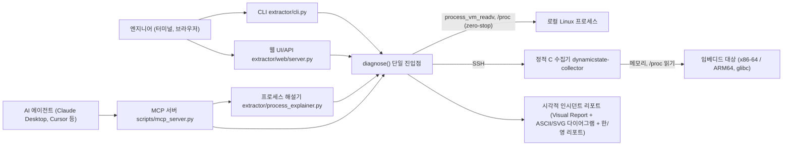

# 비즈니스 개요 (Business Overview)

> 기준: `main` 브랜치 HEAD `9b327dd` (2026-11-15, PR #1 머지 완료). 모든 내용은 현재 코드에서 확인한 사실만 적었다.

## 비즈니스 맥락 도식

## 비즈니스 설명

- **비즈니스 설명**: dynamicState 는 AI 에이전트 또는 엔지니어가 **실행 중인 Linux 프로세스**를 멈추지 않고 실시간으로 진단하고 원인을 규명하게 하는 도구이다. 프로세스 가상 메모리(`process_vm_readv`, `/proc/<pid>/mem`)와 커널 메트릭을 읽고, DWARF 디버그 정보와 결합하여 심볼, 변수 이름, 락, 정확한 소스 라인(`file:line`) 수준으로 결함을 특정한다.
- **주요 해결 결함**: 메모리 누수(소유 변수 및 힙 청크 역추적), 힙/전역 버퍼 오버플로, 이중 해제(Double Free), use-after-free, 교착 상태(Deadlock) 및 자체 교착(Self-Deadlock), 락 경합(Lock Contention), 고아 락(Orphan Lock), 스핀 스레드(Busy-wait), 스레드 누수(Thread Leak), 메모리 매핑 비정상 증가(Mapping Growth), 파일 디스크립터 누수 등.
- **핵심 역량**:
  1. **제로스톱(Zero-stop) 비침습 진단**: 프로세스를 중단시키지 않고 안전하게 런타임 상태를 관측.
  2. **시각적 인시던트 리포트 (Visual Incident Report)**: 결함 원인, 객체 연관 체인(결함 -> 메모리 객체 -> 변수 -> 스레드), 메모리 손상 상태 등을 시각적인 다이어그램(ASCII/SVG/HTML)과 한/영 이중언어로 제공.
  3. **자연어 프로세스 해설 (Process Explainer)**: 엔지니어와 AI 에이전트가 신속히 상황을 파악할 수 있도록 복잡한 결함 메커니즘을 명확한 자연어로 설명.
  4. **libstdc++ 컨테이너 심층 디코딩**: STL 컨테이너(`std::vector`, `std::map`, `std::string` 등)의 내부 메모리 구조를 역디코딩하여 누수 및 오염 객체 식별.
  5. **eBPF/uprobe 동적 추적 모드**: 정적 심볼 후보와 실시간 실행 위치를 명확히 분리하여 오탐 방지.
  6. **시간 예산 관리 (Default Check Time Budget)**: 진단 시간 예산 내에서 기본 점검을 안정적으로 완수.

## 비즈니스 트랜잭션
1. **단일 호출 실시간 진단 (`diagnose()`)**
2. **시각적 사고 보고서 렌더링 및 내보내기**
3. **프로세스 거동 및 결함 원인 자연어 설명 (`runtime_explain_process_behavior`)**
4. **원격 임베디드 타깃(SSH) 진단 및 정적 수집기 배포**
5. **실시간 감시 세션 및 시계열 관측**
6. **힙 메모리 무결성 및 소유권 역추적**
7. **STL 컨테이너 및 객체 연관 체인 탐색**
