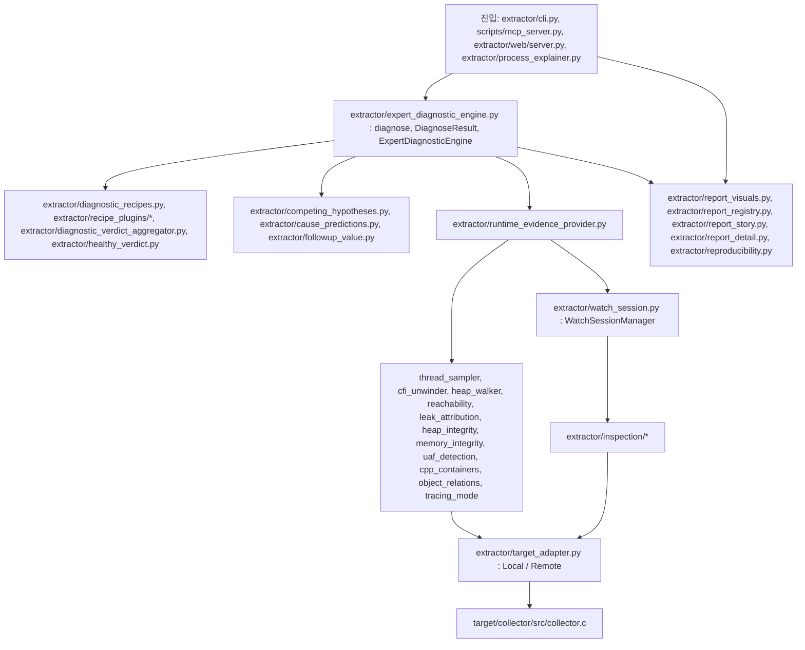
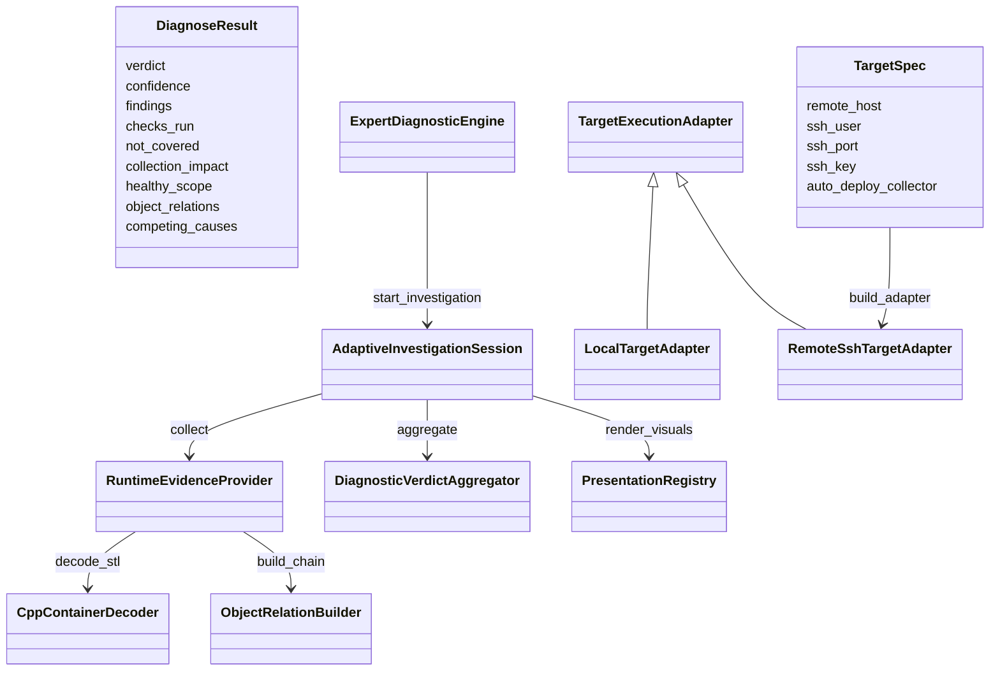

# 코드 구조 (Code Structure)

> 기준: `main` HEAD `9b327dd`, `git ls-files` 의 추적 파일 1082개. 목록에서 `.agents/`, `aidlc-docs/`, `.aidlc-rule-details/`, `build/`, `dynamicstate.egg-info/`, 추적되지 않는 파일은 제외했다.

## 빌드 시스템

- **유형**: Python `setuptools`(pip 로 설치) + 대상용 C 수집기는 `make`.
- **설정**:
  - `pyproject.toml`: 패키지 `dynamicstate` 0.1.0, `requires-python >= 3.10`, 런타임 의존성 `mcp>=2.0.0,<3`, 선택 의존성 `test = ["PyYAML>=6.0"]`, 콘솔 스크립트 `dynamic-state` (`extractor.cli:main`), `dynamic-state-workspace` (`extractor.web.workspace:main`), `dynamic-state-mcp` (`scripts/mcp_server.py:main`). `scripts/` 는 설치 시 `dynamicstate_mcp` 로, `skills/` 는 `dynamicstate_skills` 로 매핑된다.
  - `target/collector/Makefile`: `all`, `dist`, `clean`, `install`. `target/collector/VERSION`(1.3.0).
  - 린터/포매터: `.pre-commit-config.yaml` 이 추가되어 기본 점검 도구와 연계 가능.

## 주요 클래스/모듈

### 모듈 계층

### 핵심 클래스

## 디렉터리별 파일 분포

- `extractor/` (175개): 핵심 진단 엔진, 레시피 플러그인(`extractor/recipe_plugins/`), 리포트 시각화(`extractor/report_visuals.py` 등), 웹 백엔드 및 리플레이 UI(`extractor/web/ui/`).
- `tests/` (436개): 단위 테스트, 통합 테스트, 실제 프로세스 런타임 픽스처.
- `benchmarks/` (167개): 진단 정확도 벤치마크, 수집 영향 평가, 캡처 벤치마크, 21개 held-out 결함 검증 스위트.
- `docs/` (209개): 진단 베이스라인, HEALTHY 규칙, 임베디드 타깃 매트릭스, PRD 및 과거 진단 기록.
- `scripts/` (23개): MCP 서버(`scripts/mcp_server.py`), QEMU 매트릭스 스크립트, 운영 수용 시연 스크립트.
- `target/` (10개): 대상용 C99 정적 수집기 소스(`target/collector/src/`) 및 빌드 파일.
