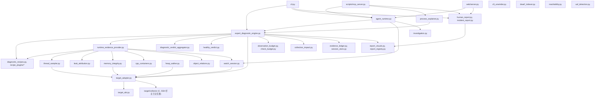

# 의존성 (Dependencies)

> 기준: `main` HEAD `9b327dd` (PR #1 머지 완료).

## 내부 의존성

## 외부 런타임 의존성

- `mcp` (`>=2.0.0,<3`): MCP 서버 프로토콜
- `setuptools` (`>=61`): 파이썬 패키징
- `PyYAML` (`>=6.0`, 선택 의존성 `test`): CI 워크플로 정합성 검증
