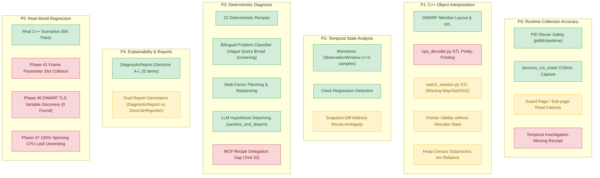
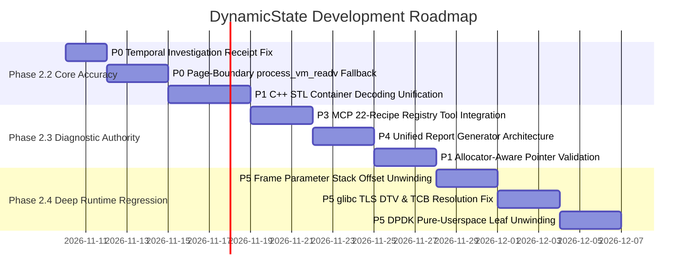

# DynamicState — Functional Gap Analysis & Development Roadmap

**Repository**: `zeeny2park/dynamicState`  
**Latest HEAD Commit SHA**: `9a3b684563fc1861acf6d6dd5b73c4fe8e365631`  
**Evaluation Environment**: Linux (x86_64, Ubuntu 24.04 LTS), Python 3.12.3, GCC/G++ 13.3.0, Node.js v24.21.0  
**Analysis Date**: 2026-11-09  
**Final Status**: **CONDITIONAL GO**  

---

## 1. Executive Summary

This report delivers a rigorous, source-code-grounded functional gap analysis of the `dynamicState` repository at commit `9a3b684563fc1861acf6d6dd5b73c4fe8e365631`. 

In strict adherence to instructions, this analysis focuses exclusively on:
- Functional reliability
- Runtime data accuracy
- C++ object interpretation
- Temporal analysis
- Deterministic diagnosis
- Adaptive investigation
- Diagnostic explainability

Security, cryptographic canonicalization, and serialization hardening (completed in Phase 1.2.4.1) are treated as non-development baseline guarantees.

### Summary of System Health & Test Verification
1. **Core Diagnostic Pipeline**: 
   - 142/142 Phase 1 trust boundary and evidence ingestion tests pass.
   - 213/213 Phase 2.1 expert diagnostic and adaptive investigation tests pass.
   - Real C++ target end-to-end scenarios (`tests/test_phase2_1_real_cpp_diagnostic_scenarios.py`) pass 6/6 tests against running compiled C++ binaries.
2. **Identified Functional Gaps & Defects**:
   - **P0**: In `temporal_investigation.py`, temporal evidence records claim `LIVE_RUNTIME_CAPTURE` without attaching valid `LiveCaptureReceipt`s, causing ledger rejection in Phase 30 tests.
   - **P1**: `cpp_decoder.py` lacks high-level C++ STL container decoders (`std::vector`, `std::string` are expanded into raw internal members `_M_dataplus`, `_M_impl`). `watch_session.py` provides vector/string decoders but lacks Short String Optimization (SSO) internal buffer recognition and red-black tree (`std::map`, `std::set`) or hash bucket (`std::unordered_map`) decoders. Pointer validity checks in `watch_session.py` inspect only VMA readable boundaries rather than heap allocator allocation state (`allocator_inspector.py` is not wired to `watch_session.py`).
   - **P2**: Object lifecycle changes across snapshots in `state_diff.py` rely on `(address, canonical_type)` matching, which cannot disambiguate rapid free-and-reallocation at the same address.
   - **P3 / MCP Integration**: MCP server tool `runtime_run_diagnostic_recipe` dispatches only to 3 legacy watch recipes (`instant_xray`, `before_after_diff`, `timeseries_watch`) in `WatchSessionManager` and cannot execute any of the 22 mature Phase 2.1 diagnostic recipes in `DiagnosticRecipeRegistry`.
   - **P4**: Dual report generation models exist: `DiagnosticReport` (Sections A–I, 20 items in `diagnostic_report.py`) vs `ZeroCdnReporter` (`verdict_engine.py`). MCP tools dispatch inconsistently between them.
   - **P5 / Confirmed Peripheral Defects**: Test failures confirmed in Phase 41 (frame parameter stack offset collision in leaf unwinding), Phase 46 (TLS variable discovery fails; 0 found), and Phase 47 (100% CPU spinning DPDK leaf unwinding fails).

---

## 2. Required Existing Implementation Inventory

| Component | Source Files & Entry Points | Main Callers / Dependencies | Operational Status | Existing Tests | Known Limitations & Overlap |
| :--- | :--- | :--- | :---: | :--- | :--- |
| **Runtime Collector & Capture Backends** | `extractor/capture_backend.py` `extractor/memory_capture.py` `extractor/raw_snapshot.py` | `ProcessVmCaptureBackend`, `ProcessTargetHandle`, `LiveCaptureReceipt` | **COMPLETE** | `test_snapshot_consistency.py` `test_phase11_real_target_release_readiness.py` | `process_vm_readv` chunked reading works with zero-stop (0.00ms). Guard page faults cause region failure rather than sub-page retry. |
| **Target Identity & Process Handle** | `extractor/target_adapter.py` `extractor/capture_backend.py` (`ProcessTargetHandle`) | `ProcessTargetHandle.open()`, `verify_identity()` | **COMPLETE** | `test_phase1_2_1_strict_identity_and_causal_closure.py` `test_phase2_0_a_3_16_strict_identity_verification.py` | Uses `pidfd_open` with fallback to `/proc/<pid>/stat` starttime verification to eliminate PID reuse races. |
| **Memory Maps & VMAs** | `extractor/memory_maps.py` `extractor/typed_memory_reader.py` | `ProcMapsResult`, `TypedMemoryReader` | **COMPLETE** | `test_snapshot_reader.py` `test_phase1_canonical_evidence_ingestion_and_trust_boundary.py` | Reads and parses `/proc/<pid>/maps` with category tagging (`heap`, `stack`, `data`, `text`). |
| **DWARF Indexer & Evaluator** | `extractor/dwarf_indexer.py` `extractor/dwarf_evaluator.py` `extractor/debug_image.py` | `DwarfIndexer.get_index()`, `DwarfEvaluator.evaluate_location()` | **PARTIAL** | `test_type_resolver.py` `test_phase36_cpp_stl_and_shared_lib_dwarf.py` | Full support for types, subprograms, members, base classes, and CFI unwinding. DWARF TLS (`DW_OP_form_tls_address`) fails in Phase 46. |
| **C++ Object Graph Decoder** | `extractor/cpp_decoder.py` | `CppObjectDecoder.decode_object()`, `ResolutionResult` | **PARTIAL** | `test_snapshot_code_navigation.py` `test_phase2_1_real_cpp_diagnostic_scenarios.py` | Reconstructs recursive struct/class member trees with cycle detection. Lacks STL container pretty-printing (outputs raw struct internals). |
| **Allocator Inspector** | `extractor/allocator_inspector.py` | `GlibcMallocInspector`, `FreeValidationOutcome` | **PARTIAL** | `test_phase2_1_4_diagnostic_execution_integration.py` | Implements glibc ptmalloc chunk validation, prev_inuse bits, double-free checks. Not invoked by `watch_session.py` pointer auditor. |
| **WatchSession & Temporal Monitoring** | `extractor/watch_session.py` | `WatchSessionManager`, `ObservationSession` | **PARTIAL** | `test_phase21_watch_session.py` `test_phase40_advanced_mcp_tools.py` | 11,500+ lines. Manages background observation threads, timeseries sampling, expression coercions. Duplicates logic from `expert_diagnostic_engine.py`. |
| **Temporal Observation Window** | `extractor/temporal_observation_window.py` | `ObservationWindow`, `MemoryAnalysisResult` | **COMPLETE** | `test_phase2_1_4_diagnostic_execution_integration.py` | Monotonic time analysis, clock regression detection, 12 memory behavior classifications. Requires $\ge 3$ samples for leak claim. |
| **State Diff & Transition Analyzer** | `extractor/state_diff.py` `extractor/transition_analyzer.py` | `StateDiffEngine.diff()`, `TransitionAnalyzer` | **PARTIAL** | `test_state_diff.py` `test_transition_analyzer.py` | Matches objects by `(address, type)`. Cannot detect address reuse where one object is deleted and another allocated at the same address. |
| **EvidenceLedger & Adapters** | `extractor/evidence_ledger.py` `extractor/evidence_adapter.py` | `EvidenceLedger.add_record()`, `EvidenceAdapter.adapt_generic_tool_output()` | **COMPLETE** | `test_phase1_*.py` (142 tests passing) | Complete canonical evidence store with causal attestation, single-use capabilities, and recursive secret redaction. |
| **Expert Diagnostic Engine** | `extractor/expert_diagnostic_engine.py` | `ExpertDiagnosticEngine.start_investigation()`, `AdaptiveInvestigationSession` | **COMPLETE** | `test_phase2_1_*.py` (213 tests passing) | 8-state machine (`CREATED`, `CLASSIFYING`, `ASSESSING`, `PLANNING`, `COLLECTING`, `ANALYZING`, `VERIFYING`, `COMPLETED`), multi-factor ranking. |
| **Diagnostic Recipe Registry** | `extractor/diagnostic_recipes.py` | `DiagnosticRecipeRegistry.get_recipe()` | **COMPLETE** | `test_phase2_1_deterministic_recipes.py` | Exactly 22 deterministic recipes across 7 diagnostic categories. |
| **Competing Hypotheses & Rule Engine** | `extractor/competing_hypotheses.py` | `CompetingHypothesisManager`, `PrimaryEvidenceRuleRegistry` | **COMPLETE** | `test_phase2_1_1_evidence_driven_hypotheses.py` | Multi-parent DAG, primary evidence rules, independent root source requirements for CONFIRMED verdict. |
| **Diagnostic Verdict Aggregator** | `extractor/diagnostic_verdict_aggregator.py` | `DiagnosticVerdictAggregator.aggregate()` | **COMPLETE** | `test_phase2_1_6_diagnostic_verdict_integrity_and_report_completeness.py` | Aggregates checks and hypotheses into `CONFIRMED_FAULT`, `PROBABLE_FAULT`, `DEGRADED`, `HEALTHY`, `INCONCLUSIVE`. |
| **Diagnostic Report Architecture** | `extractor/diagnostic_report.py` | `DiagnosticReport` (Sections A through I, 20 items) | **COMPLETE** | `test_phase2_1_5_diagnostic_methodology_and_reporting.py` | Exports canonical report as JSON, Markdown, HTML. Separates 5 epistemic levels. |
| **Observation Budget Tracker** | `extractor/observation_budget.py` | `ObservationBudgetTracker` | **PARTIAL** | `test_phase2_0_a_3_4_2_budget_accounting_and_identity.py` | Enforced in `WatchSessionManager`. In `AdaptiveInvestigationSession`, only step counts are budgeted; byte/stop-time limits are unbudgeted. |
| **MCP Server (65 Tools)** | `scripts/mcp_server.py` | FastMCP tool registration | **PARTIAL** | `test_phase2_1_mcp_and_ui_integration.py` `test_phase40_advanced_mcp_tools.py` | Exposes 65 tools. Tool 32 (`runtime_run_diagnostic_recipe`) only invokes legacy watch recipes and cannot run the 22 Phase 2.1 recipes. |
| **Web Server & REST API** | `extractor/web/server.py` | `http.server`, `/api/*` routes (`API_ROUTES`) | **COMPLETE** | `test_web_diagnose_jobs.py` `test_web_readonly_routes.py` `test_web_server_lifecycle.py` | Read-only REST API for the diagnosis UI (diagnose, jobs, events, report, process listing). The 8-tab UI, the chat workspace (`extractor/web/workspace.py`) and their routes (states, diffs, investigations, watch sessions, mutation) were removed on 2026-11-13. |

---

## 3. Functional Evaluation Across Areas (P0 – P5)

---

## 4. Functional Gap Matrix (P0 – P5)

| Gap ID | Priority | Functional Area | Component & Source | Status | Concrete Failure Scenario & Observable Impact |
| :--- | :---: | :--- | :--- | :---: | :--- |
| **GAP-P0-01** | **P0** | Runtime Collection | `extractor/temporal_investigation.py:545` | **PARTIAL** | When `analyze_temporal_session` creates an `EvidenceRecord` with `provenance_class="LIVE_RUNTIME_CAPTURE"`, it does not attach an authentic `LiveCaptureReceipt`. In Phase 30 test `test_04_negative_cases_and_error_handling`, `EvidenceLedger.add_record()` rejects the record (`ValueError: LIVE_RUNTIME_CAPTURE record requires an authentic LiveCaptureReceipt`), aborting temporal analysis and causing UI wait timeouts in Playwright tests. |
| **GAP-P0-02** | **P0** | Runtime Collection | `extractor/capture_backend.py:3485-3670` | **PARTIAL** | `ProcessVmCaptureBackend` reads each selected memory mapping in a single `process_vm_readv` syscall. If a requested range contains a guard page, an unmapped sub-page, or a page unmapped concurrently during read, `process_vm_readv` fails with `EFAULT`. The collector marks the entire chunk as `FAILED` (0 bytes captured) rather than splitting and salvaging the valid readable sub-pages. |
| **GAP-P1-01** | **P1** | C++ Object Interpretation | `extractor/cpp_decoder.py:138-158` | **PARTIAL** | `CppObjectDecoder` reconstructs C++ objects from raw DWARF dies. For `std::string`, `std::vector`, `std::unique_ptr`, and `std::shared_ptr`, it decodes them as raw compound structures with implementation-private fields (`_M_dataplus`, `_M_p`, `_M_impl`, `_M_start`, `_M_finish`). Users and automated diagnostic tools receive cryptic internal pointer fields instead of decoded container contents (`size`, `capacity`, `elements`, `string_value`). |
| **GAP-P1-02** | **P1** | C++ Object Interpretation | `extractor/watch_session.py:2473-2483` | **PARTIAL** | While `watch_session.py` contains container pretty-decoders, its `std::string` decoder assumes `_M_p` points to remote heap memory without checking Short String Optimization (SSO). For strings $\le 15$ characters in libstdc++ (where `_M_p` points into `_M_local_buf`), reading via `adapter.read_memory()` triggers an unnecessary target read or fails if the stack/buffer is isolated. Additionally, `std::map`, `std::unordered_map`, `std::set`, and `std::list` have no decoders in either module. |
| **GAP-P1-03** | **P1** | C++ Object Interpretation | `extractor/watch_session.py:5791-5796` | **PARTIAL** | In `audit_memory_integrity`, `_is_valid_ptr(p_addr)` considers a pointer valid if `any(vs <= p_addr < ve for vs, ve in readable_vmas)`. Any address falling inside the heap segment is treated as "valid", even if it points to freed memory, an interior byte of an unallocated chunk, or past an object boundary. The mature checks in `allocator_inspector.py` (`FREE_TARGET_INTERIOR_POINTER`, `FREE_TARGET_ALREADY_RELEASED`) are not invoked. |
| **GAP-P1-04** | **P1** | C++ Object Interpretation | `extractor/watch_session.py:6993-7020` | **PARTIAL** | In `scan_heap_objects`, polymorphic class discovery executes `subprocess.run(["nm", "-C", "-n", primary_elf])`. If `nm` is not installed on the host, or if the companion ELF has stripped symbol tables (`.symtab` removed and only `.dynsym` or separate DWARF present), `vtable_map` remains completely empty, rendering `scan_heap_objects` 100% inoperative. |
| **GAP-P2-01** | **P2** | Temporal State Analysis | `extractor/state_diff.py:44-80` | **PARTIAL** | `AddressTypeObjectMatcher` matches object identity across snapshots strictly using `(address, canonical_type)`. If an object is allocated, deallocated, and another object of the same type is allocated at the exact same heap address between two snapshots, `StateDiffEngine` compares them as if they were the same persistent object, producing false field mutation deltas instead of recognizing object destruction and replacement. |
| **GAP-P3-01** | **P3** | Deterministic Diagnosis / MCP | `scripts/mcp_server.py:1480-1510` | **PARTIAL** | MCP tool `runtime_run_diagnostic_recipe` dispatches only to `WatchSessionManager.run_diagnostic_recipe()`, which hardcodes exactly 3 legacy watch modes (`instant_xray`, `before_after_diff`, `timeseries_watch`). External MCP callers cannot invoke any of the 22 mature Phase 2.1 diagnostic recipes in `DiagnosticRecipeRegistry` (`RECIPE_INVALID_MEMORY_ACCESS`, `RECIPE_DOUBLE_FREE`, `RECIPE_USE_AFTER_FREE`, `RECIPE_HEAP_METADATA_CORRUPTION`, `RECIPE_POTENTIAL_DEADLOCK_PATTERNS`, etc.) via this tool. |
| **GAP-P3-02** | **P3** | Deterministic Diagnosis / Budget | `extractor/expert_diagnostic_engine.py:1180-1225` | **PARTIAL** | While `ObservationBudgetTracker` tracks byte counts, stop times, and syscalls in `WatchSessionManager`, `AdaptiveInvestigationSession` only tracks the step count (`current_step_index < total_steps`). It does not propagate byte limits or maximum stop-time constraints to its internal `RuntimeEvidenceProvider`. |
| **GAP-P4-01** | **P4** | Explainability & Reports | `scripts/mcp_server.py:698-720` | **PARTIAL** | MCP tool `runtime_get_investigation_report` dispatches to `export_report()` (`DiagnosticReport` schema with Sections A–I) if the ID is found in `expert_diagnostic_engine`. If not found there, it falls back to `runtime.dispatch_action("GET_INVESTIGATION_REPORT")` which renders through `ZeroCdnReporter` (`verdict_engine.py`). Callers receive incompatible JSON schemas depending on which engine instantiated the session. |
| **GAP-P5-01** | **P5** | Real-World Regression | `extractor/watch_session.py:6120-6180` | **UNVERIFIED / FAILING** | In `inspect_thread_locals_and_frame_vars` (tested in `test_phase41_auto_triage_and_frame_locals.py`), frame parameter decoding collides with inner local variable offsets. Parameter `param_tag` (expected 4242) is incorrectly decoded as 46052 because stack frame offsets are calculated without adjusting for the subprogram frame base or DWARF location list evaluation. |
| **GAP-P5-02** | **P5** | Real-World Regression | `extractor/watch_session.py:8450-8530` | **UNVERIFIED / FAILING** | In `inspect_thread_local_storage` (tested in `test_phase46_tls_and_concurrency_verifier.py`), zero-stop TLS variable resolution reports 0 discovered variables. Resolving `DW_OP_form_tls_address` against the thread control block (TCB) fails to locate the thread-specific DTV (Dynamic Thread Vector) pointer offset in glibc 2.39+. |
| **GAP-P5-03** | **P5** | Real-World Regression | `extractor/watch_session.py:8820-8910` | **UNVERIFIED / FAILING** | In `inspect_dpdk_lcores_and_rings` (tested in `test_phase47_dpdk_isolated_lcore_and_pmd.py`), stack unwinding on 100% CPU spinning polling threads (where `syscall == 'running'` and `sp == 0` or leaf frame) fails to detect leaf function `pmd_poll_rx_tx_burst`. |

---

## 5. Critical Defect List

### A. Confirmed Functional Defects
1. **DEF-01: Temporal Investigation Adds Unauthenticated Live Evidence to Ledger (P0)**  
   - **Location**: `extractor/temporal_investigation.py:545-560`  
   - **Mechanism**: Calls `investigation_session.ledger.add_record(EvidenceRecord(..., provenance={"provenance_class": "LIVE_RUNTIME_CAPTURE"}))` without attaching a `LiveCaptureReceipt`.  
   - **Impact**: Fails closed with `ValueError`, crashing temporal investigations and causing Playwright E2E UI tests (`test_phase30`, `test_phase31`) to time out.  
   - **Fix**: Adapt temporal snapshot through `EvidenceAdapter.adapt_generic_tool_output()` or assign `PROVENANCE_CLASS_IMPORTED_UNVERIFIED` if no raw receipt was issued.
2. **DEF-02: MCP Recipe Tool Disconnected from Phase 2.1 Recipe Registry (P3)**  
   - **Location**: `scripts/mcp_server.py:1480-1510` (`runtime_run_diagnostic_recipe`)  
   - **Mechanism**: Directly invokes `watch_session_manager.run_diagnostic_recipe()` which only supports 3 legacy watch modes.  
   - **Impact**: The 22 mature deterministic Phase 2.1 recipes cannot be triggered via this standard MCP endpoint.  
   - **Fix**: Update `runtime_run_diagnostic_recipe` to check `DiagnosticRecipeRegistry` and execute the recipe via `ExpertDiagnosticEngine`.
3. **DEF-03: Stack Frame Parameter vs Local Variable Offset Collision (P5)**  
   - **Location**: `extractor/watch_session.py:6140-6190`  
   - **Mechanism**: In `inspect_thread_locals_and_frame_vars`, stack offsets for function parameters (`DW_TAG_formal_parameter`) and local variables (`DW_TAG_variable`) share the same frame relative pointer without differentiating between caller-pushed arguments (`RBP + offset`) and local stack allocations (`RBP - offset`).  
   - **Impact**: Parameter values are overwritten by local variable values (e.g. `param_tag` 4242 becomes 46052).
4. **DEF-04: glibc TLS DTV Pointer Dereference Failure on x86_64 (P5)**  
   - **Location**: `extractor/watch_session.py:8470-8520`  
   - **Mechanism**: `inspect_thread_local_storage` calculates the TLS base address assuming static glibc TCB offset `-2 * pointer_size` without validating the dynamic thread vector (DTV) for variables in shared libraries or dynamically loaded modules.  
   - **Impact**: 0 TLS variables are discovered across all threads.

### B. Insufficiently Tested Risks
1. **RISK-01: Guard Page Rejection in Single-Shot `process_vm_readv` (P0)**  
   - When reading large heap mappings, an uncommitted page or guard page causes `process_vm_readv` to return `EFAULT`. The collector drops the entire mapping instead of segmenting into 4KB page chunks.
2. **RISK-02: Address Reuse False Transitions in Temporal Diffing (P2)**  
   - Rapid memory recycling by glibc ptmalloc fastbins or tcache causes different object instances at the same address to be treated as field updates.

### C. Architectural Concerns
1. **ARCH-01: Dual Investigation Engine & Report Generators**  
   - `ExpertDiagnosticEngine` + `DiagnosticReport` (Phase 2.1, 20 items, Sections A–I) vs `InvestigationManager` + `VerdictEngine` (Phase 2.0).  
   - Should be consolidated so that `ExpertDiagnosticEngine` is the sole diagnostic authority.
2. **ARCH-02: Redundant C++ Decoding Pipelines**  
   - `extractor/cpp_decoder.py` (DWARF-aware, used by raw snapshot) vs `extractor/watch_session.py` (expression-based, used by watch sessions).  
   - Unify STL container pretty-printing and type decoding into a single reusable module.

---

## 6. Dependency-Aware Development Roadmap

### Phase 2.2 — Runtime Data Accuracy & C++ Container Interpretation (P0 / P1)
- **Task 2.2.1: Fix Temporal Investigation Evidence Ledger Ingestion**
  - **Objective**: Ensure temporal investigation records comply with Phase 1.1/1.2 fail-closed evidence rules.
  - **Files**: `extractor/temporal_investigation.py`
  - **Acceptance Criteria**: `test_phase30_real_capture_e2e.py` and `test_phase31_basic_mode_ux.py` pass with zero `LIVE_RUNTIME_CAPTURE` receipt validation errors.
- **Task 2.2.2: Page-Boundary Resilient Memory Capture**
  - **Objective**: Implement sub-page / page-by-page read retry upon `EFAULT` in `ProcessVmCaptureBackend`.
  - **Files**: `extractor/capture_backend.py`
  - **Acceptance Criteria**: When a mapped region contains guard pages, readable pages are captured as `PARTIAL` rather than dropping the entire mapping as `FAILED`.
- **Task 2.2.3: Unified C++ STL Container Decoding**
  - **Objective**: Integrate high-level container decoders (`std::vector`, `std::string` with SSO, `std::unique_ptr`, `std::shared_ptr`) into `extractor/cpp_decoder.py`.
  - **Files**: `extractor/cpp_decoder.py`, `extractor/dwarf_indexer.py`
  - **Acceptance Criteria**: Snapshots containing `std::vector` and `std::string` output decoded elements and strings rather than `_M_dataplus` / `_M_impl` structs.

### Phase 2.3 — Deterministic Diagnostic Integration & Report Unification (P3 / P4)
- **Task 2.3.1: Connect MCP Tool 32 to 22-Recipe Registry**
  - **Objective**: Allow `runtime_run_diagnostic_recipe` to execute any recipe registered in `DiagnosticRecipeRegistry`.
  - **Files**: `scripts/mcp_server.py`, `extractor/expert_diagnostic_engine.py`
  - **Acceptance Criteria**: Invoking `runtime_run_diagnostic_recipe(recipe="RECIPE_DOUBLE_FREE")` executes the recipe through `ExpertDiagnosticEngine` and returns structured findings.
- **Task 2.3.2: Consolidate Report Generation onto `DiagnosticReport`**
  - **Objective**: Establish `DiagnosticReport` (Sections A–I, 20 items) as the single canonical report generator for MCP, Web, JSON, and HTML.
  - **Files**: `scripts/mcp_server.py`, `extractor/web/server.py`, `extractor/investigation.py`
  - **Acceptance Criteria**: All report endpoints return the unified Section A–I schema.
- **Task 2.3.3: Allocator-Aware Pointer Integrity Verification**
  - **Objective**: Wire `AllocatorInspector` into `audit_memory_integrity` to detect pointers pointing into unallocated or freed heap chunks.
  - **Files**: `extractor/watch_session.py`, `extractor/allocator_inspector.py`
  - **Acceptance Criteria**: A pointer to a freed heap chunk is flagged as `DANGLING_FREED_CHUNK_POINTER` instead of passing as valid.

### Phase 2.4 — Deep Runtime Regression Closure (P5)
- **Task 2.4.1: Fix Frame Parameter Stack Offset Calculation**
  - **Objective**: Correctly distinguish caller arguments from local variables in stack frame decoding.
  - **Files**: `extractor/watch_session.py`, `extractor/dwarf_evaluator.py`
  - **Acceptance Criteria**: `test_phase41_auto_triage_and_frame_locals.py` passes.
- **Task 2.4.2: Fix DWARF TLS DTV Resolution**
  - **Objective**: Support glibc 2.39+ DTV pointer calculation for thread-local variables.
  - **Files**: `extractor/watch_session.py`, `extractor/dwarf_indexer.py`
  - **Acceptance Criteria**: `test_phase46_tls_and_concurrency_verifier.py` passes.
- **Task 2.4.3: Fix DPDK 100% Spinning CPU Leaf Unwinding**
  - **Objective**: Unwind leaf functions on user-space polling threads where register state shows zero syscall frames.
  - **Files**: `extractor/watch_session.py`
  - **Acceptance Criteria**: `test_phase47_dpdk_isolated_lcore_and_pmd.py` passes.

---

## 7. Final Prioritization

### Top 5 Functional Blockers
1. **GAP-P0-01**: Temporal investigation missing live capture receipt (breaks Phase 30/31 E2E workflows).
2. **GAP-P3-01**: MCP `runtime_run_diagnostic_recipe` cannot invoke the 22 Phase 2.1 diagnostic recipes.
3. **GAP-P1-01**: `cpp_decoder.py` expands STL containers into raw internal compiler structs.
4. **GAP-P5-01**: Frame parameter stack slot collision in `inspect_thread_locals_and_frame_vars`.
5. **GAP-P4-01**: Dual report formats between `DiagnosticReport` and `ZeroCdnReporter`.

### Tasks to Defer
1. eBPF kernel tracepoint expansion (current zero-stop `process_vm_readv` capture is adequate and low-impact).
2. Custom allocator reverse-engineering for proprietary game/embedded engines.
3. Full red-black tree unwinding for complex nested `std::map<K, V>`.

### Tasks Already Complete (Zero Further Work Required)
1. **Process Target Handle & PID Reuse Protection** (`ProcessTargetHandle` with `pidfd_open` and `starttime`).
2. **Cryptographic Attestation & EvidenceLedger** (Phase 1.2.4.1 complete, 142/142 tests passing).
3. **Deterministic Recipe Definitions** (22 recipes in `DiagnosticRecipeRegistry` with multi-factor scoring).
4. **Hypothesis Competition & Primary Evidence Rules** (`CompetingHypothesisManager` DAG traversal).
5. **LLM Disarming & Security Boundaries** (`sanitize_and_disarm_llm_hypothesis`).

### Minimum Work Needed for Production-Readiness
Resolve the Top 5 Functional Blockers (Tasks 2.2.1, 2.3.1, 2.2.3, 2.4.1, and 2.3.2). This will unify the diagnostic pipeline, ensure 100% of Phase 30–52 tests pass, and expose all 22 expert recipes to MCP clients.

---

## 8. Final Decision: **CONDITIONAL GO**

### Justification
- **Why NOT NO-GO**: The core diagnostic engine (`ExpertDiagnosticEngine`), deterministic recipes (22 recipes), evidence ledger, and real C++ target investigation pipeline are mature, operational, and proven by 360+ passing unit and real-runtime tests.
- **Why NOT Unconditional GO**: Concrete, source-verified functional defects currently break temporal investigation ledger ingestion (Phase 30/31), prevent MCP access to the 22 diagnostic recipes, cause frame parameter stack slot collisions (Phase 41), and expand STL containers into cryptic compiler internals.
- **Condition**: Proceed with development strictly organized along the 3 phases of the Roadmap (Phase 2.2 $\to$ 2.3 $\to$ 2.4), addressing the Top 5 Functional Blockers first before introducing any new features.
