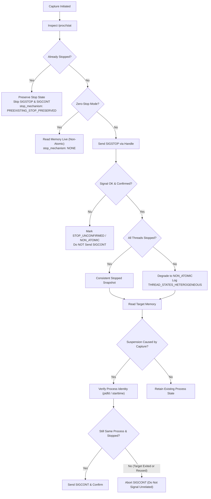

# Capture Safety, Snapshot Diff Accuracy & Evidence Integrity

## 1. Executive Summary

This document specifies the safety contracts, invariants, and semantic definitions implemented in Dynamic State for:
1. **Live Process Capture Lifecycle & State Preservation**
2. **PID-Reuse Mitigation via Linux `pidfd` and `/proc` Fallbacks**
3. **Internally Consistent Byte and Region Accounting**
4. **Strict Object vs. Field Counting in Snapshot Diffs**
5. **Evidence Ledger Schema Validation and Provenance DAG Traversal**

---

## 2. Capture Lifecycle Safety & Process State Preservation

### 2.1 The Suspension Ownership Invariant

Dynamic State captures memory from running C/C++ targets using external kernel signals (`SIGSTOP` / `SIGCONT`) combined with zero-copy `process_vm_readv` (or fallback `/proc/<pid>/mem`).

**Invariant:**
> *A capture operation only owns the right to resume a target process if and only if this capture successfully caused the suspension, and the target was not already stopped beforehand.*

### 2.2 Guarantees of the Stop/Resume Lifecycle

Every capture records a verified `lifecycle_guarantees` dictionary:
- `process_stop_requested`: `True` if `SIGSTOP` was delivered by this capture.
- `process_stop_confirmed`: `True` if the process leader confirmed stopped state (`state == 'T'`) within `max_stop_time_ms`.
- `all_threads_stopped`: `True` if all threads in `/proc/<pid>/task` were confirmed stopped.
- `memory_read_completed`: `True` if memory read phase completed.
- `resume_requested`: `True` if `SIGCONT` was sent to resume the process.
- `resume_confirmed`: `True` if the process confirmed transition to active running state.

### 2.3 Linux Thread Group Semantics
`SIGSTOP` sent to a process leader signals all threads in the thread group. However, individual threads may take variable kernel cycles to enter task stopped state.
- If all threads in `/proc/<pid>/task` are verified stopped: `all_threads_stopped: True`, consistency classified as `SIGNAL_STOPPED`, snapshot consistency classified as `PROCESS_STOPPED_MEMORY_SNAPSHOT`.
- If thread states are mixed (some running, some stopped): `all_threads_stopped: False`, consistency classification is degraded to `NON_ATOMIC`, and diagnostic `THREAD_STATES_HETEROGENEOUS` is recorded. Torn memory reads are never misreported as atomic snapshots.

---

## 3. Process Identity & PID-Reuse Mitigation

When signaling processes by numeric PID (`kill(pid, sig)`), rapid PID recycling can theoretically lead to sending signals to an unrelated process that reused the PID.

### 3.1 Primary Mechanism: Linux `pidfd`
Dynamic State uses `pidfd_open` (syscall 434) and `pidfd_send_signal` (syscall 424) where supported by the kernel (Linux 5.3+ / 5.1+):
- A file descriptor pins the exact kernel `struct task_struct`.
- Even if the original process terminates and its numeric PID is recycled by the kernel, `pidfd_send_signal` returns `ESRCH` and never delivers signals to the new process.
- Verified in `ProcessTargetHandle` with `pidfd_used: True`.

### 3.2 Fallback Mechanism: `stat` Starttime Verification
If `pidfd` is unavailable (older kernels, restricted seccomp policies, or forced fallback):
- Dynamic State parses `/proc/<pid>/stat` to record `(comm, starttime)` at handle initialization.
- Before every signal transmission and during cleanup, starttime is verified against the initial identity.
- If starttime changes: returns `(False, "PID_REUSED")` and aborts signal delivery.

**Residual Risks in Fallback:**
> *Fallback starttime verification cannot guarantee complete immunity against kernel scheduling races between the `/proc/<pid>/stat` read and the `os.kill()` syscall. While this window is sub-microsecond, high-assurance environments should always use kernels with `pidfd` support enabled.*

---

## 4. Byte Counters Definitions and Invariant

Dynamic State enforces an exact, internally consistent mathematical invariant across all capture backends (`ProcessVmCaptureBackend` and `ProcfsCaptureBackend`):

$$\mathbf{bytes\_requested} = \mathbf{bytes\_read} + \mathbf{bytes\_failed} + \mathbf{bytes\_omitted} + \mathbf{bytes\_unread}$$

### 4.1 Metric Definitions

| Metric | Definition |
| :--- | :--- |
| `bytes_requested` | Sum of sizes of all candidate memory ranges requested by the capture plan. |
| `bytes_read` | Total physical bytes successfully transferred into memory buffers. |
| `bytes_failed` | Total bytes of regions where memory read failed with error (e.g. `EFAULT`, `EIO`). |
| `bytes_omitted` | Total bytes skipped due to policy limits (`max_capture_bytes`, `max_capture_ranges`), including tails of partially capped regions. |
| `bytes_unread` | Bytes requested in an attempted region that were not returned by a short read (`chunk_size - nread`). |
| `regions_complete` | Number of regions read 100% to requested size without truncation. |
| `regions_partial` | Number of regions where tail bytes were omitted or short read occurred. |
| `regions_failed` | Number of regions where read returned 0 bytes / error. |
| `regions_omitted` | Number of regions entirely skipped due to policy limits. |
| `regions_read` | `regions_complete + regions_partial`. |
| `regions_attempted` | `regions_read + regions_failed + regions_omitted`. |

### 4.2 Cross-Layer Equivalence
To prevent reporting discrepancies between raw memory buffers and metadata:
- `raw_memory.total_bytes == observation_metadata.captured_bytes == observation_metadata.bytes_read`
- `summary.bytes_requested == observation_metadata.bytes_requested`

---

## 5. Snapshot Diff Semantic Correctness

Snapshot diffing compares two runtime observations without conflating object-level lifecycle events with field-level mutations.

### 5.1 Strict Metric Separation
- **Object Lifecycle**:
  - `objects_created`: Target object newly observed at address/type.
  - `objects_removed`: Target object no longer observed at address/type.
  - `object_lifecycle_changes`: `objects_created + objects_removed`.
  - *Rule: Field modifications inside existing objects never increment object lifecycle metrics.*
- **Field Level**:
  - `fields_added`: New field observed in a matched object.
  - `fields_unavailable`: Field absent or unreadable in subsequent observation.
  - `value_changes`: Primitive data modifications (`int`, `float`, string).
  - `reference_changes`: Changes to object pointer/edge references (`object_ref`).
  - `field_level_changes`: `fields_added + fields_unavailable + value_changes + reference_changes`.
- **Observation Availability**:
  - `availability_changes`: Transition between `available` and `unavailable` observation status.
  - `observation_availability_changes`: `availability_changes + fields_unavailable`.
- **Identity Ambiguity**:
  - `identity_ambiguities`: Events where object matching has `identity_confidence: "uncertain"` (e.g., missing address or empty canonical type).

---

## 6. Evidence Ledger Schema Validation & Provenance DAG

The Evidence Ledger records the causal lineage of observations, inferences, and diagnostics.

### 6.1 Validation Rules
- **Identifier Non-emptiness**: `evidence_id`, `session_id`, and `finding_id` must be non-empty, non-whitespace strings.
- **Type Safety**: `evidence_type` must be in `VALID_EVIDENCE_TYPES` (`OBJECT_STATE`, `RUNTIME_IDENTITY`, `CAPTURE_QUALITY`, `DIAGNOSTIC`, `STATIC_LINK`).
- **Nature Safety**: `nature` must be in `VALID_NATURES` (`OBSERVATION`, `INFERENCE`, `HYPOTHESIS`).
- **Self-Reference Rejection**: A record listing its own `evidence_id` in `parent_evidence_ids` is rejected immediately with `ValueError`.

### 6.2 Traversal Semantics
- **Deterministic Traversal**: Parents are sorted lexicographically before recursive descent, ensuring 100% reproducible chain output across platforms.
- **Cycle Detection**: Active traversal paths are tracked. Cycles append `{"status": "CYCLE_DETECTED"}` and terminate safely without stack overflow.
- **Unresolved Lineage**: Missing parent records append `{"status": "UNRESOLVED_PARENT"}`.
- **Diamond DAG Support**: Diamond dependencies (root $\to$ left/right $\to$ leaf) are supported without false cycle alarms.
