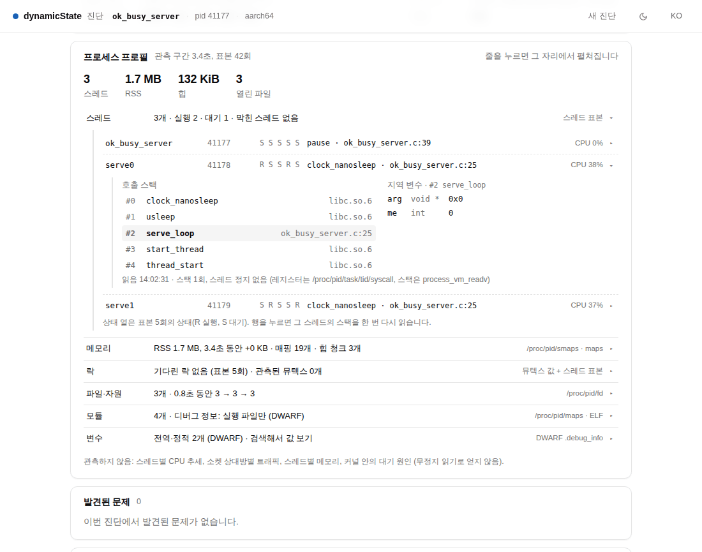
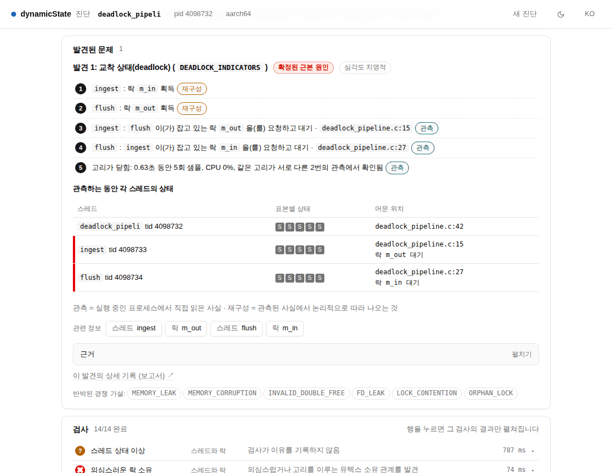
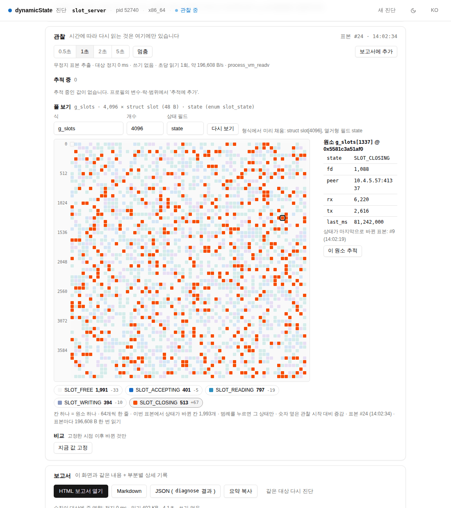
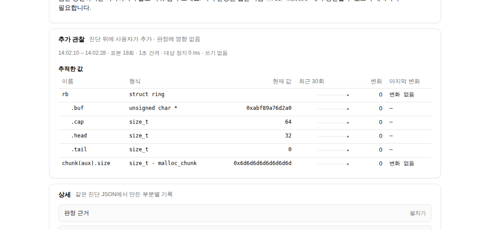

# 프로세스 탐색 기능을 새 UI로 옮기는 제안 (목업)

- **작성일**: 2026-11-13 · 기준 `stage1/integ` `5209d75`
- **상태**: 2026-11-13 구현됨 (E1–E5). 실제 화면: `docs/ui-redesign/screens/impl/explore-*.png`, 라우트: `API_CONTRACT.md` 10장. 아래 본문은 목업 당시의 제안 그대로
- **목업**: `docs/ui-redesign/mock/explore.html` (+ `explore.css`, `explore.js`, `explore-data.js`). `theme.css` 와 실제 UI의 `ui.css` 를
  그대로 읽는다. 단일 파일판은 `python3 docs/ui-redesign/mock/build_standalone.py` → `mock/dist/explore.standalone.html`
  (출력은 커밋하지 않음. 원본에서 언제든 같은 바이트로 다시 만들어진다)
- **주소 파라미터**: `?case=healthy|deadlock|overflow|threads300|pool|nodebug` · `?stage=0..` (또는 단계 이름) · `?view=report` ·
  `?theme=dark` · `?lang=en` · `?still=1`(시계 멈춤, 스크린샷용) · `?bar=0`(목업 바 숨김)
- 오른쪽 아래 **목업 바**에서 사례와 단계를 고르고 **▶ 재생**으로 그 사례의 흐름(프로필 → 스레드 → 변수 추가 → 값 변화 → 풀 갱신)을 본다.
  모든 것은 손으로도 누를 수 있다. 값과 풀 격자는 미리 만든 데이터로 1초마다 바뀐다.
- 스크린샷: `docs/ui-redesign/screens/explore/` (36장, `mock/shoot_explore.py` 로 다시 찍음)
- 2026-11-13 범위 변경: 휴대폰 폭은 고려하지 않는다. 데스크톱(본문 920 px, 창 1100 px 이상)을 기준으로 하고 760 px 창에서 깨지지 않으면 된다.

## 1. 배치 규칙

**한 열 그대로. 탭·모달·별도 페이지 없음. 탐색은 진단 결과 화면 안에서, 이미 있는 줄을 눌러 그 아래에서 펼친다.**

```
판정 → 타일 → 대상 → [프로세스 프로필] → 발견된 문제(+관련 정보 칩) → 검사 → 확인하지 못한 것 → 다음에 할 일 → [관찰] → 보고서
```

- 새 카드는 둘뿐이다. **프로세스 프로필**(항상, 대상 바로 아래)과 **관찰**(무언가를 추가했을 때만, 다음에 할 일 아래).
- 프로필의 줄은 버튼이다. 누르면 **그 줄 바로 아래**에 상세가 열린다(가는 세로선으로 들여쓰기, 카드 안의 카드 아님). 상세 안의 줄도 같은 방식으로 한 단계 더 열린다.
- **위는 움직이지 않는다.** 줄이 열리면 그 아래 내용만 밀려 내려간다(펼침이 아래를 미는 것은 의도된 동작). 칩을 눌러 위쪽 프로필로 가는 경우만 화면이 스크롤되며, 열린 상세에 "← 발견 1로 돌아가기"가 붙는다.
- **시간에 따라 다시 읽는 것은 관찰 카드에만 있다.** 프로필의 상세는 누를 때 한 번 읽고(또는 진단 표본을 보여주고) 읽은 시각을 적는다.
- 상태 단어·색은 네 개 그대로. 새 상태를 만들지 않는다. 풀 격자의 상태값 색은 상태 어휘가 아니라 `--chart-1..5` 이다.

## 2. 사례별로 목업이 보여주는 것

| 사례 (`?case=`) | 대상 (출처) | 단계 | 스크린샷 |
|---|---|---|---|
| `healthy` | `ok_busy_server` (벤치마크 대상, 스레드 3: main·serve0·serve1) | 결과 → 스레드(serve0 스택·지역 변수) → 메모리(구성·매핑) → 변수(`handled` 검색·값·추적) → 관찰(값이 1초마다 증가, 스파크라인) → 비교 → 보고서의 "추가 관찰" | `healthy.png`, `healthy-thread-stack.png`, `healthy-memory-maps.png`, `healthy-variable-search.png`, `healthy-watch-sparklines.png`, `healthy-compare.png`, `healthy-report-observation.png`, `dark-healthy.png` |
| `deadlock` | `deadlock_pipeline` (실제 화면 `real-deadlock-ko.png` 와 같은 pid·tid·줄 번호) | 결과(칩 4개) → [스레드 ingest] 칩 → 프레임 #2 지역 변수·잡은/기다리는 락 → [락 m_out] 칩(소유자·대기자와 맨 위 프레임) → 두 뮤텍스 추적: 24회 동안 한 번도 안 바뀜 | `deadlock.png`, `deadlock-chips.png`, `deadlock-chip-thread.png`, `deadlock-lock.png`, `deadlock-watch-flat.png`, `dark-deadlock-thread.png` |
| `overflow` | `overflow_ring` (fixture `overflow_ring.json.gz` 의 주소·크기) | 결과(칩) → [rb.buf 주변 메모리] → 160 B 범위 보기(버퍼·넘친 24 B·다음 청크 색 구분 + 형식 해석) → [rb 값](포인터 "따라가기") → 추적 → 보고서의 "추가 관찰" | `overflow.png`, `overflow-chips.png`, `overflow-range-view.png`, `overflow-value-follow.png`, `overflow-report-observation.png`, `en-overflow-range.png` |
| `threads300` | `request_threads` (스레드 301, 판단 불가 · 예산 소진, fixture와 같은 수치) | 결과 → (이름, 맨 위 위치)로 묶은 2줄 → 묶음의 스택 1개 + 구성원 70개 격자 → "230개 더" → 구성원 하나의 스택 | `threads300.png`, `threads300-groups.png`, `threads300-members.png` |
| `pool` | `slot_server` **설명용 대상**(벤치마크에 연결 슬롯 풀이 없음) | 결과 → 변수 `slot` 검색 → `g_slots` 의 "풀로 보기" → 4,096칸 격자가 1초마다 갱신 → SLOT_CLOSING만 보기 + 칸 #1337 선택 → 비교(상태별 개수, 원소) | `pool.png`, `pool-search.png`, `pool-grid.png`, `pool-grid-selected.png`, `pool-compare.png`, `dark-pool-grid.png` |
| `nodebug` | `svc_main` **설명용 대상**(board-7, SSH, strip됨) | 결과(판단 불가) → 스택: libc 이름 + `모듈+오프셋`, 지역 변수 없음과 이유 → 변수: 검색 비활성 + 이유 + 해결법 → 주소로 64 B 읽기(원시 해석만) → 주소 추적(SSH 비용) → 대상 종료: 읽기 실패, 관찰 멈춤, 헤더 "대상 종료" | `nodebug.png`, `nodebug-thread-symbols.png`, `nodebug-variables-disabled.png`, `nodebug-raw-range.png`, `nodebug-exited.png` |

그 밖에: `w760-healthy-watch.png`(760 px 창), `mockbar.png`(목업 바).



## 3. 레거시 기능 → 새 자리

| 레거시 기능 (API) | 새 자리 | 컴포넌트 |
|---|---|---|
| 스레드 목록 + 호출 스택 (`/api/watch/thread-callstacks`) | 프로필 › 스레드 줄 › 스레드 줄 | 줄 버튼(`.row-btn`) + 스택(`.stack`, 프레임이 버튼) |
| 프레임 지역 변수 (`/api/watch/frame-locals`) | 스레드 상세의 오른쪽 "지역 변수" (고른 프레임) | `.locals` (dl) |
| 락 소유자·대기자 (`/api/watch/callstack-locks`, `find-owners`) | 프로필 › 락 › 락 줄 / 스레드 상세의 "락" | `.table` |
| 메모리 맵 (`/api/watch/memory-map`) | 프로필 › 메모리 › 매핑 목록 | `.progress-stack`(구성) + `.table` |
| 범위 검사기 (`/api/target/inspect-range`) | 프로필 › 메모리 › 범위 읽기 (주소 입력, 매핑·변수·칩에서 진입) | **`.hex`** + 형식 해석 `.table` |
| DWARF 전역·정적 탐색, 심볼 검색 (`/api/watch/search-symbols`) | 프로필 › 변수 › 검색 상자 → 결과 표 | `.input` + `.table` |
| 식 평가 (`/api/eval-expression`) | 변수 결과의 "값 보기"(이름 또는 식) | `.valbox` |
| 연결 구조 따라가기 (`/api/watch/traverse-list`) | 값 보기의 포인터 옆 "따라가기 →" (범위 보기 또는 다음 원소의 값 보기를 연다) | `.valbox` 안의 링크 버튼 |
| 워치 리스트, 값 이력 (watch session) | 관찰 › 추적 중 | `.table` + **`.spark`** |
| 메모리 풀·배열 스캐너 (`/api/watch/scan-pool`) | 관찰 › 풀 보기 (식·개수·상태 필드) | **`.pool`** + 범례 버튼 + 원소 `.table` |
| 스냅샷 비교 (`/api/watch/capture-diff`, baseline compare) | 관찰 › 비교 ("지금 값 고정" → 바뀐 것만) | `.cmp` 목록 |

## 4. 프로필 카드

요약 줄 4개 수치(스레드 · RSS · 힙 · 열린 파일)와 6줄. 카드 설명에 관측 구간과 표본 수, 줄마다 오른쪽에 어디서 읽었는지(`스레드 표본`,
`/proc/pid/smaps · maps`, `/proc/pid/fd`, `DWARF .debug_info` …). 카드 끝에 **관측하지 않은 것**을 한 줄로 적는다(스레드별 CPU 추세, 소켓
상대방별 트래픽, 스레드별 메모리, 커널 안의 대기 원인). 줄의 값은 모두 진단이 이미 모은 것이라 프로필을 그리는 데 추가 읽기가 없다.

| 줄 | 한 줄 요약 | 열면 |
|---|---|---|
| 스레드 | 개수 · 상태별 수 · 막힌 스레드 | 스레드 줄(이름 · tid · 표본 5회 상태 · 맨 위 프레임 · CPU). 스레드를 누르면 스택(프레임마다 파일:줄 또는 모듈), 고른 프레임의 지역 변수, 잡은/기다리는 락(락 줄로 이동). 많으면 (이름, 맨 위 위치)로 묶고 구성원 격자 20개 + "N개 더"(50개씩) + tid 거르기 |
| 메모리 | RSS와 관측 중 변화 · 매핑 수 · 힙 청크 | 상주 메모리 구성 막대 → 매핑 목록 → 범위 읽기(최대 4 KiB 한 번). 형식을 아는 곳은 해석 표, 모르면 원시 해석(u64·u32·ascii·포인터 후보) |
| 락 | 뮤텍스 수 · 소유/대기 | 락 줄 → 소유자·대기자와 각자의 멈춘 곳·맨 위 프레임, `__lock`/`__owner` 값, "소유자 추적" |
| 파일·자원 | fd 수와 관측 중 추이 | fd 표(번호 · 종류 · 대상) |
| 모듈 | 모듈 수 · 디버그 정보 범위 | 모듈 표(이름 · 기준 주소 · 디버그 정보 종류) |
| 변수 | 전역·정적 수 | 검색 상자(DWARF에서 찾음, 대상 읽기 없음) → 이름·형식·크기·위치 → "값 보기"(1회 읽기) · "추적에 추가" · 배열이면서 열거형 필드가 있으면 "풀로 보기" |

## 5. 발견의 "관련 정보" 칩

발견 JSON의 `subject_details`(이미 있음: `thread`, `thread_name`, `lock`, `variable`, `function`, `source_location`, 그리고 관측 문장의 주소)에서 만든다.

| 종류 | 칩 | 누르면 |
|---|---|---|
| `thread` (tid) | `스레드 <이름>` | 프로필 › 스레드 › 그 스레드, 발견이 가리킨 프레임 선택 |
| `lock` | `락 <이름>` | 프로필 › 락 › 그 락 |
| `variable` 포인터 | `범위 <이름> 주변 메모리`, `추적 <이름>` | 범위 보기 / 관찰에 추가 |
| `variable` 그 밖 | `값 <이름>` | 프로필 › 변수 › 값 보기 |
| 주소 | `주변 메모리 <주소>` | 범위 보기 (같은 범위면 합침) |
| `thread_name`, `function`, `source_location` | 만들지 않음 | 스택 안에 이미 보인다 |

- 같은 곳으로 가는 칩은 하나로 합친다. **최대 4개**, 나머지는 `+N` 버튼으로 그 자리에서 펼친다. 칩은 근거 접힘 바로 위 한 줄이라 발견 그림을 가리지 않는다.
- 칩은 상세를 **복제하지 않는다.** 프로필의 같은 자리를 열고 그리로 스크롤하며, 열린 상세에 "← 발견 1로 돌아가기"가 붙는다.
- 검사 행을 펼치면 영역별 칩(스레드와 락 → 스레드·락, 메모리 → 메모리, 프로그램 상태 → 파일·자원·스레드)이 같은 방식으로 붙는다.



## 6. 관찰 카드

무언가를 추가하면 다음에 할 일 아래에 생긴다(위 카드는 움직이지 않는다). 헤더의 대상 칩에 "● 관찰 중"(멈추면 "관찰 멈춤", 대상이 끝나면 "대상 종료").

- **조작 줄**: 표본 간격(0.5 · 1 · 2 · 5초), 멈춤/계속, 보고서에 추가. 바로 아래 **비용 줄**: "무정지 표본 추출 · 대상 정지 0 ms · 쓰기 없음 · 초당 읽기 N회, 약 B/s · process_vm_readv"(원격이면 "SSH 왕복 1회/표본 (약 18 ms)").
- **추적 중**: 이름 · 형식 · 현재 값 · 최근 30회 스파크라인 · 변화 횟수 · 마지막 변화 시각 · ✕. 구조체·배열은 ▸ 로 필드 줄을 펼친다(필드마다 자기 스파크라인).
- **풀 보기**: 식 / 개수 / 상태 필드(형식에서 미리 채움) → 격자 + 범례(상태별 개수, 관찰 시작 대비 증감, 누르면 그 상태만) + 오른쪽에 고른 원소의 필드와 "이 원소 추적". 표본마다 갱신.
- **비교**: "지금 값 고정" → 고정 이후 바뀐 것만 `이전 → 지금 (+차이)`. 풀이 있으면 상태별 개수와 바뀐 칸 수도.
- **읽기 실패**: 대상이 끝나면 카드 위에 경고, 관찰이 멈추고 마지막 값은 남는다. 범위 보기의 "다시 읽기"도 그 자리에서 실패를 말한다.
- **보고서에 추가**: 보고서의 다음에 할 일 뒤에 **"추가 관찰"** 절(시각 범위 · 표본 수 · 간격 · 대상 정지 0 ms, 추적 표 · 풀 · 비교)을 넣는다. "진단 뒤에 사용자가 추가 · 판정에 영향 없음"을 절 설명에 적는다.




## 7. 새 컴포넌트와 토큰 (`explore.css`, 원색 값 없음)

| 컴포넌트 | 클래스 | 색 |
|---|---|---|
| 스파크라인 | `.spark` (`.ln` 선, `.ar` 면, `.pt` 마지막 점, `.tk` 비수치 값의 변화 눈금, `.flat` 변화 없음, `.gone` 대상 종료) | `--chart-1`, 변화 없음 `--muted-foreground`, 종료 `--destructive`, 기준선 `--border` |
| 풀 격자 | `.pool` `.pool-md` `.pool-sm`, 칸 `.pc.s0..s5`, `.sel`, `.cur`, 필터 `data-only`, 범례 `.pool-legend` | 0값(빈 칸) `--muted`, 상태값 `--chart-1..5`, 선택 `--foreground`, 키보드 위치 `--ring` |
| 범위 보기 | `.hex` (`.o` 주소, `.bs` 바이트, `.as` ASCII, `.tag` 표시) + `.b-hdr` `.b-buf` `.b-over` | 표·코드 토큰: `--surface` `--muted` `--info-soft` `--destructive-soft` `--destructive` |

그 밖은 기존 테마 컴포넌트다: 줄 버튼은 검사 행(`.ck-row`)과 같은 모양의 `.row-btn`, 상세 들여쓰기 `.dt-in`, 표 `.table`, 칩 `.btn-outline.btn-sm`,
구성 막대 `.progress-stack`, 경고 `.alert-tone`, 접힘 `.collapsible`. 구현할 때 `explore.css` 는 `ui.css` 로, 세 컴포넌트는 `theme.css` 로 간다
(보고서의 "추가 관찰" 절도 같은 스파크라인·격자를 쓰므로).

**풀 격자 크기 규칙**: 한 줄 64칸. 원소 ≤ 256 → 22 px, ≤ 1,024 → 14 px, ≤ 4,096 → 8 px(4,096칸 = 576 × 576 px로 스크롤 없이 한눈에,
옆에 원소 필드). 4,096 초과는 칸 하나가 ⌈N/4,096⌉개를 묶고 다수 상태 색을 쓰며, 칸을 누르면 그 묶음의 원소 목록이 나온다(목업에는 없음).
상태값이 5개를 넘으면 많은 순 4개 + "그 밖" 하나. 0값은 회색이라 바쁜 칸이 드러난다. 격자는 Tab 한 번에 들어가고 화살표로 움직이며
Enter로 고른다(4,096개 버튼을 Tab 순서에 넣지 않음). 갱신마다 196,608 B 한 번 읽기(비용 줄에 표시).

## 8. 옮기지 않는 것, 그리고 서버

옮기지 않는다: 상태 그래프·상태 DAG·Object Graph, 변경(mutation)·복원(restore)·Lab, 채팅(LLM), 임의 명령·gdb 명령, 메모리 쓰기,
타임라인·Investigation 탭의 가설 조작, checkpoint/snapshot 저장소. 탐색 기능이 남은 웹 서버는 **읽기 전용**이 된다: 대상에 쓰거나
멈추는 경로가 HTTP에 없다. (MCP 도구는 이 제안과 별개.)

## 9. 레거시 제거 목록과 남길 라우트

**지울 프런트엔드**: `extractor/web/static/` (index.html · app.js · app.css), `extractor/web/workspace_static/`, `extractor/web/workspace.py`
(채팅 워크스페이스 전용 실행기), 새 UI 헤더의 "도구 ▾" 메뉴(레거시 링크만 있음; 목업에서 이미 뺐다).

**지울 HTTP 라우트**(레거시 화면만 씀; 구현 때 `grep` 으로 다시 확인): `/legacy`, `/legacy/`, `/legacy/workspace`, `/workspace`, `/static/...`,
`/legacy/api/...`·`/legacy/workspace/api/...` 별칭, `/api/workspace/chat`, `/api/investigation/*` (chat · analyze-chat · hypotheses · propose ·
step · cycle · …), `/api/investigations*`, `/api/mutation*`, `/api/restore`, `/api/write-memory`, `/api/arbitrary-command`,
`/api/gdb-command`, `/api/state-graph`, `/api/state-lab/tree`, `/api/states`, `/api/transition(s)`, `/api/snapshot(s)`, `/api/checkpoint`,
`/api/capture`, `/api/runtime*`, `/api/verify-determinism`, `/api/explore`, `/api/observe`, `/api/llm/status`, `/api/watch/*` 전부
(아래 새 경로가 같은 백엔드 함수를 부른다).

**남길 라우트**: `/` 와 `extractor/web/ui/` 정적 파일, `/api/diagnose/start` · `/jobs` · `/{job}/events` · `/{job}/status` ·
`/{job}/report`, `/api/diagnose`(동기), `/api/target/processes`, `/api/health`.

**새 읽기 라우트**(진단 작업에 묶음, GET만): `/api/diagnose/{job}/profile`, `…/thread/{tid}` (스택·지역 변수),
`…/memory/maps`, `…/memory/range?addr&len≤4096`, `…/vars?q=`, `…/value?expr=`, `…/watch` (SSE 또는 폴링; 추적 목록·간격·풀 정의를
쿼리로) — 각각 기존 `thread-callstacks` · `frame-locals` · `memory-map` · `inspect-range` · `search-symbols` · `eval-expression` ·
`scan-pool` · `traverse-list` · watch session 함수를 부른다.

**지울(또는 고칠) 테스트** — 레거시 마크업·라우트를 단언하는 것: `tests/test_phase39_chat_trace_workspace_ui.py`,
`tests/test_phase51_real_workspace_web_service.py`, `tests/test_investigation_ui.py`, `tests/test_phase28_memory_explorer_ux.py`(전체 후보),
`tests/test_phase22_zero_config_live_capture.py`, `tests/test_phase52_web_and_mcp_defensive_hardening.py`, `tests/test_web_api.py`,
`tests/test_web_diagnose_jobs.py`(레거시 경로 단언만). `tests/test_web_ui.py` 는 그대로 + 새 카드 단언 추가.

## 10. 구현 단계

| 단계 | 내용 | 완료 조건 |
|---|---|---|
| E1 프로필 (읽기 없음) | `verdict` 이벤트에 이미 모은 값으로 `profile` 블록을 싣고, UI에 프로필 카드와 6줄·요약(상세 없이). 보고서 HTML에도 같은 카드 | fixture 15종 모두 화면·보고서에 프로필이 깨지지 않음, 관측하지 않은 것 줄이 있음, `tests.test_web_ui` 통과 |
| E2 제자리 상세 | 새 GET 라우트(스레드·매핑·범위·변수·값)와 줄별 상세, 칩(`subject_details` 규칙), 돌아가기 | `deadlock_pipeline`·`overflow_ring` 실제 대상에서 칩 → 스택/범위가 1초 안에 열림, 대상 정지 0 ms, 쓰기 경로 없음(테스트로 확인) |
| E3 관찰 | watch 라우트(SSE/폴링), 추적·스파크라인·간격·멈춤·비용 줄·읽기 실패, 비교 | `ok_busy_server` 에서 `handled[0]` 이 1초마다 증가, 대상 종료 시 관찰이 멈추고 마지막 값 유지, 간격 상·하한 적용 |
| E4 풀 보기와 보고서 | 풀 격자·범례·원소, "보고서에 추가" → 보고서 "추가 관찰" 절(HTML·MD·JSON) | 4,096 원소 갱신이 1초 간격을 지킴, 보고서가 그 시점 값과 같음, 판정·검사 결과 불변 |
| E5 레거시 제거 | 9장의 디렉터리·라우트·테스트 제거, README · `bin/dynamic-state-ui` 갱신 | 남은 서버 테스트 통과, HTTP로 쓰기·정지 경로 0, 데모 주소에서 새 UI만 |

## 11. 개요(outline)와 다르게 한 것

| 개요 | 목업 | 이유 |
|---|---|---|
| 프로필 줄 "스레드, 메모리, 락, 파일·자원, 모듈, 변수" | 같음 + 카드 끝 "관측하지 않음" 한 줄 | 관측 안 된 것을 줄마다 빈칸으로 두면 6줄이 12줄이 된다. 한 줄로 모았다 |
| 요약 "세 수치" | 네 수치(스레드 · RSS · 힙 · 열린 파일) | 개요에 적힌 항목이 넷이었다 |
| 스레드가 많을 때 "이름으로 묶기" | (이름, **맨 위 위치**)로 묶고 묶음의 스택을 한 번만, 구성원은 tid 격자 | 같은 이름이라도 다른 곳에 멈춘 스레드는 따로 봐야 한다. 300줄이 같은 스택을 반복하면 읽을 수 없다 |
| 메모리 줄 → 매핑 목록 → 범위 | 메모리 줄 안에 "매핑 목록"과 "범위 읽기" 두 하위 줄 | 주소를 직접 입력하는 진입점이 매핑 목록 안에 숨지 않게 |
| 칩 예: `stage_a`, `q1.mu`, `rb.buf 추적` | 실제 대상 이름(`ingest`, `m_out`, `rb.buf`) · 칩 최대 4개 + `+N` | 실제 발견 데이터에서 나온 이름을 썼다. 칩이 발견 카드를 덮지 않게 상한을 뒀다 |
| 추적 항목 "현재 값 · 스파크라인" | 비수치 값(포인터·문자열·열거형)은 변화 눈금, 값이 그대로면 회색 선 | 숫자가 아닌 값은 선으로 그릴 수 없고, "안 바뀜"(교착)이 한눈에 보여야 한다 |
| 풀 격자 클릭 → 격자 아래에 원소 | 격자 **옆**에 원소 필드(1,000 px 미만 창이면 아래) | 데스크톱 폭을 쓰라는 범위 변경. 576 px 격자 옆 공간이 남는다 |
| 풀 상태 색 `--chart-1..5` | 0값(빈 칸)은 `--muted`, 그 밖 `--chart-*` | 대개 칸의 절반 이상이 빈 칸이라, 그것까지 색을 주면 바쁜 칸이 묻힌다 |
| 바뀐 칸 표시 | 칸 표시 없이 "이번 표본에서 바뀐 칸 N개"와 범례 증감 | 4,096칸에서 매 표본 수천 칸이 바뀌면 테두리 표시는 잡음이 된다 |
| 풀 입력을 사용자가 채움 | 변수 결과의 "풀로 보기"가 형식에서 식·개수·상태 필드를 미리 채움 | 배열 형식과 첫 열거형 필드는 DWARF에 이미 있다 |
| "추적에 추가" 뒤 관찰로 이동 | 제자리에 "관찰에 있음 ↓" 링크만 (칩에서 추가할 때만 스크롤) | 읽던 자리를 잃지 않게 |
| 대상 칩 "관찰 중" | + "관찰 멈춤", "대상 종료" | 멈춤과 대상 종료도 같은 자리에서 보여야 한다 |
| 헤더 "도구 ▾" | 없음 | 레거시 링크만 담고 있었고 이 제안으로 레거시가 사라진다 |
| 휴대폰 폭 | 고려 안 함 (760 px 창만 확인) | 2026-11-13 범위 변경 |
| 스타일 파일 하나 | `theme.css` + 실제 `ui.css` + `explore.css` | 실제 UI와 같은 모습을 보장하려고 실제 레이아웃 파일을 그대로 읽었다. 새로 더한 것은 `explore.css` 에만 있다 |

## 12. 결정이 필요한 것

1. **풀 기본값**: 상태 필드를 형식에서 고를 때 "첫 열거형 필드"로 할지, 이름(`state`, `status`)을 우선할지. 열거형이 아닌 정수 상태(0/1/2)도 허용할지.
   4,096 초과는 묶음 칸(제안) / 페이지 / 불허 중 무엇으로 할지.
2. **관찰을 보고서에 기본으로 넣을지**: 제안은 "보고서에 추가"를 눌러야만 넣는다(진단 결과와 사용자 관찰을 섞지 않으려고). 기본 포함을 원하면 절 설명의 "판정에 영향 없음"은 유지.
3. **표본 간격 한계**: 제안 0.5–5초, 한 표본당 읽기 상한(예: 256 KiB)과 초당 읽기 상한. 풀 4,096 × 48 B = 192 KiB/표본은 허용 범위인지.
4. **원격 대상**: SSH에서도 관찰을 허용할지(표본마다 왕복 1회, 비용 줄에 표시), 허용하면 최소 간격을 로컬보다 길게(예: 2초) 할지.
5. **프로필을 보고서에 넣을지**: 제안은 넣는다(같은 JSON, 같은 카드 순서). 상세(스택 등)는 진단 때 읽은 것만, 탐색 중 새로 읽은 것은 "추가 관찰"로만.
6. **새 읽기 라우트의 경로**: 진단 작업(`/api/diagnose/{job}/…`)에 묶는 안(제안, 대상·권한이 이미 정해짐) / 별도 `/api/target/…`.

## 13. 파일

- `docs/ui-redesign/mock/explore.html` · `explore.css` · `explore.js` · `explore-data.js` — 목업
- `docs/ui-redesign/mock/build_standalone.py` — 단일 파일판 (`dist/` 는 커밋 안 함)
- `docs/ui-redesign/mock/shoot_explore.py` — 스크린샷 (headless Chromium, `file://`, 서버 없음)
- `tests/test_explore_mock.py` — 외부 URL 없음, `theme.css` 밖 원색 없음, 단일 파일판 재현성, JS 구문·사례 데이터
